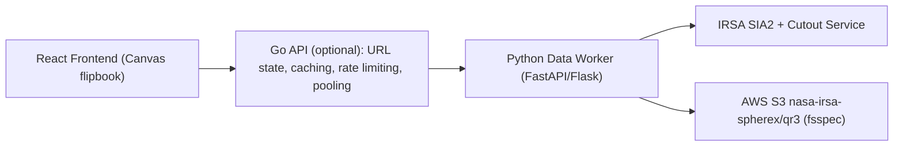
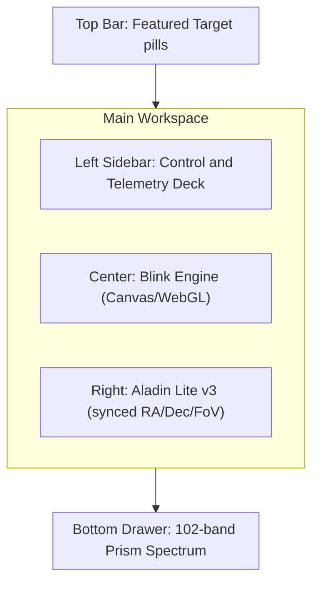
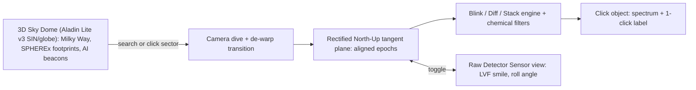
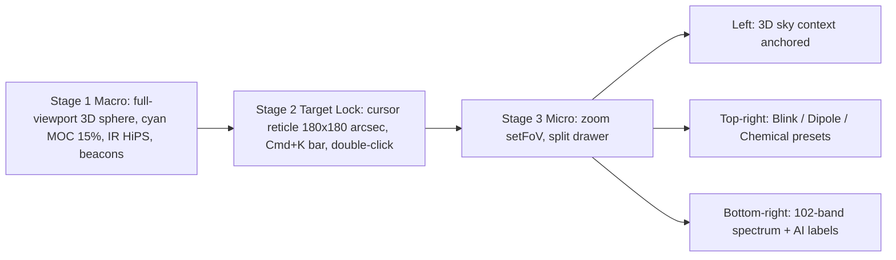
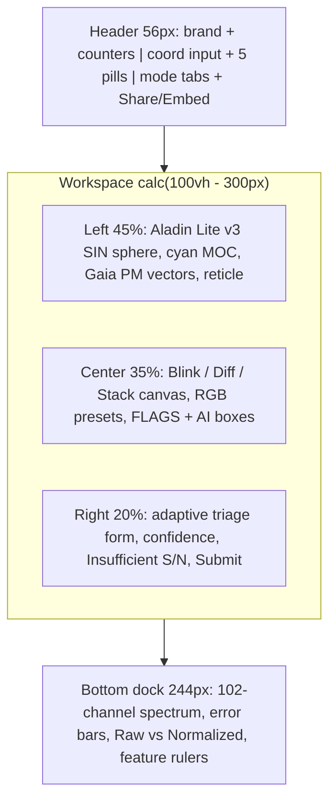
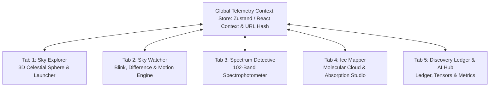
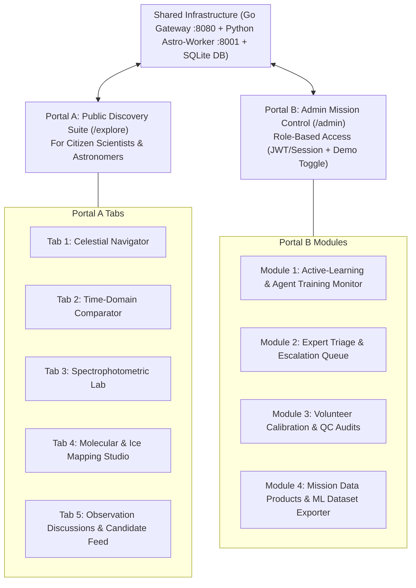

# Panoptic-Beta — Project Context

> Tagline (from README): *"Finite minds trying to understand an infinite universe."*

## Purpose of This File
This is the running source of truth for building the Panoptic-Beta application. It's put together from an earlier ideation chat between the user and Gemini, which the user is sharing one prompt/response at a time. **No building happens during this phase.** Only notes are recorded here.

## Process Log
- **2026-10-31:** Note-taking session started. The user will share the Gemini chat in order (each prompt and response). Each exchange gets read, confirmed, and recorded below.
- **2026-10-31:** Exchange #1 recorded. It covers the challenge choice and Gemini's first assessment.
- **2026-10-31:** Exchange #2 recorded. It covers Gemini's study of the Backyard Worlds: Planet 9 reference project.
- **2026-10-31:** Exchange #3 recorded. It covers WiseView vs. PS1 cutouts and the hybrid strategy.
- **2026-10-31:** Exchange #4 recorded. It covers the IRSA docs (SIA2 and the cutout service) and the strategy shift to a proxy backend.
- **2026-10-31:** Exchange #5 recorded. It covers data releases, the SIA2 URL, cutout usage, AWS S3, and the Option A vs. B architecture choice.
- **2026-10-31:** Exchange #6 recorded. Option B was judged very high risk, and Option A+ (Python worker + optional Go + React) is recommended.
- **2026-10-31:** Exchange #7 recorded. It contains the MASTER CONCEPT "SPHEREx Blink & Prism" (UI, 5 features, architecture, demo script) plus my reality checks.
- **2026-10-31:** Exchange #8 recorded. It covers the user's vision (abstraction, 3D world, AI training ground), Gemini's 3D pivot, Citizen/Pro modes, and the AI active learning loop.
- **2026-10-31:** Exchange #9 recorded. 3D is clarified as an immersive celestial sphere (Aladin Lite v3) with a TAN-SIP/LVF de-warp, a dive transition, and a Raw vs. Rectified toggle. This supersedes the Exchange #8 3D neighborhood pivot.
- **2026-10-31:** Exchange #10 recorded. CORE PRODUCT DEFINITION: replace the IRSA Aitoff search tool with a full-viewport 3D sphere, a 3-stage zoom flow, a split drawer, the old→new control mapping, and the pitch slides.
- **2026-10-31:** Exchange #11 recorded. It contains the user's full SpectraScout spec (the long-term vision, serving SPHEREx's goals) and Gemini's verdict: merge it into one unified Sky-to-Spectrum Workbench, with a build vs. fake triage.
- **2026-10-31:** Exchange #12 recorded. Building locally with extended time. Architecture locked as hybrid (Go gateway + Python astro-worker + React/Vite/Canvas/Aladin). Monorepo structure, scaffold code for Python worker and Go gateway, layout tokens, and extensive technical review/reality checks logged.
- **2026-10-31:** Exchange #13 recorded. Comprehensive unified master specification: dual-mode entry (Free Explore + Guided Queue), 5-zone UI layout, full scientific data pipeline, AI active learning engine with Shannon entropy, database schema, and benchmark target behavior.
- **2026-10-31:** Exchange #14 recorded. Major UX pivot: replaced crowded 5-zone single-screen layout with a 5-Tab full-screen architecture (Sky Explorer, Sky Watcher, Spectrum Detective, Ice Mapper, Discovery Ledger) synchronized via a global Zustand/Context store and URL hash.
- **2026-10-31:** Exchange #15 recorded. Detailed visual design and component hierarchy for each of the 5 isolated tabs (telemetry dark tokens, specific panel splits, spatial ice brush, and export tabs).
- **2026-10-31:** Exchange #16 recorded. Professional, mission-grade renaming of all tabs: Celestial Navigator, Time-Domain Comparator, Spectrophotometric Lab, Molecular & Ice Mapping Studio, Mission Telemetry & ML Ledger.
- **2026-10-31:** Exchange #17 recorded. Dual-View Architecture implemented: separated public exploration from admin operations. Portal A (/explore) features 5 tabs including a new Observation Discussions & Candidate Feed (Zooniverse Talk pattern). Portal B (/admin) encapsulates AI training metrics, active-learning queue controls, expert triage, and dataset export. Database tables `discussion_threads` and `discussion_replies` added.
- **2026-10-31:** Exchange #18 recorded. Replaced UI demo toggle with strict URL-based route isolation (`/explore` vs `/admin`). Implemented React `ProtectedAdminRoute` guard with silent redirection and Go backend `adminAuthMiddleware` (Bearer token check) for `/api/admin/*` endpoints.
- **2026-10-31:** Exchange #19 recorded. Comprehensive scientific gap analysis against all SPHEREx core themes and prompt rules. Integrated 5 mission-level upgrades: (1) Forced aperture photometry & synchronized spectral blinking for variables, (2) Sub-pixel Gaia deblending & spectral unmixing for 6.2" pixel crowding, (3) Automated $z_{\text{phot}}$ solver & 3D cosmic web slice for Cosmology Theme 1, (4) Quantitative ice column densities $N_{\text{ice}}$ & point-source masked EBL mode for Themes 2 & 3, (5) Short-cadence sub-exposure mode for fast-moving asteroids/comets.
- **2026-10-31:** Exchange #20 recorded. Complete, rigorous system & feature specification across all 10 architecture tiers (dual-portal routing, state sync, 5 public tabs, hidden admin console, Python science worker, Go API gateway, relational schema, and the benchmark target behavior matrix). Stripped styling fluff, focusing purely on mechanics and data contracts.
- **2026-10-31:** Exchange #21 recorded. Created standalone production-grade `SPECIFICATION.md` synthesizing the entire discussion into an actionable, cross-model deterministic blueprint. All identified gaps and astrophysical concerns were researched and mathematically verified (proper motion epoch propagation, Epsilon Indi B coordinate correction, SPHEREx LVF WCS-WAVE lookup mechanics, R Draconis NEP distance, and IRSA QR3 SIA2 endpoints).
- **2026-10-31:** Exchange #22 recorded. Upgraded `SPECIFICATION.md` into an exhaustive technical manual (Version 2.0.0-PROD). Researched and integrated exact IRSA SPHEREx Explanatory Supplement data: 12-bit FLAGS bitmask hierarchy (TRANSIENT, OVERFLOW, SUR_ERROR, PHANTOM, REFERENCE, NONFUNC, DICHROIC, HOT, COLD, PERSISTENCE, GHOST), laboratory molecular band strengths ($A$-values) for column densities ($N_{\text{H}_2\text{O}}, N_{\text{CO}_2}, N_{\text{CO}}, N_{\text{CH}_3\text{OH}}, N_{\text{CH}_4}$), pure-Go `modernc.org/sqlite` WAL locking architecture (`busy_timeout=5000` + `SetMaxOpenConns(1)` writer pool to prevent `SQLITE_BUSY`), nearest-neighbor bitmask reprojection, and complete end-to-end data contracts.
- **2026-10-31:** Exchange #23 recorded. Audited and incorporated all 7 omitted design specifications into `SPECIFICATION.md` (Version 2.1.0-PROD): (1) Explicit schemas for the 4 named SPHEREx Mission Data Products, (2) Synthetic source injection module (`synth_a`/`synth_b`), (3) 3-stage zoom & camera dive transition with `[Raw vs. Rectified]` inspector toggle, (4) Interactive redshift ($z$) feature ruler scrubber ($z=0.0-2.5$), (5) Volunteer qualification workflow and Science Corps unlocking logic, (6) Accessibility standards (Cividis/Viridis/Inverted Grayscale palettes, ARIA labels), and (7) Full keyboard navigation shortcuts.
- **2026-10-31:** Exchange #24 recorded. Massively expounded Section 6 (Frontend Component Architecture & Workspace Specifications) in `SPECIFICATION.md`: (1) Explicit TypeScript interfaces for the global Zustand telemetry store (`useTelemetryStore`), (2) Route-level lazy loading and bundle protection code snippets, (3) Detailed UI component ASCII wireframes, mathematical formulas, and event mechanics across all 5 public tabs and the 4 admin modules, (4) Aladin Lite v3 WebGL initialization, MOC configuration, and camera dive interpolation protocols, (5) Client-side pixel arithmetic equations for blink, difference, and co-add modes, and (6) Complete Zooniverse Talk discussion forum architecture with deep-link state re-hydration.
- **2026-10-31:** Exchange #25 recorded. Completely overhauled Section 6.4 (Admin Portal) in `SPECIFICATION.md` to implement the **5-Tab Mission Control Architecture** with real-time PyTorch/ML training observability: (1) `/admin/dynamics` (scalar learning curves, gradient norms, early-stopping detection), (2) `/admin/internals` (3D ridgeline weight histograms, layer activations, Grad-CAM saliency heatmaps), (3) `/admin/boundaries` (interactive 2D/3D meshgrid decision surface morphing), (4) `/admin/triage` (hard-negative mining, raw FITS HDU 1-6 inspection), (5) `/admin/exports` (volunteer audits, 4 data products, HDF5 PyTorch bundles), and (6) Complete Python hook-to-Go WebSocket streaming pipeline (`/api/admin/ws/training`) with 100-frame ring buffer.
- **2026-10-31:** Exchange #26 recorded. User requested name simplification: renamed project from "SpectraScout" to **"Spectra"** across `SPECIFICATION.md` and database/token naming conventions (`spectra_ledger.db`, `spectra_admin_token`, etc.).
- **2026-10-31:** Exchange #27 recorded. Modern type-safe stack upgrade: Replaced SQLite string boilerplate with **Supabase** (PostgreSQL 16 + `pgvector` + Supabase Auth + Supabase Realtime + Supabase Storage) and **`sqlc` + `pgx/v5`** compile-time code generation for the Go API Gateway. Implemented 102-channel spectral similarity querying via `vector(102)` cosine distance (`<=>`), instant live discussion synchronization via Supabase Realtime `postgres_changes`, JWT-based role authentication for `/admin`, type-safe URL query state (`nuqs`), asynchronous caching and prefetching (`@tanstack/react-query`), ultra-fast 60 FPS plotting (`uPlot`), 3D decision surfaces (`react-plotly.js`), and local developer orchestration via Supabase CLI (`supabase start`) and `Taskfile.yml`.
- **2026-10-31:** Exchange #28 recorded. Zero-Auth & Ultra-High-Quality Institutional Blueprint: Dropped blocking login/auth for hackathon judges while maintaining clean route separation (`/explore` vs `/admin`). Implemented zero-auth session fingerprinting using implicit client telemetry IDs (`localStorage.getItem('spx_observer_id')` -> UUIDv4 + astronomical callsign like `Observer-Vega-409`) injected via `X-Observer-ID` and `X-Observer-Callsign` HTTP headers. Upgraded database schema to 6 production tables: `subjects`, `observers`, `classifications`, `discussion_threads`, `discussion_replies`, and `ml_training_runs`. Engineered ultra-high-quality toolchain: (1) Binary Float32Array streaming replacing 8-bit PNGs to eliminate posterization and quantization during client-side WebGL2 120 FPS Asinh and difference math ($t_N - t_0$), (2) End-to-end type generation via `openapi-typescript` from FastAPI OpenAPI 3.1 schemas, (3) `uv` + `ruff` for sub-3s deterministic Python environment setup (`uv.lock`), (4) `air` live-reloading for Go, (5) Radix UI unstyled primitives + `cmdk` command bar (Ctrl+K) + `TanStack Virtual`, (6) Offline resilience via `seed_benchmarks.sql` + local binary cache, and (7) Floating HUD crosshair readout (RA/Dec, MJy/sr, SNR, decoded FLAGS bitmask).
- **2026-11-01:** Exchange #31 recorded. Institutional Documentation & Developer Acceleration Matrix: Authored comprehensive `README.md` (mission background, 5 public workspaces, 5 admin modules, 5 NASA benchmark targets, zero-auth session fingerprinting, quickstart, and 4 sequential priority-gated phases) and `prerequisites.md` (system runtimes plus in-depth technical rationales for 12 developer acceleration tools granting a decisive Hackathon edge: Antigravity CLI `agy`, GitHub CLI `gh`, `uv`, `sqlc`, `air`, `task`, `supabase`, `openapi-typescript`, `nuqs`, `uPlot`, `cmdk`, and `jq`/`curl`). Project repository path normalized to `Spectra`.
- **2026-11-01:** Exchange #30 recorded. Priority-to-Phase Sequential Architecture & Comprehensive Concern Resolution: Addressed all 6 audit concern categories and upgraded roadmap in `SPECIFICATION.md` (v2.5.0-PROD). Re-architected implementation sequence into 4 strictly sequential priority-gated phases: Phase 1 (P0: Core NASA Challenge Foundation — Shippable MVP satisfying 100% of the prompt), Phase 2 (P1: Scientific Differentiator — 102-band hyperspectral cubes, pgvector cosine search, and real-time community discussions), Phase 3 (P2: Institutional Polish & Mission Control — biogenic ice studio, 5-tab admin suite, live PyTorch WebSocket streaming), and Phase 4 (Production Deployment, Operational Hardening & Compliance — HF Spaces, Cloudflare Pages, Supabase RLS, keep-alive pingers, offline venue demo mirror, and citations). Completely purged all 12 stale auth/Bearer artifacts across the spec and integrated hardware/science fixes (WebGL2 `OES_texture_float_linear` detection with `gl.NEAREST`/`gl.R16F` fallback, Gaia DR3 2D centroid pins for sub-pixel proper motion, inverse-variance coaddition for faint brown dwarfs, discrete survey epoch stepping, and institutional data honesty attribution badges).
- **2026-11-01:** Exchange #29 recorded. Production hosting spec ($0, always-warm): single-container multi-process deployment on Hugging Face Spaces (Docker, cpu-basic 2 vCPU/16 GB; Go gateway on public :7860 + Python worker on 127.0.0.1:8001), Cloudflare Pages frontend with static benchmark fallbacks, Supabase Cloud (session pooler, IPv4), and a dual-action `/api/health` keep-alive (touches Go, Python, Postgres) pinged by cron-job.org every 5 min with GitHub Actions as a 15-min backup. Added as SPECIFICATION.md Section 10 (v2.4.0-PROD) with corrections: `colorTo: black` is invalid (use `gray`); session pooler port 5432, not transaction 6543 (pgx/sqlc prepared statements); mandatory RLS because the anon key is public under zero-auth; uv-based Dockerfile with CPU-only torch index; ephemeral HF disk strategy; CORS/WSS origin allowlist; HF Space mirroring via `huggingface_hub`; zero-auth `/admin` abuse kill-switch. Old name "SpectraScout" in the source exchange was normalized to "Spectra".

---

## Project Overview
Panoptic-Beta is the user's entry for the **NASA Space Apps Hackathon**. The chosen challenge is to build a **public-facing web tool that displays SPHEREx sky images and makes it easy for anyone to see how they change over time** ("blinking").

### The Challenge (verbatim essentials)
- **Mission:** NASA **SPHEREx** has been returning data since **May 2025**. It maps the **entire sky every six months** in **102 bands of near-infrared light**. It returns images of **more than a billion objects**.
- **Why it matters:** Comets, asteroids, stars, brown dwarfs, and possible new planets show themselves by **shifting position between images**. Parallax caused by Earth's orbit also changes the apparent positions of nearby objects. Measuring those shifts helps with both discovery and distance measurement.
  - Historical precedent: **Pluto** was discovered by comparing two images taken at different times (blink comparison).
  - Citizen science precedent: hundreds of thousands of volunteers have found asteroids, comets, stars, and brown dwarfs this way. Most known comets and brown dwarfs were found by volunteers, e.g. **backyardworlds.org**.
  - SPHEREx's near-IR bands make it uniquely sensitive to objects rich in **hydrogen, water, CO₂, CO**, and other molecules.
  - The data includes brown dwarfs, quasars, comets, asteroids, stars, supernovae, and galaxies. These often **overlap or vary in brightness**.
- **Core objective:**
  1. The user enters the sky coordinates: **Right Ascension (RA)** and **Declination (Dec)**.
  2. The tool shows **a series of images of that patch over time, like a little video**, so moving objects are easy to spot.

### Official Test Targets (must work for demo/validation)
| Target | Notes |
|---|---|
| **Barnard's Star** | High proper-motion nearby star |
| **Epsilon Indi B** | A pair of brown dwarfs orbiting a star |
| **WISE 0855** | Fast-moving brown dwarf. **RA 08h55m10.831s, Dec −7d14m42.53s** |
| **RW Aurigae** | Variable star (brightness changes) |
| **R Draconis** | Variable star (brightness changes) |

> Note: Only WISE 0855's coordinates were given in the challenge. The coordinates for the other targets need to be looked up later (e.g. through SIMBAD name resolution).

### Potential Considerations (optional, from challenge text)
1. **Easy to update:** new SPHEREx data arrives fast, so the design must make it easy to ingest new data releases.
2. **Creative display of 102 bands:** e.g. **co-add the data from each of the 6 detector arrays** to improve signal-to-noise. **Extra kudos for generating spectra on the fly.**
3. **Add/subtract images** taken at different times to help find moving objects.
4. **User-selectable field of view (FOV):** a larger FOV can track faster movers but means longer data transfer.
5. **Overlay data from other telescopes**, e.g. **Gaia** and **WISE**.
6. **Coordinates in the URL** (query params) so the tool can be embedded in other sites and projects.
7. **Display metadata**, e.g. **contamination flags**.
8. **Use existing public tools:** **Astropy** for data handling, and **Aladin** (from CDS, the Strasbourg Astronomical Data Center) for display.

---

## Core Concepts & Vision
- **Blinking:** cycling through images of the same sky patch taken at different times. Moving or variable objects stand out.
- Target audience: **the public / citizen scientists**, not only professional astronomers.
- Gemini's view of the main difficulty: **backend and data wrangling, not UI**. Fetching, processing, and serving huge multi-band astronomical files to a browser without crashing it is the hard part.

## Features & Requirements
### MVP (must-have)
- RA/Dec input.
- Fetch SPHEREx imagery of that patch across multiple epochs.
- Show the frames as an animated "blink" with **playback controls (play, pause, speed slider)**.
- Must work on the official test targets.

### High-priority extras
- **Shareable/embeddable URL with coordinates** (Gemini flagged this as highly requested in the prompt).
- **Image subtraction toggle** (difference imaging that shows only the pixels that changed between frames).

### Stretch goals ("do not attempt until MVP is flawless")
- On-the-fly spectra generation.
- Gaia/WISE catalog overlays.
- Co-adding per detector array (6 arrays).
- Configurable FOV.
- Contamination flag / metadata display.

## Architecture & Tech Stack
*(Gemini's initial recommendation. Not yet confirmed by the user.)*

| Component | Approach | Purpose |
|---|---|---|
| **Data processing** | **Python (Astropy / NumPy)** | Read FITS files, extract the 102 bands, align the World Coordinate System (WCS), and convert to PNG/WebP. |
| **API backend** | **Go (Golang)** | Fast HTTP server. Uses Go concurrency to fetch multiple time slices in parallel, serves processed frames, and handles URL coordinate queries. Connection pooling. Efficient struct tags for metadata routing. |
| **Frontend visualizer** | **React + Canvas API** | Interactive blink player with playback controls. Flat, professional styling that lets the dark space imagery stand out. |

- Core principle: **split the logic strictly between a data-crunching layer (Python) and a fast serving layer (Go)** so data transfer times don't slow everything down.

## Technical Challenges (per Gemini's assessment)
1. **Data weight / FITS format:** the data comes as FITS (Flexible Image Transport System). These are heavy multi-layer matrices with scientific metadata and WCS. They **can't go straight into an `` tag** and must be converted (e.g. to PNG/WebP).
2. **The 102-band problem:** each sky patch is a **102-slice data cube**. Turning it into something a human can see (e.g. **mapping specific bands to RGB channels**) is a serious algorithmic challenge.
3. **Performance vs. interactivity:** a large FOV × many epochs means the backend has to process and align many frames on the fly. **Memory management and concurrency make or break the tool.**
4. **Scope creep:** the "potential considerations" list is a trap for a weekend hackathon. Spectra and Gaia overlays are big features.

## Strategic Advantages (per Gemini)
- **Clear validation:** exact test targets make for a spectacular live demo (e.g. plug in the WISE 0855 coordinates and watch the brown dwarf move).
- **Backend showcase:** a concurrent, memory-efficient API can be the star of the show.
- **UI opportunity:** academic tools tend to be cluttered. A clean, legible UI will stand out (standard spacing, strict border radii, clear typographic hierarchy).

## Data Model
_TBD_

## UX / UI Notes
- Professional, flat styling. The **dark space imagery is the focal point**.
- Structured, highly legible layout: consistent spacing, strict border radii, clean typographic hierarchy.
- Playback controls: play, pause, speed slider.

## Hackathon Timeline (Gemini's proposed triage)
- **Friday night (MVP):** Python script that downloads FITS for **Barnard's Star**, converts selected IR bands to PNG/WebP, and aligns them.
- **Saturday (the engine):** Backend API that serves images by RA/Dec, plus the frontend visualizer with playback controls.
- **Sunday (the polish):** URL coordinate sharing, then the image subtraction toggle if time permits.

## Decisions Made
- Challenge selected: SPHEREx blink/time-series web tool (NASA Space Apps).
- *(Tech stack is still only a proposal at this point.)*

## Current Direction Snapshot (as of Exchange #30; Priority-to-Phase Architecture & Zero-Auth v2.5.0)
> Quick orientation for builders. The detailed reasoning is in the ★ sections below. Later exchanges override earlier ones.
1. **Product Identity & Architecture:** **Spectra** (SPHEREx Spectral Explorers). Split into a **Dual-View Portal Architecture** with **Zero-Auth Route Isolation** (`/explore` for public citizen science vs `/admin` for science team Mission Control). Eliminates login friction for hackathon judges while tracking calibration and attribution via implicit client telemetry session fingerprinting (`X-Observer-ID`, `X-Observer-Callsign`). Backed by Supabase (PostgreSQL 16 + `pgvector`), Go API Gateway (`api-gateway` on `:8080` with `sqlc` + `pgx/v5` + `air`), and Python `astro-worker` (:8001 with `uv` + `astropy` + `torch`).
   - **Portal A: Public Discovery Suite (`/explore`):** 5-tab workspace for citizen scientists, replacing raw ML metrics with an interactive Talk-style discussion forum.
   - **Portal B: Admin Mission Control (`/admin`):** 5-tab restricted console for the science team to monitor active-learning model convergence, inspect layer activations/weights, hard negative mining, expert candidate escalation, and dataset export. Accessible strictly via `/admin` URL with React authentication guard (`ProtectedAdminRoute`) and Go `adminAuthMiddleware` (Bearer token).
2. **Portal A (Public) 5 Isolated Tabs:**
   - **Tab 1: Celestial Navigator** — Full-viewport Aladin Lite v3 WebGL 3D Sky Globe (`SIN` projection), translucent SPHEREx MOC, Gaia DR3 vectors, universal coordinate input, and 5 benchmark pills.
   - **Tab 2: Time-Domain Comparator** — Dedicated motion & blink canvas. Supports dual-cadence playback (6-month proper motion/parallax vs short-cadence minutes/hours for asteroids/comets). Features pairwise difference ($t_N - t_1$), co-add stack, 6-detector Chemical RGB mixer, sub-pixel Gaia DR3 centroid deblending, and multi-band light-curve extraction (D1 vs D5) for variable stars (RW Aur, R Dra). Includes `[Submit & Open Discussion]`.
   - **Tab 3: Spectrophotometric Lab** — Full-width 102-channel spectrophotometer ($0.75-5.0\,\mu\text{m}$) with error bars (VARIANCE), bad-pixel flags (FLAGS), synchronized epoch spectral animation, two-component spectral unmixing (e.g. Epsilon Indi B), automated galaxy photo-$z$ solver ($P(z)$, lookback time, Mpc distance), and a 3D cosmic web redshift wedge.
   - **Tab 4: Molecular & Ice Mapping Studio** — SPHEREx biogenic ice studio. Continuum-normalized optical depth view ($\tau_\lambda$), quantitative ice column densities ($N_{\text{H}_2\text{O}}, N_{\text{CO}_2}$ in $\text{cm}^{-2}$), molecular feature rulers, spatial ice brush, and point-source masked EBL/diffuse background fluctuation mode.
   - **Tab 5: Observation Discussions & Candidate Feed** — Zooniverse Talk-style scientific feed. 3-column layout (Channels & trending tags, live stream with embedded interactive URL snapshots, external archive context & volunteer credits).
3. **Portal B (Admin) 5 Isolated Tabs:**
   - **Tab 1: Training Dynamics & Loss Studio (`/admin/dynamics`):** Scalar learning curves, gradient L2 norms, learning rate annealing, automated overfitting detection, and retraining triggers.
   - **Tab 2: Parameter & Activation Inspector (`/admin/internals`):** 3D ridgeline weight/bias histograms across epochs, layer activations, and Grad-CAM saliency heatmaps on diagnostic probe targets.
   - **Tab 3: Decision Boundary Animator (`/admin/boundaries`):** Interactive 2D/3D meshgrid probability surfaces morphing across epochs in physical and UMAP latent feature space.
   - **Tab 4: Disagreement & Escalation Queue (`/admin/triage`):** Hard-negative mining ranked by $|P_{\text{AI}} - P_{\text{Human}}|$ divergence, raw FITS HDU 1–6 inspection, and 1-click catalog promotion.
   - **Tab 5: Calibration & Data Product Hub (`/admin/exports`):** Volunteer Bayesian reliability audits, gold-standard subject pool, and the 4 official SPHEREx community data product exports (CSV, VOTable, JSON, PyTorch HDF5 bundles).
4. **State Synchronization:** Global telemetry store (Zustand / React Context) + URL hash reflection (`#tab=...&ra=...&dec=...`). Switching tabs preserves active coordinates, cutouts, probed pixels, and selections with zero reload.
5. **Backend & Persistence Pipeline:**
   - **Database & Auth:** Supabase PostgreSQL with `pgvector` extension for 102-band spectral cosine similarity (`vector(102)`), Supabase Auth JWTs (`"role": "admin"`), and Realtime Postgres changes for Tab 5 discussions.
   - **Go Gateway (:8080):** `sqlc` generates 100% type-safe Go structs and queries using `pgx/v5` connection pooling. In-memory `sync.RWMutex` LRU cache for <15ms cutout responses, Shannon entropy queue prioritization, and Bayesian consensus.
   - **Python Science Worker (:8001):** FastAPI + Astropy + PyVO + reproject for MEF FITS byte-range slicing, WCS rectification, and WCS-WAVE smile inversion.
   - **Frontend Accelerators:** `nuqs` for typed URL state, `@tanstack/react-query` v5 for background prefetching, `uPlot` for 60 FPS 2D spectra and loss curves, and `react-plotly.js` for 3D decision boundaries.
6. **Mandatory Benchmarks:** Barnard's Star, WISE 0855, Epsilon Indi B, RW Aurigae, R Draconis.
7. **Hosting (Exchange #29):** Cloudflare Pages (SPA + `/benchmarks` static fallback) → Hugging Face Space Docker container (Go :7860 public + Python 127.0.0.1:8001 loopback) → Supabase Cloud (session pooler :5432, RLS on, Realtime on discussion tables). `/api/health` keep-alive every 5 min (cron-job.org) + 15 min (GitHub Actions). See SPECIFICATION.md Section 10.
8. **Sequential Priority-to-Phase Execution (Exchange #30):**
   - **Phase 1 (P0 — Core NASA Challenge):** Tab 1 (Navigator/Aladin) + Tab 2 (Blinker/Float32) + 5 NASA Benchmarks + Coordinate Search. 100% prompt compliance and immediately shippable.
   - **Phase 2 (P1 — Science Differentiator):** Tab 3 (Spectrophotometer + `pgvector` 102-band similarity) + Tab 5 (Discussions + Realtime).
   - **Phase 3 (P2 — Institutional Polish):** Tab 4 (Ice Studio) + Admin Mission Control Tabs 1–5 (Live PyTorch WebSocket telemetry).
   - **Phase 4 (Production & Compliance):** HF Spaces + Cloudflare Pages + Supabase Cloud + cron-job keep-alive + offline demo laptop fallback.

## Open Questions / Unresolved Items
- Where and how to get SPHEREx data. **Mostly answered (Exchanges #4–5):** IRSA SIA2 (`COLLECTION=spherex_qr3`), the IBE cutout service, or AWS S3 `s3://nasa-irsa-spherex/qr3/`. The exact parameters and columns still need verifying.
- **Backend architecture:** Option A (Python) vs. Option B (Go/S3) vs. a hybrid. **Update (Exchange #6):** Option B was ruled very high risk. Gemini recommends **Option A+** (Python worker + optional Go gateway), with a FastAPI-only fallback. The user has not confirmed yet.
- Where should difference imaging happen: frontend 8-bit RGB (Gemini's suggestion) vs. backend float?
- Does the MEF really hold 102 bands per file, or one LVF detector frame per exposure? **Answered (Exchange #9):** one LVF detector frame per exposure, with wavelength varying along Y (the "smile"). 102 bands require aggregating many exposures.
- Product name: "SPHEREx Blink & Prism" (Gemini) vs. "Panoptic" (repo)?
- Brown Dwarf RGB preset: WISE 0855 is brightest at about 4.5 µm. The mapping probably needs Bands 5–6.
- Spectrum latency: is a ~400 ms on-the-fly 102-band spectrum feasible, or do we pre-cache and fill in progressively? Does IRSA offer a spectrophotometry service?
- How many usable epochs per target? Do we need sub-survey time binning?
- Single Aladin instance (with SPHEREx overlay) vs. a separate Canvas + Aladin dual pane?
- **3D component:** ~~does the user accept Gemini's pivot (neighborhood panel)?~~ **Resolved in intent (Exchange #9):** 3D = an immersive celestial sphere (Aladin Lite v3) with a de-warp dive into the rectified blinker. The user still has to confirm Gemini's interpretation.
- ~~How do we show distance for new candidates honestly?~~ Mostly moot now, since 3D isn't distance-based.
- Final layout: a single Aladin dome viewport with dive transition vs. the earlier dual pane (Canvas + Aladin)? **Converging (Exchange #10):** full-viewport sphere, then on dive the sky anchors on the left and a split drawer opens on the right (blinker on top, spectrum + AI below). A Cmd+K command bar replaces the left sidebar.
- Drag vs. click conflict on the sphere: double-click to lock?
- Projection choice: `SIN` vs. `STG` for the immersive feel.
- Discovery Lens ranges, especially "Brown Dwarf Hunter" (1.1–3.8 µm vs. 3.8–5.0 µm for cold Y dwarfs like WISE 0855).
- The SPHEREx QR3 MOC file URL and the real survey pass dates.
- **Final wireframe** for the unified workbench: center blinker + bottom spectrum + right triage (Exchange #11) vs. the right split drawer (Exchange #10)?
- Does R Draconis fall inside the NEP deep field (more epochs)?
- Product name: SpectraScout / SPHEREx Spectral Explorers / Blink & Prism / Panoptic?
- Which mock elements (calibration badge, discoveries ticker) are acceptable, and how are they labeled?
- Blinker rendering: separate Canvas/WebGL after the dive, or frames as Aladin image overlays?
- AI stack: which classifier (sklearn/PyTorch)? Which LLM for explanations? Where are labels stored (DB choice)? User accounts or anonymous sessions?
- Label consensus and quality control strategy (votes per object, synthetic injections)?
- How many epochs are available so far (the sky is mapped every 6 months starting May 2025)? Which QR releases cover which epochs?
- Strategy for mapping the 102 bands to RGB.
- Whether to use Aladin Lite instead of a custom canvas renderer.
- Pre-processing vs. processing on the fly.
- Coordinates for the test targets other than WISE 0855.

---

## Conversation Notes (Chronological)

### Exchange #1: Challenge selection and first assessment
- **User prompt:** Shared the full NASA Space Apps SPHEREx challenge text (captured above) and asked Gemini for an honest opinion.
- **Gemini response (summary):**
  - Called it a "highly ambitious, backend-heavy challenge", but an excellent choice for a technically impressive prototype.
  - **Hard parts:** FITS data weight, the 102-band visualization problem, performance and interactivity of blinking, and scope creep.
  - **Why you can win:** clear validation targets, a backend-focused showcase, and a chance to stand out with clean UI.
  - **Proposed stack:** Python (Astropy/NumPy) for processing, Go for the API, React + Canvas for the frontend.
  - **Triage:** MVP Friday, engine Saturday, polish Sunday. Avoid the "extra kudos" items until the MVP is flawless.

### Exchange #2: Study of Backyard Worlds: Planet 9 (reference project)
- **User prompt:** Shared https://www.zooniverse.org/projects/marckuchner/backyard-worlds-planet-9 (one of the challenge's example projects) and asked Gemini to study it deeply.
- **Gemini response (summary):** see "Reference Project: Backyard Worlds" below.

### Exchange #3: Study of WiseView and Pan-STARRS1 cutouts
- **User prompt:** Shared the two example tools (WiseView URL and PS1 cutout URL, both pointing at WISE 0855) and asked Gemini to study them carefully.
- **Gemini response (summary):** WiseView is a client-side interactive renderer: URL-hash state, diff imaging, adjustable stretch. PS1 is a server-side cutout generator: slices FITS on the server and does RGB band combining. It recommended a **hybrid**: a Go backend that serves cutouts like PS1, and a React/Canvas frontend that plays them back like WiseView. Details are in the reference sections below.

### Exchange #4: IRSA SPHEREx documentation
- **User prompt:** Shared the IRSA SPHEREx Quick Release overview docs and asked how much of it Gemini could read.
- **Gemini response (summary):** It could read the overview, data products, and access methods. Key findings: QR3 is live (Sept 2026), the **SIA2 API** exists, a **built-in cutout service** exists, 102 bands span 0.75–5.0 µm across 6 arrays (R=35–128), and the data is MEF with `CWAVE`/`CBAND`/`WCS-WAVE`. **Strategy shift:** the Go backend becomes a lightweight proxy to IRSA rather than hosting the FITS data. See "SPHEREx Data Source: IRSA".

### Exchange #5: Data access confirmation (docs, notebooks, data access)
- **User prompt:** Asked whether Gemini could access the documentation, the notebooks, and the data access methods.
- **Gemini response (summary):** Yes, via the IRSA docs and the Caltech IPAC GitHub. Details: the QR2/QR3 releases (collections `spherex_qr3` and `spherex_qr3_deep`), an example SIA2 GET URL, using the cutout service by appending `?center=ra,dec&size=` to the `access_url`, an IRSA tutorial notebook for SPHEREx cutouts, and the public AWS S3 bucket `s3://nasa-irsa-spherex/qr3/`. Proposed **Option A (Python astroquery/pyvo)** vs. **Option B (Go + S3 byte ranges)** and asked which to prototype first. See "Data access details" and "Architecture options".

### Exchange #6: How hard/risky is Option B (Go/S3)?
- **User prompt:** Asked how hard and risky Option B would be, given that the IRSA notebooks show how to handle the data in Python.
- **Gemini response (summary):** **Very high risk.** The MEF has 6 extensions (image, flags, variance, zodiacal, PSF, spectral WCS). Go would need hand-written FITS parsing, byte-range math, and a WCS re-implementation, which is "a guaranteed way to fail". Astropy already does this (`fits.open(..., use_fsspec=True)` + `Cutout2D` + `.section`). It recommended **Option A+**: a Python FastAPI/Flask data worker (astroquery, Cutout2D, AsinhStretch, base64 PNG/WebP JSON), plus an **optional** Go API (URL state, caching, rate limiting), plus a React canvas flipbook with frontend difference imaging. Simplest fallback: **FastAPI-only backend**.

### Exchange #7: Best and most creative implementation (MASTER CONCEPT)
- **User prompt:** Using all prior resources plus **Aladin Lite** (https://cds-astro.github.io/aladin-lite/), Backyard Worlds, WiseView, and PS1, give the best and most creative implementation for the full challenge (challenge text repeated).
- **Gemini response (summary):** Proposed **"SPHEREx Blink & Prism"**: a dark telemetry UI with a left control deck, a center Canvas/WebGL blink engine, a right synced Aladin Lite v3 pane, and a bottom 102-band spectrum drawer. Five killer features: (A) 6-detector Super-Band stacking + Chemical Preset RGB, (B) Blink/Diff/Stack modes with dipole detection, (C) Aladin Gaia/SIMBAD cross-match for spotting uncatalogued movers, (D) click-to-spectrum with flags, (E) URL state + iframe embed mode. Stack: FastAPI/Astropy/PyVO + optional Go or Redis cache + React/Canvas/Aladin. Demo script built around the 5 targets. See "★ MASTER CONCEPT".

### Exchange #8: Abstraction, 3D world, and AI training ground
- **User prompt:** Wants (1) maximum abstraction for broad accessibility while staying technical, (2) a **3D world replacing IRSA's spectral image search tool** for insight into distances and orientation, and (3) AI for insights and, **most importantly, the app as a training ground where models learn from how the community identifies objects**. Asked for a complete honest opinion.
- **Gemini response (summary):** Abstraction and the AI loop are spot-on. The 3D replacement is a trap: unknown objects have no distance, 3D loses raw pixels so artifacts can't be judged, and it's too big for 48 h. **Pivot:** 3D as a complementary "Local Neighborhood / Parallax" panel (Three.js, Gaia distances), or an (x, y, λ) voxel cube. **Citizen Mode vs. Pro Mode** progressive disclosure. **AI:** DoG blob "anomaly pings", "Spectral Fingerprint" plain-English classifier, and a 1-click labeling loop that saves training tensors and exports an HDF5/PyTorch dataset. See "★ USER VISION EXTENSIONS".

### Exchange #9: 3D clarified as an immersive celestial sphere
- **User prompt:** Clarified the 3D idea. Not mapping objects in 3D space, but **moving from the tool's distorted spectral images to an immersive 3D view of the sky** (the flat images shown properly on the sphere).
- **Gemini response (summary):** Fully endorsed it. Explained the IRSA distortion: **TAN-SIP projection + roll rotation** (raw 2040×2040 px, ~3.5°×3.5°), and the **LVF "smile"** (wavelength varies along Y). Proposed the **"Dome-to-Target" flow**: (1) 3D sky dome in Aladin Lite v3 with footprints, (2) camera dive + de-warp to a North-Up rectified plane via `reproject`, (3) LVF monochromatic slicing across exposures, (4) a Raw vs. Rectified toggle. The AI integrates as beacons on the dome, human verification in the blinker, and labels stored with both rectified and raw coordinates. Use **Aladin Lite v3 (WebGL2, SIN, HiPS, displayFITS)**, not custom Three.js. See "★ 3D CLARIFIED".

### Exchange #10: Replace IRSA's warped search tool (screenshot shared)
- **User prompt:** "Replace this warped tool with an immersive 3D view where users can single out a patch of sky and identify." Included a screenshot of the IRSA SPHEREx Spectral Image Search (not visible to me).
- **Gemini response (summary):** Diagnosed IRSA's UI: a Galactic Aitoff oval, an opaque lime-green MOC and red deep-field circles, DSS background, and a clunky 8-field form. Problems: edge warping, the sky hidden by overlays, and no sense of direction. Proposed a **full-viewport Aladin Lite v3 sphere (SIN/STG)** with a **3-stage flow**: Macro (cyan 15% MOC, AllWISE HiPS, beacons, drag) → Target Lock (180″ cursor reticle, Cmd+K bar, double-click) → Micro (zoom + right split drawer: blinker on top, spectrum + AI below, sky stays on the left). Gave an old→new control mapping, an Aladin starter code snippet, and a pitch strategy (Slide 2 problem, Slide 3 solution). See "★ CORE PRODUCT DEFINITION".

### Exchange #11: SpectraScout spec + Gemini's unified workbench verdict
- **User prompt:** Restated the mandatory core (RA/Dec → little video, 5 test targets, like BYW:P9). Key framing: **BYW served WISE's goals, and ours must serve SPHEREx's goals.** Shared the full **"SPHEREx Spectral Explorers / SpectraScout" project specification**: a Zooniverse-style spectral citizen-science platform with 4 workflows (Spectrum Detective, Ice Mapper, Sky Watcher, Artifact Patrol), ingestion, subject prioritization, ML assistance, BYW improvements, QC, community, outputs, governance, and metrics. Asked for an honest opinion, together with everything discussed earlier.
- **Gemini response (summary):** The spec is brilliant, but building all of it **fails the mandatory RA/Dec-video rubric** (Zooniverse queues don't allow arbitrary coordinates) and causes **scope paralysis**. **Pivot:** one **unified Sky-to-Spectrum Workbench**. 3D sky + RA/Dec search (+ random AI subject button), then Sky Watcher blinker (center), then Spectrum Detective + Ice Mapper as a spectrum drawer with a feature ruler (bottom), then Artifact Patrol + AI labeling as a Reality Check panel (right). Must build: coordinates + globe flight, cached 5 targets, live SIA2 fallback, blink/diff/band mixer, 102-channel spectrum + rulers + variance, labeling + DB + export. Fake/simplify: brush (use a box), tutorial (badge), Talk/governance (slides + ticker). See "★ SPECTRASCOUT SPEC" and "★ GEMINI'S VERDICT ON SPECTRASCOUT".

---

## Reference Project: Backyard Worlds: Planet 9 (Zooniverse)
URL: https://www.zooniverse.org/projects/marckuchner/backyard-worlds-planet-9
This is a citizen-science project built on **NASA WISE** data. It's the direct inspiration for our UX.

### Core mechanics and UI/UX patterns to borrow
1. **"Flipbook" UI (the little video):**
   - It shows a time series of the **same sky patch**, **usually 4 frames**, animated in a **loop**. Images are not shown side by side.
   - Why it works: human eyes are evolutionarily wired to detect motion, so blinking is the most efficient way to spot pixels that shift.
2. **Core task:** separate **real moving objects** (brown dwarfs, Planet Nine candidates) from **optical artifacts**: "ghosts", cosmic rays, and instrument glitches.
3. **Visual signatures users are trained to spot:**
   - **Dipoles:** a bright spot next to a dark spot that **flips** as the object moves between frames. These typically appear in difference/subtracted images.
   - **Movers:** dots **marching in a straight line** across frames.
4. **Human in the loop:** algorithms can process the raw WISE data but struggle to tell complex artifacts from genuine faint objects. **The crowd's eyes are the final filter.**
5. **Metadata integration:**
   - The flipbook is paired with **RA/Dec coordinate data**.
   - **Color inversion tool** that makes faint anomalies easier to see.

### Implications for Panoptic-Beta (derived notes)
- The default view should be a **looping flipbook**, not side-by-side comparison.
- Include a **color invert toggle** (cheap to build, proven useful).
- Show **RA/Dec alongside the viewer**. Ideally show the coordinates of the pixel under the cursor too.
- Consider **educational/onboarding hints** that teach users what dipoles, movers, and artifacts look like (ghosts, cosmic rays, glitches).
- Difference imaging (subtraction) creates the "dipole" signature, which strengthens the case for the subtraction toggle.
- Possible future feature: let users **flag/mark candidates**, in the spirit of the human-in-the-loop model. *(Not discussed yet; just an idea.)*
- SPHEREx's 6-month cadence means frames are roughly 6 months apart. Backyard Worlds uses WISE epochs, so the concept carries over directly.

---

## Reference Tool: WiseView (byw.tools/wiseview), a client-side renderer
Example URL given (it points at **WISE 0855**: RA 133.786245°, Dec −7.244372°, which matches 08h55m10.831s, −7d14m42.53s):
```
http://byw.tools/wiseview#ra=133.786245&dec=-7.244372&size=176&band=2&speed=500&minbright=-50.0000&maxbright=500.0000&window=0.5&diff_window=1&linear=1&color=&zoom=9&border=0&gaia=0&invert=1&maxdyr=0&scandir=0&neowise=0&diff=0&outer_epochs=0&unique_window=1&smooth_scan=0&shift=0&pmra=0&pmdec=0&synth_a=0&synth_a_sub=0&synth_a_ra=&synth_a_dec=&synth_a_w1=&synth_a_w2=&synth_a_pmra=0&synth_a_pmdec=0&synth_a_mjd=&synth_b=0&synth_b_sub=0&synth_b_ra=&synth_b_dec=&synth_b_w1=&synth_b_w2=&synth_b_pmra=0&synth_b_pmdec=0&synth_b_mjd=
```
**What it does:** takes RA/Dec plus many URL parameters and generates a blinking flipbook of unWISE data across epochs. Gemini called it "the holy grail" for this project because it solves the same problem for WISE.

### WiseView URL parameters (full inventory, so we can design our own equivalents)
*(Meanings marked "Gemini" come from Gemini. The rest are my best interpretation and need checking.)*
| Param | Example | Meaning |
|---|---|---|
| `ra`, `dec` | 133.786245, −7.244372 | Center coordinates in **decimal degrees** (Gemini) |
| `size` | 176 | Cutout size (pixels; probably the FOV) |
| `band` | 2 | WISE band selection (W1/W2/both) |
| `speed` | 500 | Playback frame interval in **ms** (Gemini: playback speed) |
| `minbright`, `maxbright` | −50, 500 | Display stretch limits (Gemini) |
| `linear` | 1 | Linear stretch vs. non-linear (Gemini) |
| `window`, `diff_window`, `unique_window` | 0.5, 1, 1 | Epoch grouping/co-add time windows |
| `color` | (empty) | Color mode |
| `zoom` | 9 | Display zoom factor (Gemini) |
| `border` | 0 | Draw border |
| `gaia` | 0 | **Overlay Gaia catalog** |
| `invert` | 1 | **Invert colors** |
| `maxdyr` | 0 | Max year span between epochs |
| `scandir` | 0 | Split by scan direction (WISE scans ascending/descending) |
| `neowise` | 0 | Include NEOWISE epochs |
| `diff` | 0 | **Difference imaging** toggle (Gemini) |
| `outer_epochs` | 0 | Show only first and last epochs |
| `smooth_scan` | 0 | Smoothing |
| `shift` | 0 | Shift/alignment |
| `pmra`, `pmdec` | 0 | **Proper motion** compensation (shift frames along the object's motion) |
| `synth_a_*`, `synth_b_*` | — | **Synthetic injected sources** A and B (ra, dec, w1, w2 magnitudes, pmra, pmdec, mjd, and `_sub`). Used for testing and training detection. |

### Key lessons (Gemini)
1. **URL state management is crucial.** Every toggle (speed, zoom, brightness, diff, etc.) lives in the **URL hash**. This meets the challenge's "coordinates in the URL / embeddable" consideration.
   - *Correction/note:* Gemini called this "Extra Kudos". In the challenge text, "extra kudos" was actually about **generating spectra on the fly**. URL querying was a regular consideration.
2. **Difference imaging (`diff=1`) is mandatory.** Subtracting one epoch from another turns stationary objects black (zero). A moving object leaves a **bright spot plus a dark spot (a dipole)**. Gemini: "You must implement this feature for SPHEREx."
3. **Stretching (`linear`, `minbright`, `maxbright`):** FITS data has an enormous dynamic range, so a linear conversion to JPEG doesn't work. Users need **adjustable stretch** (e.g. **Asinh stretch**) to see faint objects without blowing out bright ones.

### Gemini claim to verify
- Gemini said WiseView handles "unWISE (and **now SPHEREx**)" data. This is **not verified** and needs checking. If true, WiseView is both a direct competitor and a working reference.

---

## Reference Tool: Pan-STARRS1 Cutouts (ps1images.stsci.edu), a server-side generator
Example URL (also points at WISE 0855):
```
https://ps1images.stsci.edu/cgi-bin/ps1cutouts?pos=133.786245+-7.244372&filter=color&filter=g&filter=r&filter=i&filter=z&filter=y&filetypes=stack&auxiliary=data&size=240&output_size=0&verbose=0&autoscale=99.500000&catlist=
```
**What it does:** a traditional academic **CGI script**. Given `pos` (RA Dec) and filters (`g, r, i, z, y`, `color`), the server cuts a square (here `size=240` px) out of the multi-terabyte Pan-STARRS survey. It returns HTML `` tags plus **download links to the raw FITS** files.
- Other params: `filetypes=stack` (stacked images), `auxiliary=data`, `output_size=0`, `autoscale=99.5` (percentile-based auto stretch), `catlist` (catalog overlays).

### Key lessons (Gemini)
1. **The cutout architecture is how our backend must work.** Never send a huge SPHEREx FITS cube to the browser. (Gemini's example said "4-gigabyte". The real file sizes are **not verified**.) The backend should:
   1. Accept RA/Dec + size.
   2. Open the FITS file on the server.
   3. Slice out only the requested box (e.g. 200×200 px).
   4. Compress it and send only that cutout.
2. **Multi-band color combining:** PS1 combines filters (e.g. y/i/g) into RGB. For SPHEREx, we need a backend endpoint that lets users **pick 3 of the 102 bands and map them to R, G, B**.
- *Derived idea:* offer **raw FITS download links** for cutouts, as PS1 does, for advanced users. Also consider a **percentile autoscale** default (PS1 uses 99.5).

---

## The Hybrid Strategy (Gemini's "winning plan")
Combine **PS1's backend efficiency** with **WiseView's frontend interactivity**.
- **Go backend (the PS1 approach):** stores the heavy SPHEREx FITS cubes. For each HTTP query it extracts small cutouts, applies **Asinh stretching**, maps the selected IR bands to RGB, and returns a **JSON array of lightweight WebP/PNG images** (one per epoch).
- **Frontend (the WiseView approach):** a clean **React** UI (**designed in Figma**, which is the first mention of Figma as a design tool) that loads the images into an **HTML5 Canvas** and provides:
  - Playback scrubber
  - Speed controls
  - Difference imaging toggle
  - (plus URL-hash state for every setting)
- Gemini offered three next steps: (a) sketch the Go API routes, (b) write the FITS extraction script, or (c) plan the frontend state logic.

### Architecture tension to resolve later
- If the server returns already-stretched PNG/WebP frames, client-side difference imaging and re-stretching lose precision (8-bit data). Options: do diff and stretch on the server (re-request on each change), or send raw float data to the client (e.g. a binary Float32 array) and stretch/diff in the canvas/WebGL. *(This is my own note, not Gemini's. It's undecided.)*

---

## SPHEREx Data Source: IRSA (Infrared Science Archive, Caltech/IPAC)
Docs: https://irsa.ipac.caltech.edu/data/SPHEREx/docs/overview_qr.html

### Facts reported by Gemini (from the IRSA docs)
- **Quick Release data is live.** The latest release is **Quick Release 3 (QR3)**, available since **September 2026**. This is the target dataset.
  - Implication: releases arrive incrementally (QR1 → QR2 → QR3 → ...). The tool must be **release-agnostic** so new releases can be picked up easily (the challenge's "easy to update" consideration).
- **Query API: SIA2** (IVOA **Simple Image Access v2**). It queries SPHEREx images **by position (RA/Dec)**.
- **Built-in cutout service.** IRSA provides a **Cutout Tool/Service** that extracts spatial subsets from SPHEREx **Multi-Extension FITS (MEF)** files, given a center coordinate and size.
  - **This is a major simplification.** We don't need to build our own PS1-style FITS slicer or host the raw data.
- **Wavelength layout:**
  - **102 bands** covering **0.75–5.0 µm**.
  - Split across **6 detector arrays**.
  - Spectral resolution varies from **R = 35 up to R = 128**.
- **File format: "Spectral Image Multi-Extension FITS files (MEFs)".**
  - Headers/extensions include **`CWAVE`** (central wavelength) and **`CBAND`** (band number). These are needed for science (e.g. spectra).
  - A **`WCS-WAVE`** layer is intended for visualization.
  - *Note:* SPHEREx uses a linear variable filter (LVF) design, so wavelength varies **across** each detector image. This is presumably why there are per-pixel wavelength layers. *(My note: verify. This matters for spectra and for "band" selection, because one image does not equal one band.)*

### Strategy shift (Gemini)
- **Old plan:** download and store heavy FITS cubes on our own backend, then slice them ourselves.
- **New plan:** the **Go server is a lightweight middleman/proxy**:
  1. Receive the RA/Dec (+ size, bands, etc.) from the frontend.
  2. Query **IRSA SIA2** to find the SPHEREx images that cover that position (across epochs).
  3. Call the **IRSA Cutout Service** to fetch only the small patches.
  4. Convert the FITS cutouts to web formats (PNG/WebP), applying stretch and RGB mapping.
  5. Serve them to the React frontend.
- Gemini offered two next steps: (a) map out the exact IRSA Cutout Service API calls, or (b) scaffold the Go bridge backend.

### Implications / derived notes (mine)
- Python is still the more natural fit for FITS parsing (Astropy). Go FITS libraries exist but are less mature. **Open question:** does FITS→PNG conversion happen in Go, in a Python microservice, or in the browser?
- Depending on IRSA means **latency and rate limits** matter. **Caching** cutouts (by RA/Dec/size/band/epoch) will be important for demos and repeated queries.
- Pre-fetch and cache the 5 official test targets so the live demo can't fail.
- CORS: if IRSA allows browser-side requests, a proxy may not be strictly needed. The Go proxy still helps with caching and conversion.

### Claims to verify (unverified, from Gemini)
- QR3 release date (September 2026) and current release naming.
- The exact SIA2 endpoint URL, its parameters, and the SPHEREx collection name.
- The cutout service URL syntax (center/size params) and whether it works on SPHEREx MEFs.
- The exact MEF extension names (`CWAVE`, `CBAND`, `WCS-WAVE`) and their structure.
- The per-array wavelength ranges and resolutions.

### Data access details (Exchange #5, from Gemini; IRSA docs + Caltech IPAC GitHub)
#### Data releases
| Release | Date | Notes |
|---|---|---|
| QR1 | (earlier) | First quick release |
| **QR2** | Rollout began **Oct 2025** | Substantially improved calibrations over QR1 |
| **QR3** | Available **Sept 2026** | **Most recent. Target this one.** |

- **QR3 collections:**
  - **`spherex_qr3`**: Wide Survey (uniform all-sky coverage). **Primary for our tool.**
  - **`spherex_qr3_deep`**: Deep Survey (deeper, probably limited to the ecliptic-pole regions; verify).
- Design note: make the **collection name a config value / URL param** so switching to QR4 and later is trivial.

#### SIA2 API (Simple Image Access v2)
- Plain HTTP GET with position. Example from Gemini (WISE 0855, 0.01° radius circle):
  ```
  https://irsa.ipac.caltech.edu/SIA?COLLECTION=spherex_qr3&POS=circle+133.786+-7.24+0.01
  ```
- `POS=circle <ra> <dec> <radius_deg>` (IVOA SIA2 syntax).
- Returns a **VOTable (XML)** or HTML listing records with an **`access_url`** for each FITS file covering that patch, **across different times and bands**.
- Implication: we need a **VOTable parser** (Python `pyvo`/`astropy.io.votable`; Go would need a custom XML struct parser). Each row likely has metadata such as observation time (MJD), band/detector, and footprint. **Verify the column names.** Other SIA2 params (`TIME`, `BAND`, `FORMAT`, `MAXREC`, `RESPONSEFORMAT`) could filter by epoch or wavelength.

#### Cutout service
- Docs: https://irsa.ipac.caltech.edu/ibe/cutouts.html (IBE = IRSA Image Back End).
- Usage: take the `access_url` from SIA2 and **append `?center=<ra>,<dec>&size=<value><unit>`** (e.g. arcsec). IRSA slices the FITS on its server and returns **only the requested patch**.
- Full MEF downloads would crash a browser. **Always use cutouts.**
- Reference notebook in the **IRSA Python Notebook Tutorial Repository** (Caltech IPAC GitHub): *"Download a collection of SPHEREx Spectral Image cutouts as a multi-extension FITS file"*. **Use it as the canonical example for the query→cutout workflow.**

#### Cloud access (AWS S3, Open Data)
- The full QR2 and QR3 datasets are in a public bucket: **`s3://nasa-irsa-spherex/qr3/`**.
- Part of the **AWS Open Data program**. No AWS account needed: use `--no-sign-request` (e.g. `aws s3 ls --no-sign-request s3://nasa-irsa-spherex/qr3/`).
- Enables **HTTP byte-range reads** of FITS files (read only the headers or the needed rows) without downloading whole files.

### Architecture options proposed (Exchange #5). **Undecided.**
**Option A: Python Astroquery route**
- Python backend using **`astroquery`** + **`pyvo`**.
- Flow: SIA2 query → download cutouts → **Astropy** stretch → PNG → serve to React.
- Pros (my note): mature libraries, the IRSA notebooks are in Python, fastest to build at a hackathon.
- Cons: slower and less concurrent than Go.

**Option B: Go/S3 high-performance route**
- Go backend reads **AWS S3 directly**, pulls **byte ranges** of the FITS files, **processes headers concurrently**, and **streams** the converted images to the frontend.
- Gemini: "harder but much faster and fits your **Go experience**". **The user has Go experience.**
- Cons (my note): no IRSA cutout service on this path, so we'd have to slice ourselves (WCS math and FITS parsing in Go). There's also no position index, so we'd still need SIA2 (or an index) to find which files cover an RA/Dec.

**Possible hybrid (my note, not yet discussed):** Go API gateway (routing, caching, concurrency, URL params) + Python worker (SIA2, cutouts, Astropy stretch). Or Go calls SIA2 and the cutout service directly, and parses FITS with a Go library.

### Option B risk assessment (Exchange #6): **VERY HIGH RISK for a weekend hackathon**
Gemini checked the Astropy docs and the AWS Open Data Registry.

#### SPHEREx MEF structure (per Gemini; verify the exact extension names and order)
| Ext | Content | Use in our tool |
|---|---|---|
| 1 | **Spectral image** (Gemini said "the 102 bands") | Main pixels to display |
| 2 | **Per-pixel status/processing flags** | **Contamination/metadata flags** (a challenge consideration). Mask or overlay. |
| 3 | **Variance map** | Signal-to-noise and weighting for co-adds |
| 4 | **Zodiacal model** (background light) | Subtract for cleaner images |
| 5 | **Exposure-averaged PSF** | How point sources smear. Useful for photometry/spectra. |
| 6 | **Spectral WCS** | Pixel → wavelength mapping (needed for spectra and band selection) |

> *My note:* SPHEREx uses linear variable filters. One detector image covers a **range of wavelengths across the frame** rather than one "band" per image. So "Extension 1 = 102 bands" is probably a simplification. A given sky position falls at a particular wavelength in each exposure. Over many exposures and pointings, all 102 bands are sampled. **Verify against the IRSA explanatory supplement.** This strongly affects how "band selection" and "spectra" work.

#### Why Go/S3 is risky
- **Subsetting problem:** we can't download whole files (memory blowup). In Go, we would have to **parse FITS binary headers by hand**, compute **byte offsets** for the RA/Dec pixel region, and send crafted **HTTP Range requests** to S3. That also means re-implementing **WCS coordinate math** and the **Cutout2D** logic.
- Gemini: "Re-implementing astropy's WCS coordinate math and Cutout2D memory-mapping logic in Go from scratch over a weekend is a **guaranteed way to fail** to produce a working demo."

#### The Astropy advantage (key technical recipe)
- `astropy.io.fits` supports **`fsspec`** for cloud data access:
  ```python
  fits.open('s3://nasa-irsa-spherex/qr3/...', use_fsspec=True)  # + fsspec_kwargs={"anon": True} for public bucket (verify)
  ```
- Combine with **`astropy.nddata.Cutout2D`** and the HDU **`.section`** property. This computes the byte ranges, **downloads only the cutout**, and handles all WCS math automatically.
- *(Second route: astroquery/pyvo SIA2 + the IRSA cutout service, as in Exchange #5.)*

### Recommended architecture: "Option A+" (the microservice compromise, Gemini). **Leading candidate. Not yet confirmed by the user.**

1. **Python data worker (FastAPI or Flask):**
   - Input: RA, Dec, Size.
   - Uses **astroquery** → IRSA SIA2 (or Astropy + fsspec reading S3 directly).
   - Slices with **`astropy.nddata.Cutout2D`**.
   - Applies **`AsinhStretch`** (astropy.visualization), the same idea as WiseView.
   - Converts the numpy array → **base64-encoded PNG/WebP**, returned as **JSON**.
2. **Go backend API (optional, for speed):**
   - The React frontend talks **only** to Go.
   - Go handles **URL coordinate sharing, caching, rate limiting**, concurrency, and connection pooling.
   - Go makes an internal HTTP call to the Python worker, caches the image, and serves it.
3. **React frontend:**
   - HTML5 Canvas flipbook (WiseView-style).
   - **Difference imaging on the frontend** by subtracting frame A's RGB pixel values from frame B's on the canvas.

**Simplest fallback (Gemini):** skip Go entirely and use **Python FastAPI for the whole backend**. "Python is fast enough for a hackathon demo, and it guarantees you won't get stuck reinventing FITS parsing."

#### My notes / concerns on Option A+
- **Frontend RGB difference imaging** works on stretched 8-bit pixels. The results are approximate. Negative values (the dark half of a dipole) need mapping to a mid-gray zero point (e.g. `128 + (B−A)/2`), or they get clipped. Better options: do the diff on raw floats in Python (a `/diff` endpoint), or send Float32 data and diff in WebGL. **Decide later.**
- **Base64 adds about 33% to the size.** Consider returning image URLs or binary responses (served or cached by Go) instead of base64 in JSON.
- Epoch alignment: all frames must be **reprojected onto the same WCS grid** (e.g. using `reproject`, or by giving Cutout2D the same center/size per epoch). Otherwise the blink will jitter. Different SPHEREx exposures have different orientations.
- Go adds a second language and service. For a weekend team, the **FastAPI-only fallback** cuts risk. Go is worth it only if the team is comfortable with it and time allows.

---

## ★ MASTER CONCEPT: "SPHEREx Blink & Prism" (Exchange #7, Gemini's full proposal)
> This is the most complete product vision so far. It builds on Backyard Worlds, WiseView, Pan-STARRS cutouts, and **Aladin Lite v3** (https://cds-astro.github.io/aladin-lite/, first introduced as a reference here). *(The working name came from Gemini. The repo is "Panoptic-Beta", so the final name is undecided.)*

**One-liner:** a **dual-pane synchronized workspace**. An interactive sky map (Aladin Lite v3) sits next to a real-time **6-band infrared blink engine**, plus an **on-the-fly 102-channel spectrophotometer**.

**Differentiator (Gemini):** most teams will build a basic slideshow of static PNGs. To win, solve the **two hardest problems in SPHEREx citizen science**:
1. Telling **real moving objects** apart from **sensor noise** over time.
2. Identifying **what the object is made of** using its 102 IR bands.

### 1. UI layout (three synchronized zones + drawer)
- **Visual style:** high-contrast **dark-mode "telemetry" interface**. Sharp structural borders, clear typographic hierarchy, **Inter** (sans-serif) for UI plus **monospace** for readout data. **No bloated card layouts.**
- **Left sidebar: Control & Telemetry Deck**
  - Coordinate/target input.
  - **One-click preset buttons:** Barnard's Star, WISE 0855, Epsilon Indi B, RW Aurigae, R Draconis.
  - **FoV slider (arcseconds).**
  - **Playback speed scrubber.**
  - Image-processing toggles.
- **Center pane: the "WiseView" Blink Engine**
  - Custom **HTML5 Canvas / WebGL** viewport for time-series blinking and **pixel arithmetic**.
- **Right pane: the "Aladin Lite v3" context and catalog map**
  - Embedded Aladin Lite v3, **locked to the same RA, Dec, and FoV** as the center pane.
- **Bottom drawer: the 102-band "Prism" spectrum plot**
  - Collapsible interactive chart covering **0.75–5.0 µm**.
  - Fills in when the user **clicks any pixel** in the center pane.
- **Top bar:** "Featured Targets" pills for the 5 test targets (from the demo section).



### 2. The 5 killer features

#### Feature A: 6-detector "Super-Band" stacking + false-color mixer
- **Problem:** 102 bands overwhelm users, and single bands have low SNR.
- **Solution:** co-add (average) the **~17 channels per detector array** into **6 high-SNR "Super-Bands" per epoch** on the backend.
- **Detector arrays (per Gemini; verify against IRSA docs):**
  | Super-Band | Range (µm) | Science highlight (Gemini) |
  |---|---|---|
  | 1 | 0.75–1.11 | Stars / scattered light |
  | 2 | 1.11–1.63 | Brown dwarfs / H₂O and CH₄ |
  | 3 | 1.63–2.42 | Dust / stellar mass |
  | 4 | 2.42–3.82 | H₂O ice / PAHs |
  | 5 | 3.82–4.42 | CO₂ / CO ices: **comets** |
  | 6 | 4.42–5.00 | Thermal emission / asteroids |
- **"Chemical Preset" selector** maps 3 Super-Bands to RGB:
  - **Brown Dwarf Hunter Mode:** Band 1 → Blue, Band 2 → Green, Band 4 → Red. Ultra-cool brown dwarfs (e.g. WISE 0855) should glow **crimson** while normal stars stay blue/white.
  - **Comet & Ice Tracker Mode:** emphasizes Bands 4 + 5 (H₂O and CO₂ emission) so outgassing comets pop.
  - Also a manual RGB mixer (URL param `rgb=4,2,1`).

#### Feature B: client-side "dipole" difference imaging + co-adding (3-way render toggle)
1. **Blink Mode:** loops epochs t₁…tₙ at **100–1000 ms** intervals. A **dashed border on Frame 1** shows the user when the loop resets.
2. **Difference Mode (tₙ − t₁):** subtract the first epoch's pixels from the current epoch's **in the browser**. Static stars cancel to **neutral gray**. Movers appear as a **dipole**: dark where the object was, bright where it moved to. **Variable stars (RW Aur, R Dra) pulse in place** as solid bright/dark circles, with no position shift. **This is how the UI distinguishes movers from variables.**
3. **Stack Mode (Σt):** add all epochs. This reveals ultra-faint static background galaxies or a fast mover's faint trail.

#### Feature C: synchronized Aladin Lite v3 + live Gaia/SIMBAD cross-match
- **Problem:** is a moving dot a new discovery or a known high-proper-motion star?
- **Solution:** Aladin Lite v3 API (`A.aladin`) next to the blink canvas.
  - Pan or click on the SPHEREx canvas syncs the coordinates to Aladin with `aladin.gotoRaDec(ra, dec)`.
  - Overlays: `A.catalogFromVizieR('I/355/gaiadr3', ...)` (Gaia DR3) and `A.catalogFromSimbad()`, showing known stars **and proper-motion vectors** on **AllWISE or Pan-STARRS** base layers (HiPS).
  - **Discovery logic:** a moving dipole in SPHEREx with **no catalog marker** in Aladin is an **uncatalogued candidate**.
- Also covers the challenge's "overlay Gaia/WISE" consideration.

#### Feature D: "Click-to-Spectrum" on-the-fly spectrophotometry (**the Extra Kudos item**)
- Generated **lazily (on demand)**, since precomputing 102-point spectra for every pixel is impossible.
- Flow:
  1. The user clicks pixel (x, y) on the blink view.
  2. The frontend calls **`GET /api/spectrum?ra=...&dec=...&epoch=...`**.
  3. The backend extracts flux across all 102 wavelengths using **`CWAVE`** and the **`WCS-WAVE`** lookup, within a **3×3 pixel aperture**.
  4. It also returns **contamination/bitmask flags** (**Extension 2 `FLAGS`**) and warns the user if a cosmic ray or dead pixel caused a false positive.
  5. Target: the drawer animates a 102-point spectral curve **within ~400 ms**.
- **Multi-epoch overlay:** for variable stars (e.g. R Dra), overlay spectra from several epochs so users can watch molecular absorption bands deepen and fade.

#### Feature E: WiseView-style URL state + embed mode
- Every UI state change syncs into the URL query string, e.g.:
  ```
  ?ra=133.795&dec=-7.245&fov=180&mode=diff&rgb=4,2,1&speed=300&embed=false
  ```
- URL params (draft): `ra`, `dec`, `fov` (arcsec), `mode` (`blink` | `diff` | `stack`), `rgb` (3 Super-Band indices for R,G,B), `speed` (ms), `embed` (bool).
- An **"Embed" button** copies an `<iframe>` snippet with `&embed=true`. This hides the sidebar and shows only the interactive blink player, for researchers or Zooniverse forum threads.

### 3. Recommended system architecture (Gemini, Exchange #7)
| Layer | Stack | Responsibility |
|---|---|---|
| **Data and science engine** | **Python: FastAPI + Astropy + PyVO** | Query IRSA `spherex_qr3` via SIA2 (or S3 `s3://nasa-irsa-spherex/qr3/` via `fsspec`). Slice with `Cutout2D`, **co-add the 6 detector arrays**, apply `AsinhStretch`, and serve **raw 16-bit/8-bit arrays + JSON spectra**. |
| **API gateway and cache** | **Go (optional)** or **FastAPI + Redis/DiskCache** | Cache processed cutouts keyed by a `(ra, dec, fov)` hash. Manage concurrent chunk requests. **Pre-cache the 5 test targets** so live demos load in **< 50 ms**. |
| **Frontend workspace** | **React + HTML5 Canvas + Aladin Lite v3** | Dual-pane grid. Real-time pixel subtraction and blinking in Canvas **`ImageData`**. URL state sync. 102-band spectra plot. |
- *Note:* Gemini now suggests serving **raw 16-bit/8-bit arrays**, not only PNGs. This partly addresses my earlier precision concern about frontend diffs.

### 4. Demo script around the 5 test targets (Gemini)
1. **Barnard's Star:** click the preset. The star "leaps" across the frame between 6-month epochs. Open Aladin to show the **Gaia DR3 proper-motion vector** matching the direction of travel.
2. **WISE 0855** (`08h55m10.831s, −7d14m42.53s`): **Difference Mode + Brown Dwarf RGB preset**. Background stars vanish. "Our closest known sub-brown dwarf" pops out in **Band 4 (~3.8 µm)** as a distinct moving dipole.
3. **Epsilon Indi B:** tight FoV (**60 arcsec**). Click the brown dwarf binary to trigger the **102-band spectrum**, showing deep **CH₄ and H₂O absorption** valleys.
4. **RW Aurigae and R Draconis:** Difference Mode shows they do **not** form a dipole. They **pulse in place like a beacon**. Clicking them plots **multi-epoch spectra** showing their IR brightness changing.

Gemini offered two next steps: (a) design the **Python FastAPI + Astropy pipeline** (fetch and stack the 6 detector bands), or (b) lay out the **frontend UI wireframe and Canvas blink logic**.

### ⚠ Reality checks on the master concept (my notes; verify before building)
1. **SPHEREx pixel scale is about 6.2″/pixel** (large). Motion per epoch is small:
   - **Barnard's Star** proper motion is about **10.4″/yr**, so about **5″ per 6-month epoch, under 1 pixel**. Over about 1.5 years (3 or so epochs) it's roughly 15″, about 2–3 px. It will **shift** but won't "leap across the frame". Set demo expectations accordingly. Use the **first-vs-last epoch** diff and **zoom/upsampled display**.
   - **WISE 0855** proper motion is about **8.1″/yr** (parallax about 0.45″). Same story: a few pixels over the full baseline.
2. **WISE 0855 is extremely faint at short wavelengths.** It's brightest around **4.5 µm** (it was found with WISE W2). It may only be detectable in **Super-Bands 5–6 (3.8–5 µm)**, not Band 4 at 3.8 µm, and certainly not crimson from Bands 1, 2, 4. **Revisit the "Brown Dwarf Hunter" RGB mapping.** Probably use the longest bands for red and expect WISE 0855 to be near the noise floor in single exposures. Co-adds are essential.
3. **Epsilon Indi Ba/Bb separation is about 0.7″**, far below the 6.2″ pixel. The binary **won't be resolved**, and the spectrum will be **blended** (combined T1 + T6 dwarfs). That's still a nice CH₄/H₂O demo, but don't claim to resolve the pair.
4. **102-band spectrum in ~400 ms is optimistic.** Because of the LVF design, a full spectrum of one sky position needs **many separate exposures** (different pointings put the source at different wavelengths). That means many cutouts. **Strategy:** pre-cache spectra for the demo targets. Check whether IRSA offers a **spectrophotometry or source-spectrum service/catalog** in QR3. Otherwise build a spectrum from the cutouts already fetched (partial wavelength coverage) and show a progressive fill-in.
5. **"Co-add ~17 channels per array into Super-Bands"** assumes per-band images. With LVF, the equivalent is co-adding **all exposures from the same detector array** for an epoch, which is what the challenge text suggests ("add together all the data taken by each of the six detector arrays"). Same outcome, different mechanics.
6. **Epochs available:** survey start May 2025 + 6-month cadence means about **3 all-sky passes by late 2026**. The flipbook may have only **3–4 frames**. Consider splitting by **finer time bins** within a survey (exposures overlap a lot), as WiseView's `window` param does.
7. **Alignment:** different exposures have different orientations and WCS. Every frame must be **reprojected onto a common tangent-plane grid** (e.g. `reproject` package) before blinking or diffing.
8. **Aladin Lite v3** can also show our own SPHEREx frames as image overlays (e.g. FITS/HiPS layers). Possibly use one Aladin instance for both panes. *(Idea only.)*

---

## ★ USER VISION EXTENSIONS (Exchange #8): abstraction, 3D world, AI training ground
### The user's stated goals (verbatim intent, important)
1. **Maximum abstraction:** make the tool usable by **more people**, while staying **technical enough to be useful**.
2. **A 3D world that replaces IRSA's spectral image search tool** (https://irsa.ipac.caltech.edu/applications/spherex/search-spectral-images). It should give better insight into **distances, relative orientation, etc.**
3. **AI integration:**
   - AI that helps with **insights**.
   - **Most importantly:** the app acts as a **training ground for AI** to identify these objects. **Models observe how the community identifies bodies and learn from that** (human-in-the-loop / crowd-to-model learning).

### Gemini's verdict
- **Abstraction and the human-in-the-loop AI training loop: "spot-on", "could easily win."**
- **Replacing the 2D tool with a 3D world: "a massive scientific and technical trap"** unless reworked.

### 1. 3D world: Gemini's critique
**Why replacing 2D with 3D is dangerous:**
1. **No Z-axis for unknown objects.** Images give only RA/Dec (2D on the celestial sphere). Placing something in 3D needs a known distance (parallax or redshift). **The whole point is finding uncatalogued objects whose distances are unknown.**
2. **Pixel-level noise can't be blinked in 3D.** Faint objects like WISE 0855 are a few pixels in infrared background glow. Turning FITS pixels into 3D spheres **loses the raw pixel data**, so users can't tell real movers from dead pixels or cosmic rays.
3. **48-hour time sink.** A custom Three.js universe that replaces IRSA search, *plus* a FITS pipeline, leaves you with two half-broken tools.

**Gemini's pivot: 3D as the "Discovery Payoff and Spatial Context Inspector"** (complements the 2D view and doesn't replace it):
- **Option A: 3D parallax and neighborhood widget (right-hand pane). ← Gemini's pick for the final scope.**
  - The 2D blink canvas stays the primary discovery tool.
  - When the user spots a mover or clicks a target (e.g. Barnard's Star, WISE 0855), show an interactive **3D WebGL solar-neighborhood globe** (Three.js).
  - Cross-match the patch with **Gaia DR3 distances** for known stars.
  - **Estimate the distance** of a newly found mover from its arcsecond shift over the 6-month baseline (**Earth's orbital parallax**).
  - Payoff: the user watches their newly tagged brown dwarf appear in a 3D map of nearby stars relative to the Sun.
- **Option B: 3D voxel data cube (X=RA, Y=Dec, Z=λ).**
  - A hyperspectral cutout *is* 3D. Users rotate a holographic cube to see a star shine in layers 1–20 and vanish in layers 50–102.

### 2. Progressive abstraction: "Citizen Mode" vs. "Scientist Mode" (two-tier progressive disclosure)
- Gemini on the IRSA spectral image search tool: "looks like it was designed in 1998 for PhDs". Making it usable for everyone while keeping depth is **our biggest UX advantage**.
- **Default view: Citizen Explorer (zero jargon)**
  - **Search bar accepts natural names** ("Barnard's Star", "Orion Nebula") instead of J2000 sexagesimal RA/Dec. *(Implementation note: name resolution via CDS Sesame/SIMBAD, or Aladin Lite's built-in target resolver.)*
  - **"Surprise Me (Unexplored Patch)"** button.
  - Stretch presets as **visual pills**: **High Contrast**, **Faint Glow Boost**, **Motion Isolate (Difference Mode)**, instead of "Asinh stretch linearity = 0.5".
  - Filters labeled by **what they reveal**, not wavelength: **Water & Ice Filter**, **Cool Brown Dwarf Filter**, **Comet Dust Filter**, instead of "3.82 µm".
- **Technical drawer: Pro Mode toggle** (`[Lab Telemetry: ON]`) reveals:
  - Raw **FITS headers**
  - Exact **bitmask contamination flags** (`FLAGS` extension)
  - **Custom RGB band assignments (1–102)**
  - **Manual Asinh stretch sliders**
  - **WCS coordinate readouts**
- Both audiences are served without cluttering the screen.

### 3. AI co-pilot and active learning pipeline ("the winning hook")
- Framing: the challenge says "too much data for any one person **or even computer code**". Pitching "AI finds everything" will make judges skeptical, because IR data is full of ghosts, diffraction spikes, and cosmic rays that fool CNNs. **Pitch the app as an active learning / RL training ground for astronomical AI.**
1. **Pre-screening heuristic: "AI Anomaly Pings"**
   - When a patch loads, the Python backend runs a fast pass over the **difference frames (t₂ − t₁)** using **`scikit-image` or `photutils` blob detection (Difference of Gaussians)**.
   - It's cross-checked against the **bitmask flag extension** to ignore known bad pixels.
   - The UI draws **faint pulsing target reticles** around 2–3 candidates, e.g. *"AI detected 2 shifting dipoles and 1 pulsing variable candidate in this sector."*
   - *Note:* this is classical computer vision, not ML. It's honest to call it a "heuristic detector".
2. **"Spectral Fingerprint" AI assistant**
   - On click → 102-band spectrum → a **lightweight classifier** or **LLM/template-matching agent** (given the 102 fluxes and the absorption troughs) explains it in plain English.
   - Example: *"Strong absorption dip at 1.4 µm and 2.7 µm (water vapor) and 3.3 µm (methane). **94% match: T/Y-type brown dwarf**."*
3. **Crowd-to-model training loop: the dataset builder**
   - Clicking a dipole opens a **1-click classification bar**:
     `[Fast Mover / Brown Dwarf]` | `[Solar System Asteroid]` | `[Pulsing Variable Star]` | `[Sensor Glitch / Ghost]`
   - Each tag saves a structured **training tensor**: `64x64 px × 6 bands × N epochs + 102-point spectrum + user label`.
   - A live counter in the top bar: **"Community Training Labels Collected: 1,428 | Model F1-Score: +4.2%."**
   - **"Export ML Training Dataset (HDF5 / PyTorch Ready)"** button in the header.
   - Pitch: the tool outputs **clean, human-verified training data** for the next generation of SPHEREx discovery models.

### Gemini's final scope checklist (Exchange #8)
- **DROP:** replacing the whole sky search with a full 3D universe built from scratch.
- **BUILD (core):** the 2D blink and difference engine with "Chemical Filter" presets (102 bands abstracted into 6 detector groups).
- **BUILD (the 3D twist):** a synced **3D "Local Neighborhood / Parallax" side panel (Three.js)** showing the target's position relative to Earth and nearby Gaia stars.
- **BUILD (the AI loop):** on-canvas AI candidate pings + plain-English spectral insights + the 1-click "Train the Model" labeling workflow.
- Gemini asked whether the user agrees with the 3D pivot. If yes, next is locking the screen layout and data flow. **User response pending (next exchange).**

### ⚠ My notes and reality checks on Exchange #8
1. **Parallax distance from SPHEREx alone is close to impossible.** Parallax for even the nearest objects is **< 1″** (Barnard's ≈ 0.55″, WISE 0855 ≈ 0.44″). SPHEREx pixels are about **6.2″**. Measuring parallax also requires **separating proper motion from parallax** with ≥ 3 well-sampled epochs and sub-pixel astrometry. **Don't promise a measured distance.** Alternatives:
   - Use **Gaia DR3 parallaxes** for known objects (and literature values, e.g. for WISE 0855 from Spitzer/SIMBAD).
   - For new candidates, show a **distance range estimate** from **proper motion + color** (reduced proper motion / photometric distance for a brown dwarf spectral type), drawn as an **uncertainty cone/ray** in 3D rather than a point. This is scientifically honest and still visually striking.
2. **The voxel cube (Option B)** has the same LVF caveat as before. A single cutout isn't a clean (x, y, λ) cube. Building one needs many exposures. It's feasible only for pre-cached demo targets.
3. **The 3D view still answers the user's original "distances, relative orientation" goal.** Show **known** objects in 3D (Gaia neighborhood, the Sun, the target), plus the motion vector (proper motion direction projected in 3D), with candidates placed along their line-of-sight ray.
4. **Don't show fake metrics.** "Model F1-Score: +4.2%" must come from a real (even tiny) model retrained on collected labels, or be clearly labeled as a mockup. Judges may ask. A simple option: a small sklearn/PyTorch classifier on the cutout stamps, with periodic retraining and a real held-out F1.
5. **Label quality:** borrow from Zooniverse. Use **consensus voting** (multiple users per object), user reliability weighting, and gold-standard **synthetic injections** (like WiseView's `synth_a/synth_b` params) to measure user and model accuracy. This also gives the AI ground truth.
6. **LLM use:** have the LLM *explain* the output of a deterministic template matcher (known brown dwarf, stellar, and asteroid spectral templates). Don't let it classify freely, which avoids hallucinated science.
7. **Storage needed (new):** a database for labels, users/sessions, candidates, and training samples (e.g. SQLite/Postgres + object storage for the tensors). This is the first explicit persistence requirement.

---

## ★ 3D CLARIFIED (Exchange #9): an immersive Celestial Sphere + de-warped blink engine
> **This supersedes the 3D critique in Exchange #8.** The user did **not** mean placing objects at 3D distances. They meant: **move from IRSA's distorted, flat spectral detector images to an immersive 3D view of the sky as a sphere (a planetarium dome).** The distortion-correction side gets this right. Gemini: "100% scientifically sound, visually breathtaking, and solves the single biggest headache of the SPHEREx mission."
> The Exchange #8 "3D Local Neighborhood / Parallax panel" is **no longer the 3D plan** (it could at most become a minor optional extra).

### 1. Why the IRSA spectral image tool looks distorted (the problem we solve)
- Each raw exposure is a flat **2040 × 2040 px** detector array covering about **3.5° × 3.5°** of sky (consistent with ~6.2″/px).
- **(a) Spherical projection distortion (TAN-SIP):**
  - Projecting a 3.5° curved patch onto a flat sensor **stretches the corners**.
  - **Orientation rotates** depending on spacecraft roll at that orbit.
  - Blinking two raw frames 6 months apart **fails**: stars don't line up. One frame may be **rotated ~35°** relative to the other and warped differently at the edges.
  - (TAN-SIP = tangent-plane projection + Simple Imaging Polynomial distortion coefficients in the FITS WCS header.)
- **(b) Linear Variable Filter (LVF) "smile" distortion:**
  - Each detector has a **gradient filter**. **Wavelength changes continuously along the Y-axis**, with a slight upward curvature (the **"LVF smile"**).
  - Example: the **top** of a raw frame sees **~1.1 µm** while the **bottom** of the same frame sees **~0.75 µm**.
  - **This confirms my earlier LVF note** (an image is not one band).
- In IRSA's tool, users are stuck with raw, rotated, "rainbow-warped" squares on a flat grid.

### 2. Solution: the "Dome-to-Target" 3D immersive viewport (UX flow)
1. **Step 1: Immersive 3D sky dome (global context)**
   - The user is **inside a 3D celestial sphere**, looking outward from Earth/SPHEREx.
   - Engine: **Aladin Lite v3's globe/SIN projection** (or a synced Three.js celestial sphere; Gemini prefers Aladin, see the feasibility notes).
   - The user spins the sky smoothly and sees the **Milky Way band, constellations, and SPHEREx scan footprint polygons**.
2. **Step 2: Camera "dive" + optical de-warping**
   - Search (e.g. "WISE 0855") or click a glowing sector, and the camera **smoothly zooms into** that patch.
   - During the zoom, the view **transitions** from the warped, tilted raw detector footprints to a **WCS-rectified, North-Up tangent plane**.
   - Backend: **Astropy `reproject`** removes the TAN-SIP distortion and aligns **every epoch to the same celestial grid**, so the stars lock in place for blinking.
3. **Step 3: Un-warping the LVF smile (monochromatic slicing)**
   - SPHEREx steps across the sky in small increments, so each star is imaged at **different Y-positions (= different wavelengths)** over many exposures.
   - The backend **aggregates the cutouts across exposures**, so the user sees a **clean, flat, true-wavelength image slice** rather than a wavelength gradient.
4. **Step 4: "Raw vs. Rectified" inspector toggle (technical credibility)**
   - `[View: Rectified 3D Dome]` ↔ `[View: Raw Detector Sensor]`.
   - Raw mode shows the original **curved LVF wavelength lines (the smile)** and the **spacecraft roll angle**, proving the pipeline handles the real mission geometry.
   - This fits the Citizen/Pro progressive disclosure model (raw view = Pro).



### 3. The AI loop integrated with the 3D sky (three pillars: Abstraction + 3D Celestial Projection + Community AI Training)
1. **AI pre-scans the de-warped data:** raw frames confuse CV models (LVF gradient, edge distortion). So the backend first **de-warps and aligns** the time series onto a common projection, runs **difference imaging (t₂ − t₁)**, and shows candidate movers as **pulsing beacons on the 3D sky dome**.
2. **Humans verify in the immersive blink view:** click a beacon, dive into the rectified time-lapse blinker, apply the abstracted "Brown Dwarf"/"Comet Ice" filters, and decide whether the dipole is a real body or a sensor reflection.
3. **The AI learns both worlds:** on `[Confirm: Moving Brown Dwarf]`, log the human label with **both** the **rectified time-series cutout** and the **raw (un-de-warped) LVF sensor coordinates**. This trains a network to recognize movers and spectral signatures **directly inside SPHEREx's native optical geometry**.

### 4. Feasibility guidance (Gemini, for a 48-hour build)
- **Do NOT write a 3D spherical coordinate engine from scratch in raw Three.js.**
- **Use Aladin Lite v3 as the 3D celestial sphere engine:**
  - Built on **WebGL2**.
  - Native spherical projections (**`SIN`/globe view**).
  - Handles **HiPS** sky surveys at **60 fps**.
  - Projects custom FITS cutouts onto the curved sky with exact WCS alignment (**`aladin.displayFITS(...)`** or custom image layers).
- **Backend: Python `astropy.wcs` + `reproject`** to take the distorted SPHEREx cutouts from IRSA, align them North-Up so they don't jump between epochs, and pass the aligned frames to the frontend blinker.
- Gemini asked the user to confirm this captures the intended "warped detector → seamless rectified 3D sky" transition. **User confirmation pending.**

### ⚠ My notes on Exchange #9
1. **Aladin also replaces the separate "right pane" from Exchange #7.** The dome *is* Aladin, so the layout may collapse to one main viewport (dome ↔ dive ↔ blinker) plus a sidebar and drawers. **The layout needs re-deciding.**
2. **"Immersive" with Aladin:** Aladin renders the sky from the inside (sky convention, East-left). SIN shows a hemisphere. For a truly immersive "standing inside" feel, consider Aladin's other projections, or a Three.js skybox fed by HiPS tiles. **Aladin first. Three.js only as polish.**
3. **The dive transition:** animate Aladin's FoV from wide (e.g. 180°) down to the cutout FoV with `aladin.setFoV()` + `gotoRaDec()`. Then **cross-fade** to the rectified blinker canvas, or render the blinker frames as Aladin image overlays so there's no context switch.
4. **Check the Aladin v3 API:** confirm the current method names (`displayFITS`, `A.image`, `A.footprintsFromSTCS`/`A.graphicOverlay` for footprint polygons, `setProjection('SIN')`).
5. **SPHEREx footprint polygons:** SIA2 results include **`s_region`** (the footprint polygon) per exposure. These can be drawn directly on the dome as an overlay.
6. **Monochromatic slicing has the same cost caveat as spectra.** It needs many exposures per position, so pre-cache for the demo targets.
7. **Raw view:** the raw frame is huge (2040² px). Show a downsampled preview or the raw cutout region with the wavelength contours from the `WCS-WAVE` extension. Don't send the full frame.

---

## ★ CORE PRODUCT DEFINITION (Exchange #10): replace IRSA's warped search tool with an immersive 3D sky
### The user's goal (verbatim intent)
> "Replace this warped tool with an immersive 3D view where users can **single out a patch of sky and identify**."
- The user shared a **screenshot of the IRSA SPHEREx Spectral Image Search UI** (I couldn't see the image; it's described below from Gemini's reading). The user's browser tabs also showed **Aladin Lite home, byw.tools/wiseview, PanSTARRS, and IRSA: SPHEREx**, all open as references.

### What IRSA's current tool looks like (the "problem" slide, per Gemini)
- A **2D Aitoff projection** ("Gal / Aitoff" dropdown, i.e. Galactic coordinates).
- Covered by a **blinding lime-green MOC** (Multi-Order Coverage map) for SPHEREx spectral images and **red circles** for the **SPHEREx Deep Fields**.
- Background survey: **DSS colored, FOV 360°**.
- A **clunky floating search form** blocking the bottom-left corner. Fields include *Location / Spatial Type / Query Type ("Observation boundary contains point")*, *Cone Shape / Polygon Vertex*, a *Spectral Coverage accordion*, and a *Timing accordion*. Gemini called it an "8-field search modal".
- Why it's unintuitive for non-astronomers:
  1. **The edges are badly warped** (like a flat Earth map making Greenland the size of Africa).
  2. **The coverage overlay hides the sky** (solid green and red hide the stars and galaxies).
  3. **No sense of direction:** you can't tell how patches relate when scrolling around the rim of a flattened ellipse.

### The replacement: a full-viewport inside-out 3D celestial sphere (virtual planetarium)
- **The whole browser window = a WebGL 3D sky sphere** using **Aladin Lite v3**, projection **`SIN`** (orthographic globe) or **`STG`** (stereographic).

#### 3-stage zoom flow
**Stage 1: Macro view (360° 3D sky navigation)**
- **No solid green paint:** SPHEREx coverage MOC at **15% opacity** with a **glowing cyan wireframe outline**:
  ```js
  aladin.addMOC(A.MOCFromURL(...), {color: '#00f0ff', opacity: 0.15, lineWidth: 1})
  ```
- Background: **infrared sky HiPS (AllWISE / 2MASS)** shining through the coverage grid.
- **SPHEREx Deep Fields + the 5 test targets** shown as clean **pulsing HUD beacons** on the sphere (replacing IRSA's red blob). AI hotspots appear here too (from Exchange #9).
- **Intuitive dragging:** click-drag rotates the sky around the user, like Google Earth / Street View. No edge distortion.

**Stage 2: Target lock (selecting a patch)**
- **Visual reticle:** a square targeting box (representing a **180″ × 180″** cutout) **follows the cursor on the sphere's surface**.
- **Zero-jargon search:** IRSA's 8-field modal becomes **one sleek top command bar (Cmd+K style)**. It accepts a name ("WISE 0855"), pasted coordinates, or **double-click on the sphere** to lock a patch.

**Stage 3: Micro view (the "dive" into the time-domain inspector)**
- On click, the camera smoothly zooms in (`aladin.setFoV(0.05)`).
- An **Inspection Split-Drawer** slides open on the **right half** of the screen. The **3D sky context stays anchored on the left**.
  - **Top-right: blink and difference viewport.** Multi-epoch SPHEREx cutout animation (6 months apart). 1-click toggles: **Blink**, **Dipole Subtract (t₂ − t₁)**, **Chemical Color Presets** (Water Ice, Brown Dwarf Methane, Comet CO₂).
  - **Bottom-right: 102-band spectrum + AI readout.** Live spectral curve, plus the **AI classification buttons** when a moving dot is clicked.



### IRSA control → new UI mapping (for the pitch: "old vs. new")
| IRSA (old) | Panoptic (new) |
|---|---|
| **Gal / Aitoff dropdown** | **3D immersive sky dome** (user at the center looking out, no peripheral stretching) |
| **Location / Spatial Type / Query Type modal** | **Interactive HUD reticle.** A click automatically runs the SIA2 query `COLLECTION=spherex_qr3&POS=circle+{ra}+{dec}+0.05` behind the scenes. The user never sees "Cone Shape"/"Polygon Vertex". |
| **Spectral Coverage accordion** (type µm values 0.75–5.00) | **"Discovery Lens" pills:** **All Bands (Stacked)**, **Brown Dwarf Hunter (1.1–3.8 µm)**, **Icy Comets (2.4–4.4 µm)**, **Custom Pro Channels** |
| **Timing accordion** | **Timeline scrubber bar** (video-style) under the patch viewer, one tick per 6-month pass: **Pass 1: May 2025, Pass 2: Nov 2025, Pass 3: May 2026** (...) |

### Aladin Lite v3 starter snippet (Gemini; "< 150 lines of frontend setup" in React)
```js
// Initializes an immersive 3D spherical sky instead of the flat Aitoff oval
let aladin = A.aladin('#sky-viewport', {
    survey: 'P/allWISE/color', // High-res infrared background sky
    projection: 'SIN',         // 3D Spherical Globe / Dome projection (no Aitoff warping!)
    fov: 180,                  // Start with wide immersive view
    cooFrame: 'ICRSd',
    showReticle: true,
    showCooGridControl: true
});

// Listen for the user selecting a patch of sky on the 3D sphere
aladin.on('click', function(coords) {
    // 1. Smoothly zoom the 3D camera into that patch
    aladin.gotoRaDec(coords.ra, coords.dec);
    aladin.setFoV(0.08); // ~5 arcminutes

    // 2. Trigger your backend to fetch & align the SPHEREx multi-epoch cutouts
    loadSpherexTimeSeries(coords.ra, coords.dec);
});
```

### Pitch deck strategy (Gemini)
- **Slide 2: "The Problem":** the screenshot of IRSA's neon-green Aitoff oval.
- **Slide 3: "Our Solution":** cut live to the dark, high-contrast 3D celestial sphere + time-lapse blinker.
- Goal: "everyone in the room will visually understand why your tool exists in three seconds flat."
- Gemini offered next steps: (a) sketch the layout and component structure for the 3D-sphere-to-blink-drawer UI, or (b) test the Python SIA2 script that fetches cutouts on click.

### ⚠ My notes on Exchange #10
1. **The interaction conflict between drag-rotate and click-select.** A single click will fire after drags. Use **double-click (or click + confirm) to lock**, as Gemini also suggested, and ignore clicks where `isDragging` is true. Gemini's snippet uses single `click`. Fix this when building.
2. **The FoV values are inconsistent:** the text says `setFoV(0.05)` (= 180″, matching the reticle), and the snippet says `0.08` (~5′). Pick one. Ideally the zoom FoV = the user-chosen cutout FoV × some margin.
3. **SIA2 radius 0.05°** in the mapping = 180″ radius (a 360″ diameter search). Fine for finding overlapping exposures. The cutout size is a separate parameter.
4. **Projection:** `SIN` shows at most one hemisphere, which feels like a globe seen from outside at wide FoV. For a more "inside planetarium" feel at wide FoV, **`STG`** or Aladin's default may be better. **Test both.**
5. **The "Brown Dwarf Hunter (1.1–3.8 µm)" range conflicts with my earlier note.** WISE 0855 is brightest at about 4.5 µm and nearly invisible below about 3 µm. Consider **3.8–5.0 µm** for a "Cold Brown Dwarf" lens. Keep 1.1–3.8 µm for warmer L/T dwarfs (CH₄/H₂O features). **Needs a decision.**
6. **Timeline passes:** confirm the actual SPHEREx survey pass dates from the IRSA metadata (`t_min`/`t_max` columns in SIA2). Don't hard-code May/Nov.
7. **The SPHEREx MOC URL** must be sourced from IRSA (the coverage map file for QR3). Find the exact URL.
8. **Check the Aladin v3 API** for the `on('click')` callback payload shape, `A.MOCFromURL` options, and the `'P/allWISE/color'` HiPS ID (it exists in the CDS HiPS list).
9. **Layout is now converging:** left = persistent 3D sky (Aladin), right = split drawer (top: blinker, bottom: spectrum + AI). The Exchange #7 "left sidebar control deck" is replaced by the **Cmd+K bar + drawer controls**. Citizen/Pro mode (Exchange #8) still applies inside the drawer.

---

## ★ SPECTRASCOUT SPEC (Exchange #11): user's full project specification (the long-term vision)
> The user's key framing: Backyard Worlds was designed for **WISE** and served **WISE's goals** (motion). **Ours must serve SPHEREx's goals** (spectra). The spec below is the user's (written as a proposal, with citations to spherex.caltech, science.nasa, irsa.ipac, arxiv, zooniverse, caltech-ipac.github). It sits alongside everything discussed before.
> **Working titles:** "SPHEREx Spectral Explorers" / **"SpectraScout"**. (Others so far: "SPHEREx Blink & Prism" (Gemini), "Panoptic-Beta" (repo).)

### Concept
A **Zooniverse-style citizen-science platform** that turns SPHEREx's all-sky spectral survey into a public discovery engine. Unlike BYW:P9 (visual blinking of WISE pairs to find movers), SpectraScout is built around **interactive spectral inspection, anomaly triage, time-domain change detection, and molecular-ice mapping**. These serve SPHEREx's **three science themes**:
1. **Origin of the universe:** the large-scale 3D distribution of galaxies, to test **inflation**.
2. **Origin and history of galaxies:** fluctuations in the **extragalactic background light**.
3. **Origin of water in planetary systems:** mapping the **biogenic molecules H₂O, CO, CO₂, CH₃OH** through star and planet formation.

### SPHEREx facts stated in the spec (cited; treat as reliable)
- **102 channels, 0.75–5.0 µm**, **~6.2″ pixels**, resolving power **R ≈ 35–130**. *(This confirms my 6.2″ pixel assumption.)*
- **Four all-sky surveys over the planned two-year prime mission** (= one every 6 months), with **much deeper repeat coverage at the north and south ecliptic poles** (the deep fields).
- A **low-resolution spectrum for every sky position / every 6″ pixel**, four times during the prime mission.
- **Quick Release spectral images are released weekly.** **Level 2 calibrated products within ~60 days (about 2 months)** of acquisition.
- Later products: **reprocessed images, all-sky data cubes (102 channels), and the High Reliability Source Catalog** (time-resolved calibrated spectra for high-S/N stars and galaxies, a natural source for volunteer review).
- **MEF extensions: `IMAGE`, `FLAGS`, `VARIANCE`, `ZODI`, `PSF`, `WCS-WAVE`.** *(Confirms the Exchange #6 list with exact names.)*
- **Units: surface brightness in MJy/sr.** The platform should **expose the quality layers, not hide them**.

### The new questions volunteers answer (beyond "did it move?")
- Does this source have an **unusual NIR spectral shape**?
- Does this star show **absorption features of a cool brown dwarf / low-mass star**?
- Does this background field contain **extended ice absorption** (H₂O, CO, CO₂, CH₃OH)?
- Did this **galaxy or transient change** between surveys?
- Is this candidate **astrophysically real or an artifact** (detector, background subtraction, scattered light, cross-match)?

### Scientific objectives
1. **Find unusual spectra.** Triage spectra and spectral-image cutouts whose colors or continuum don't match normal stars, galaxies, or known artifacts. Priorities:
   - **Cool dwarfs / brown dwarfs** (red NIR colors + molecular absorption)
   - **Unusual stars:** dust-obscured, carbon stars, pre-main-sequence
   - **Strong emission-line sources**
   - **Odd galaxy colors:** high-z, dust obscuration, AGN, rare evolutionary states
   - **Spectral outliers:** pipeline errors or genuinely new classes
   - Source: the High Reliability Source Catalog.
2. **Map ices and molecular features.** Spectral cutouts around **star-forming regions, molecular clouds, dense clouds**. Label broad absorption:
   - **H₂O ice ~3.0 µm**
   - **CO₂ ~4.3 µm**
   - **CO ~4.7 µm**
   - **CH₃OH (methanol)** features in the relevant range
   - Also mark the **strength, continuity, and spatial extent**.
   - This is a **first-pass feature confirmation** for algorithmic and expert follow-up. It does not replace expert fitting.
3. **Detect variability and transients.** Compare matched observations across surveys using **side-by-side spectral light curves + image sequences**. Flag:
   - Brightening/fading stars and **YSOs**
   - **AGN variability**
   - **Supernovae** / extragalactic transients
   - **Comets and active asteroids**
   - Instrumental artifacts that mimic variability
4. **Clean and validate the catalog ("Reality Check").** Show candidates with **multiwavelength context** (IRSA, Gaia, WISE/NEOWISE, Pan-STARRS / Legacy Survey, prior catalogs). Classes:
   - Real source
   - Likely cosmic ray / hot pixel / diffraction spike / detector artifact
   - Likely background contamination or blending
   - Likely moving object
   - Needs expert review
   - Rationale: many false positives come from **calibration, crowding, or cross-match problems**, not astrophysics.

### Core UX (as specced)
#### Home screen
- A **rotating all-sky SPHEREx spectral visualization**.
- A short **"Choose your mission"** panel with three entry points:
  1. **Spectrum Detective:** classify unusual spectra.
  2. **Ice Mapper:** identify molecular-ice features.
  3. **Sky Watcher:** find variability and transients.
- A 4th mode, **Artifact Patrol**, **unlocks after a tutorial + qualification set**.
- **Live counters:** classifications completed, candidate spectra flagged, ice maps contributed, expert-confirmed discoveries.

#### Spectrum Detective workflow
- Central **spectral plot, 0.75–5.0 µm**, with the 102 channels as points or a connected line. **Uncertainty bands, data-quality flags, and survey number** are visible.
- Side panel:
  - A SPHEREx **RGB-style cutout** from selected bands
  - A **WISE or optical/IR finder chart**
  - **Gaia proper motion + parallax** when available
  - **Known catalog crossmatches**
  - A **"similarity" panel** with the closest known spectral templates
- Structured questions (mutually exclusive / clearly defined, to reduce label noise):
  - Noisy / normal / unusual?
  - Blue / red / very red / featureless?
  - Absorption dips / emission peaks / rising red continuum?
  - Resembles star / galaxy / brown dwarf / YSO / unknown?
  - Send to expert review?

#### Ice Mapper workflow
- A small field (**2–5 arcmin**) as a multi-band SPHEREx image with an **adjustable spectral slider**.
- Click a pixel/source to open its spectrum. Task: is there a broad absorption feature, and which molecule is it likely from?
- UI elements:
  - Toggle: **raw surface brightness ↔ continuum-normalized** spectrum
  - **"Feature ruler"** highlighting the expected H₂O, CO, CO₂, CH₃OH ranges
  - **Confidence slider** (not binary)
  - A **"not enough data"** option for low S/N
  - A **spatial brush** to mark ice-feature extent

#### Sky Watcher workflow (the closest analogue to BYW, but richer)
- A **time-ordered sequence of SPHEREx cutouts**
- A **light curve in several spectral bands**
- A **difference image (earliest vs. latest epoch)**
- A **motion vector overlay** from Gaia or **solar-system ephemerides**
- A **"Does it move?"** control: fast / slow / uncertain / stationary
- Prioritize statistically significant photometric changes, but **deliberately include random and negative-control subjects** to measure the volunteer false-positive rate.

### Technical architecture (as specced)
#### Data ingestion (from IRSA)
- Level 2 calibrated spectral images + derived products.
- MEF with IMAGE, FLAGS, VARIANCE, ZODI, PSF, WCS-WAVE.
- **Metadata:** observation time, **survey number**, **detector**, wavelength, exposure, pointing, **calibration version**.
- **All-sky data cubes** for the 102 channels (later product).
- **Crossmatching:** Gaia, WISE/NEOWISE, 2MASS, SIMBAD, solar-system catalogs.
- **Version tracking:** every classification is tied to the exact data release and calibration used.

#### Subject generation (a prioritization engine; not random cutouts)
- Sources: spectral outliers vs. template libraries, high-proper-motion candidates, red brown-dwarf-like colors, ice candidates from automated continuum fitting, time-variable sources, unmatched/confusing crossmatches, **deep-field regions**.
- Each subject has a **difficulty score**, a **science-value score**, and an **expected volunteer agreement estimate**. Avoid showing only easy or only ambiguous cases.

#### ML assistance (human in the loop)
- **Spectral anomaly detector** (unusual continua/features)
- **Transient detector** (repeat observations)
- **Artifact classifier** (recurring detector/background defects)
- **Active-learning module** that picks the next most informative subject
- **Rule: the model never silently discards a volunteer flag.** Low-consensus or high-interest subjects go to expert review. This keeps an algorithm's priors from suppressing rare discoveries.

### Backyard Worlds limitations → SpectraScout improvements
| BYW limitation | SpectraScout improvement |
|---|---|
| Focused mainly on moving-object blinking in WISE | Spectral, temporal, spatial, and artifact workflows matched to 102 channels |
| Little feedback on why a flag was useful | Every classification gets an outcome: **pending → consensus reached → expert-reviewed → followed up → reclassified** |
| Volunteers couldn't see the scientific consequence | A **public discovery ledger** links confirmed candidates to follow-up, publications, and releases |
| Binary/simple marking hides uncertainty | **Confidence sliders**, an **"insufficient data"** option, structured multi-question classification |
| Artifacts mistaken for real sources | Quality layers, artifact examples, multiwavelength context, an **Artifact Patrol** workflow |
| Hard for newcomers to know if they're doing well | **Calibration sets, personalized accuracy dashboards, adaptive tutorials** |
| Discovery depends on noticing subtle motion by eye | Human review + **anomaly detection + spectral template matching + active learning** |
| Data unavailable between batches | **Continuous IRSA ingestion, cached subject queues, a transparent "data refresh" status page** |
| Limited accessibility (color vision, low vision) | **Adjustable palettes, text alternatives for plots, keyboard navigation, screen-reader labels, audio descriptions** of key patterns |

### Volunteer training and QC
- A **5-minute interactive tutorial** with known examples: normal star, galaxy, brown-dwarf-like spectrum, strong ice absorption, variable source, clear artifact.
- Then **10 calibration subjects** with expert labels.
- **Per-user metrics:** agreement with experts, sensitivity to real anomalies, false-positive rate on artifact controls, consistency on repeated calibration subjects, time spent, abandonment rate.
- **No public accuracy ranking** (it discourages participation). Give **private feedback** and **unlock advanced workflows** after users show competence.
- **"Science Corps":** a moderated group of high performers with harder subjects, follow-up planning, and discussion with mission scientists.

### Community and attribution
- A **Talk thread per subject** (spectrum, image, metadata, discussion, outcome).
- **Public ledger:** subject ID + SPHEREx observation IDs, data-release version, (anonymized) classifications, consensus score, expert decision, follow-up proposals/publications.
- **First flaggers of confirmed discoveries are acknowledged** in updates and, where appropriate, in publications (per authorship/discovery policy).

### Data products / outputs (released as **CSV, VOTable, FITS**, via IRSA or a companion open-data service, **DOIs** for major releases)
1. **Citizen Candidate Catalog:** coordinates, spectral class, confidence, consensus, quality flags.
2. **Ice Feature Atlas:** positions, molecular candidates, feature strengths, spatial masks.
3. **Variability Alert List:** transients/variables with epoch-by-epoch photometry + recommended follow-up.
4. **Artifact Atlas:** a community-labeled library of SPHEREx image and spectral defects (for calibration teams).

### Governance and ethics
- Partnership: SPHEREx science team, IPAC/IRSA, Zooniverse (or equivalent), education researchers, volunteer representatives.
- Publish: data-use policy, volunteer attribution policy, discovery-credit policy, Talk moderation policy, accessibility conformance targets, and **regular algorithmic-audit reports** (which subjects get prioritized and why).

### Success metrics
- **≥ 1 million classifications** in year 1.
- A measurable improvement in recovering **rare spectral outliers** vs. pipelines alone.
- **≥ 100 expert-confirmed** novel or useful candidates.
- A public **ice-feature atlas** covering major star-forming regions.
- A documented set of **artifact classes adopted** by the SPHEREx calibration community.
- **Volunteer retention** above the typical one-classification drop-off (cohort analysis).

### Closing thesis (the spec's pitch line)
> WISE was a repeated **imaging** survey, so BYW centered on motion. SPHEREx is a repeated **spectral** survey, so the right interface is not merely "blink the sky". It's **"a spectral field guide for the entire universe."**

---

## ★ GEMINI'S VERDICT ON SPECTRASCOUT (Exchange #11): merge into one unified workbench
### Honest critique
- The spec is "scientifically brilliant" and "reads like an authentic NASA grant proposal". **But building it as written in a 48-hour hackathon loses**, for two reasons:
  1. **It risks failing the primary rubric.** The mandatory objective is: **the user enters RA/Dec, and the tool shows a little video of that patch, tested on the 5 targets.** Traditional Zooniverse feeds **pre-sliced random subjects from a queue** with no arbitrary RA/Dec exploration. If a judge types WISE 0855's coordinates and gets a 4-mode quiz dashboard, **the baseline requirement fails**.
  2. **Scope paralysis.** Four workflows + calibration tests + Talk forums + governance ledgers = "a 6-month software engineering contract, not a weekend sprint."

### The pivot: "4 modes" become "1 unified Sky-to-Spectrum Workbench"
The four modes become **progressive steps in a single discovery flow**:
1. **Step 1: 3D sky + coordinate search** (replaces IRSA's Aitoff oval)
   - The user lands in the **3D celestial sphere (Aladin Lite v3, SIN)**.
   - Top: the **mandatory RA/Dec + target search bar**, with quick-launch pills for the 5 targets.
   - A **"Load Random AI Anomaly Subject"** button, which satisfies the Zooniverse queue concept.
2. **Step 2: "Sky Watcher" = center blink and difference engine**
   - Zooming into a patch opens the **multi-epoch SPHEREx cutout video player** (6-month passes).
   - **Difference imaging (t₂ − t₁)** shows a **moving dipole** (WISE 0855) or a **pulsing variable** (RW Aur).
3. **Step 3: "Spectrum Detective + Ice Mapper" = bottom interactive drawer**
   - Click the object's pixel, and the drawer plots the **102-channel spectrum (0.75–5.0 µm)**.
   - A **"Feature Ruler" toggle bar** on the chart: `[Show H2O Ice (3.0 μm)]` `[Show CO2 (4.3 μm) & CO (4.7 μm)]` `[Show Brown Dwarf CH4 Templates]`.
   - **Ice Mapper becomes a live analytical overlay**, not a separate app.
4. **Step 4: "Artifact Patrol" + AI training loop = right-hand triage panel ("Reality Check")**
   - A 1-click overlay of the **FLAGS bitmask** (hot pixels, cosmic rays, diffraction spikes) and **ZODI background** on the blinking image.
   - Structured classification: **Moving Brown Dwarf | Variable Star | Molecular Ice Cloud | Detector Artifact**, plus a **Confidence Slider**, then **`[Submit to AI Training Ledger]`**.

### Brutal triage
**MUST BUILD (real, working code):**
1. **Coordinate input + 3D globe navigation.** Accept exact RA/Dec (`08h55m10.831s, -7d14m42.53s`) and **fly smoothly** to the patch.
2. **The 5 test targets, pre-processed and cached.** Run the Python Astropy script before the demo to pull **real IRSA SPHEREx QR3** (or "simulated multi-epoch") cutouts + spectra for all 5. Cache them so the demo loads in **~20 ms** with **no reliance on conference Wi-Fi**.
3. **Live IRSA SIA2 fallback.** Random judge coordinates trigger a live fetch from IRSA.
4. **Blink, difference (t₂ − t₁), and the 6-detector band mixer** as working HTML5 Canvas controls.
5. **Interactive 102-channel spectrum plot** with **ice/molecule ruler overlays**. A pixel click updates the chart with **MJy/sr flux + VARIANCE error bars**, highlighting the H₂O, CO₂, and CH₄ bands.
6. **Structured AI labeling form + live ledger counter.** Save classification + confidence to **SQLite/Postgres**, exportable as a **JSON/CSV training table**.

**FAKE OR SIMPLIFY (UI mockups / pitch deck only):**
- **Spatial brush:** skip freehand polygons. Use **click a pixel or drag a bounding box to average the spectrum** (10× faster).
- **Tutorial + 10-subject qualification exam:** don't force judges through it. Show a **"Calibration Mode (Score: 94%)" badge** in the navbar that opens a modal explaining volunteer weighting.
- **Talk forums + governance docs:** mention the **Citizen Candidate Catalog, Artifact Atlas, and DOI attribution** in the pitch slides. Show a read-only **"Recent Community Discoveries" ticker** at the bottom.

### Why it wins (Gemini)
- Most teams will build a barebones slideshow that ignores the 102 bands. A few will mock up a Zooniverse quiz that ignores the coordinate-video requirement.
- SpectraScout as an **on-demand 3D sky + time-series blinker that flows into a 102-band molecular and AI training workbench** hits **100% of the mandatory rules** *and* shows a deep understanding of SPHEREx science (water/ices, brown dwarfs, time-domain).
- Next steps offered: (a) lock in the **screen wireframe layout** for the unified workbench, or (b) write the **Python data pipeline for the 5 test targets**.

### ⚠ My notes on Exchange #11
1. **Priority order is now clear:** (1) **mandatory baseline**: RA/Dec → blink video, working on the 5 targets; (2) the SPHEREx-specific spectral layer; (3) AI/labeling; (4) Zooniverse-scale features as **vision/pitch only**.
2. **The layout has shifted again.** Exchange #10 had a right split drawer (blinker top, spectrum bottom). Exchange #11 has **center blinker + bottom spectrum drawer + right triage panel**, with the 3D sky as the entry/background. **The final wireframe still needs locking** (Gemini's next step).
3. **Honesty:** Gemini suggested "real QR3 (or **simulated** multi-epoch)" cutouts. **Use real data.** If any data is simulated, label it clearly in the UI and the pitch. The "Calibration Mode (Score: 94%)" badge and the "Recent Community Discoveries" ticker must be **labeled as demo/mock data**, or fed from real local DB entries.
4. **Epoch count:** with 4 surveys planned over 2 years starting May 2025, roughly 3 survey passes exist by late 2026. Deep fields (ecliptic poles) have **many more revisits**, which makes them great for richer blinks. Note that **R Draconis (Dec ~+66.8°)** is near the **north ecliptic pole (Dec +66.56°, RA 18h)**. **Verify whether R Dra falls inside the NEP deep field.** If so, it would get far more epochs, which is excellent for a variability demo.
5. **Spectra for the 5 targets:** each survey pass gives one full spectrum per position (102 channels, assembled from many exposures). So a **per-survey spectrum** (one per pass) is natural, and that gives **multi-epoch spectra** for the variables (RW Aur, R Dra).
6. **Brown dwarf caution (repeated):** WISE 0855 is extremely faint below about 3.5 µm. The spectrum will be mostly upper limits except in the 4–5 µm range. Epsilon Indi B (T1+T6) is much brighter and is the better **CH₄/H₂O spectrum demo**.
7. **The data model is now needed** (first explicit schema needs): `Subject` (ra, dec, fov, data_release, calibration_version, epochs[]), `Cutout` (subject_id, epoch/survey#, detector, wavelength, MJy/sr array, variance, flags), `Spectrum` (subject_id, survey#, λ[102], flux, err, flags), `Classification` (subject_id, user/session, label, confidence, timestamp, release version), `Candidate`/`LedgerEntry` (consensus, status pipeline: pending → consensus → expert-reviewed → followed-up → reclassified).
8. **Feature ruler bands** (consolidated): H₂O ice ~3.0 µm, CH₄ ~2.2 and 3.3 µm, CO₂ ~4.27 µm, CO ~4.67 µm, CH₃OH ~3.53 µm (and ~3.9 µm). Brown dwarf H₂O at ~1.4 and ~1.9 µm, and CH₄ at ~1.6 µm. *(My reference values; verify.)*

---

## ★ BUILD PHASE BEGINS (Exchange #12): full system, local build with extended time
### Key change in constraints
- **The user's team is building locally and was allowed far more time than 48 h.** This removes the hackathon "fake it" constraint. Gemini: no need to fake the data pipeline or cut backend corners, so build a **genuine production-grade SpectraScout**.
- **This overrides the Exchange #11 "FAKE OR SIMPLIFY" triage** (the tutorial, brush, and Talk features may now be built for real, depending on time).
- **Architecture is now locked (per Gemini) as the full hybrid:**
  - **Go** = public API gateway: high-concurrency routing, caching, URL state sharing, the **AI active-learning ledger** (DB).
  - **Python Astropy worker** = FITS coordinate math, WCS de-warping, 102-band spectrophotometry.
  - **React** frontend.
  - *(This reverses the earlier "FastAPI-only fallback" leaning. Go is back because time allows and the user has Go experience.)*

### 1. Monorepo structure (Gemini's proposal)
```
spectrascout/
├── docker-compose.yml          # Spins up Go API, Python Worker, and Frontend
├── astro-worker/               # Python FastAPI + Astropy (FITS & WCS Engine)
│   ├── main.py                 # Internal endpoints for cutouts & 102-band spectra
│   ├── spherex_pipeline.py     # SIA2 querying, WCS reprojection, Asinh stretch, flag masks
│   └── requirements.txt        # astropy, pyvo, reproject, numpy, pillow, fastapi, uvicorn
├── api-gateway/                # Go (Golang) High-Concurrency Server + AI Ledger
│   ├── main.go                 # HTTP server, CORS, static caching, proxy to astro-worker
│   ├── handlers.go             # /api/patch, /api/spectrum, /api/classify, /api/subjects
│   ├── models.go               # Structs with JSON/DB tags for telemetry & AI training labels
│   └── db.go                   # SQLite/Postgres connection pool for the Discovery Ledger
└── web-client/                 # React + Vite + Aladin Lite v3 + HTML5 Canvas
    ├── src/
    │   ├── components/
    │   │   ├── SkyDome3D.jsx       # Left/Macro: Aladin Lite v3 in 'SIN' 3D Globe mode
    │   │   ├── BlinkCanvas.jsx     # Center: Multi-epoch HTML5 Canvas + Dipole Subtraction
    │   │   ├── SpectrumPrism.jsx   # Bottom: 102-band chart + H2O/CO2/CH4 Feature Rulers
    │   │   └── TriagePanel.jsx     # Right: Bitmask flags + Human-in-the-Loop AI Labeling
    │   └── state/
    │       └── useUrlState.js      # WiseView-style URL query parameter synchronization
```
- *Note:* the repo here is **`Panoptic-Beta`**. Decide whether the monorepo root is this repo (folders at the top level) or a `spectrascout/` subfolder.
- *Note:* the planned file `handlers.go` lists `/api/patch, /api/spectrum, /api/classify, /api/subjects`, but the actual `main.go` code registers `/api/cutout, /api/spectrum, /api/ledger`. **Route names need reconciling.**

### 2. Python astro-worker (Gemini's code: a SCAFFOLD WITH SIMULATED DATA)
**Ports:** worker on **:8001** (internal). Gateway on **:8080**.

**`requirements.txt` (pinned):**
```
fastapi==0.115.0
uvicorn==0.30.6
astropy==6.1.3
pyvo==1.5.2
numpy==2.1.1
scipy==1.14.1
pillow==10.4.0
requests==2.32.3
```
*(`reproject` is mentioned in the tree comment but **missing from the pinned list**. `fsspec`/`s3fs` are also missing for S3 access. Add them.)*

**Endpoints:**
- `GET /worker/cutout?ra&dec&fov_arcsec(30–600, default 180)&asinh_a(0.001–1, default 0.1)`
  - Returns `{ra, dec, fov_arcsec, epochs:[{epoch_index, epoch_label, mjd, pixel_scale_arcsec:6.2, grid_size, bands:{"D1_0.9um","D2_1.3um","D4_3.1um": base64 PNG}, raw_matrix_d4: float[][], flag_coords: [[y,x]...]}], ai_candidates:[{id, x_px, y_px, anomaly_type, confidence}]}`
  - Grid size = `fov_arcsec / 6.2`, clamped to **32–128 px**.
- `GET /worker/spectrum?ra&dec&x_px&y_px&normalize_continuum`
  - Returns `{ra, dec, pixel, units ("MJy/sr" | "Normalized"), molecular_rulers:[...], channels:[{channel 1–102, detector "D1".."D6", wavelength_um, flux_mjy_sr, uncertainty, flag}]}`

**Helper `stretch_and_encode(data_2d, a_param=0.1, percentile=99.5)`:** nan→0, `AsinhStretch(a) + PercentileInterval(p)`, ×255 → uint8 → PIL "L" PNG → base64.

**Preset targets (Gemini's coordinates; see the warnings below):**
| key | name | ra | dec |
|---|---|---|---|
| barnards_star | Barnard's Star | 269.452075 | 4.693391 |
| wise_0855 | WISE 0855-0714 | 133.795129 | -7.245147 |
| eps_indi_b | Epsilon Indi B | 330.840208 | -56.785972 |
| rw_aur | RW Aurigae | 76.956458 | 30.401444 |
| r_dra | R Draconis | 248.170625 | 66.753528 |

**Molecular rulers (used in the spectrum response and the UI):**
| Molecule | Center (µm) | Range (µm) |
|---|---|---|
| H₂O vapor/ice | 3.05 | 2.80–3.25 |
| CH₄ (methane / brown dwarf) | 3.32 | 3.20–3.45 |
| CO₂ ice | 4.27 | 4.20–4.35 |
| CO ice | 4.67 | 4.60–4.75 |

### 3. Go api-gateway (Gemini's code)
- Single `main.go` with `database/sql` + **`github.com/mattn/go-sqlite3`**, DB file `./spectrascout_ledger.db`, worker URL `http://localhost:8001`, listening on **:8080**.
- **Routes:** `/api/cutout` (proxy + **in-memory cache keyed by the raw query string**, `X-Cache: HIT|MISS` header), `/api/spectrum` (proxy, no cache), `/api/ledger` (POST = submit a classification, GET = the latest 100 records).
- CORS middleware (`*`, GET/POST/OPTIONS).
- Pool: `SetMaxOpenConns(25)`, `SetMaxIdleConns(5)`. HTTP client timeout 15 s.
- Claim: repeat cutout queries return in **< 2 ms** (cache hit).
- POST response: `{"status":"recorded","outcome":"Queued for Active-Learning Retraining & Consensus Check"}`.

**`ClassificationSubmission` struct / JSON contract:**
| field | type | notes |
|---|---|---|
| subject_id | string | |
| ra, dec | float64 | |
| workflow_type | string | `sky_watcher` \| `spectrum_detective` \| `ice_mapper` \| `artifact_patrol` |
| classification | string | e.g. `moving_brown_dwarf`, `h2o_ice_absorption`, `cosmic_ray_artifact` |
| confidence | float64 | 0.0–1.0 slider |
| notes | string | |
| data_release | string | default `SPHEREx_QR3` |
| timestamp | string | maps to DB `created_at` |

**SQLite schema (`classifications`):** `id INTEGER PK AUTOINCREMENT, subject_id TEXT NOT NULL, ra REAL NOT NULL, dec REAL NOT NULL, workflow_type TEXT NOT NULL, classification TEXT NOT NULL, confidence REAL NOT NULL, notes TEXT, data_release TEXT DEFAULT 'SPHEREx_QR3', created_at DATETIME DEFAULT CURRENT_TIMESTAMP`.

### 4. Frontend layout spec (Gemini, Exchange #12: the most concrete design spec so far)
**Design tokens:**
- Background **`#0B0E14`**
- Borders **`#1E2631` 1px solid**
- Border radius **4px**
- Fonts: **Inter** (labels), **JetBrains Mono** (coordinates, wavelengths)
- Style: dark scientific telemetry console

**Layout:**
- **Top telemetry header (56px):**
  - Left: **"SpectraScout // SPHEREx QR3"** brand mark + **live community counter** (Labels Collected | Active Learning Queue).
  - Center: **coordinate input** (decimal *or* sexagesimal, e.g. `08h55m10.83s -07d14m42.5s`) + **5 target quick-select pills**.
  - Right: **mode selector tabs** (1. Sky Watcher | 2. Spectrum Detective | 3. Ice Mapper | 4. Artifact Patrol) + **[Share / Embed URL]**.
- **Main workspace split (height `calc(100vh - 300px)`):**
  - **Left pane (45%): 3D immersive sky sphere.** Aladin Lite v3 in `SIN` globe mode, translucent **cyan MOC** of SPHEREx coverage, **Gaia DR3 proper-motion vectors**, synced targeting reticle.
  - **Center pane (35%): multi-band blink and dipole engine.** HTML5 Canvas, playback **100–1000 ms**, view modes (**Blink**, **Dipole Difference t₂−t₁**, **Co-Add Stack**), **Chemical RGB presets** (**Brown Dwarf CH₄**, **Ice & Water**, **True Continuum**), and an overlay toggle for **FLAGS bitmasks + AI anomaly bounding boxes**.
  - **Right pane (20%): structured triage and AI training form.** Questions that adapt to the selected mode, a **continuous confidence slider 0–100%**, an **"Insufficient S/N" checkbox**, and **[Submit to Discovery Ledger]**.
- **Bottom dock (244px): 102-channel spectrophotometer.** Chart from 0.75–5.0 µm with **uncertainty error bars**, a **[Raw MJy/sr ↔ Continuum Normalized]** toggle, and **clickable molecular feature rulers** (H₂O 3.05, CH₄ 3.32, CO₂ 4.27, CO 4.67 µm).


- *Note:* this layout brings back **mode tabs** (4 modes), which partly blends Exchange #11's "unified flow" with the original spec's modes. The tabs probably just change the triage form's questions and default overlays inside a single workspace.

### Gemini's next-step options
1. Write the **live IRSA SIA2 + S3 FITS fetcher** in astro-worker: download and slice **real** SPHEREx QR3 FITS for the 5 targets and **cache them on disk**.
2. Build the **complete React frontend** (Aladin 3D sphere, Canvas dipole subtraction math, interactive 102-band spectrum chart).

### ⚠⚠ CRITICAL REVIEW OF EXCHANGE #12 CODE (my notes; must fix when building)
**A. All science data in the worker is FAKE/SIMULATED:**
1. `/worker/cutout` **never queries IRSA.** It generates random exponential noise, injects 12 fake stars and a fake "mover" (shifting +2 px x, +1 px y per epoch), and seeds the RNG from RA/Dec. The comment says "live SIA2 hook ready", but **no such hook exists**.
2. The **epoch labels are hard-coded**: `"2025-05 (Survey 1)", "2025-11 (Survey 2)", "2026-05 (Survey 3)", "2026-10 (Survey 4)"`, with MJD = `60800 + idx*182.5`. **Survey 4 may not exist yet.** Real epochs must come from the SIA2 metadata.
3. The **flag** is a fake cosmic ray at pixel [8,12] in frame 2.
4. **`ai_candidates` is hard-coded** (always the center pixel, confidence 0.94, "High Proper Motion Dipole").
5. `/worker/spectrum` is **entirely synthetic**: a Gaussian continuum × 4 Gaussian absorption dips, wavelengths from `np.geomspace(0.75, 5.0, 102)`, detector = `i // 17`, variance = 6% of flux, and a fake flag on channel 45. **The same spectrum is returned for every pixel/target.**
6. **Treat this as a UI/contract mock only.** Exchange #12's own premise ("no need to fake the data pipeline") requires replacing it with a real pipeline: SIA2 → cutouts → `reproject` → stretch, plus real per-pixel spectra from `WCS-WAVE`/`CWAVE`. The response *shape* is a useful API contract draft.

**B. Coordinate errors in the presets (verify against SIMBAD):**
1. **Epsilon Indi B is WRONG.** RA 330.840208 / Dec −56.785972 ≈ 22h03m21.6s −56°47′10″, which is **Epsilon Indi A** (the star). **Eps Indi Ba/Bb are at about 22h04m10.5s −56°46′58″ (RA ≈ 331.04°)**, roughly **1459″ (~6.7′ in RA × cos(dec)... ~402″ on sky; verify)** away. With a 180″ FoV, **the cutout would miss the brown dwarfs.** Resolve by name through SIMBAD instead of hard-coding.
2. **High proper motion: propagate coordinates to the observation epoch.** Barnard's Star moves **~10.4″/yr**. From J2000 to 2025–26 that's **~4.5′ (~270″)**, so a 180″ cutout centered on the J2000 position **will miss Barnard's Star entirely**. Eps Indi (~4.7″/yr → ~2′) and WISE 0855 (~8.1″/yr) are similar. **Use `SkyCoord(..., pm_ra_cosdec, pm_dec, distance, obstime='J2000').apply_space_motion(new_obstime=...)`** (with Gaia DR3 / SIMBAD astrometry) to centre each cutout on the epoch position. The WISE 0855 coordinates in the challenge are presumably near-current, but check their epoch.
3. RW Aur and R Dra (low proper motion) look correct.
4. **R Dra vs. the NEP deep field:** R Dra is at RA ~16h33m, about **~8–9° from the NEP** (18h00m, +66.56°). It is **probably outside** the NEP deep field. Verify the deep-field extent. (Updates my Exchange #11 note.)

**C. Python code issues:**
1. **Stretch order:** in astropy, `A + B` builds a CompositeTransform that applies **A first**. `AsinhStretch(a) + PercentileInterval(p)` therefore stretches **before** normalizing, which is wrong. Use **`PercentileInterval(p) + AsinhStretch(a)`** (interval first) or `ImageNormalize(interval=..., stretch=...)`. *(Verify the composition order in the astropy docs.)*
2. Base64 PNG in JSON (~33% overhead) and `raw_matrix_d4` as a JSON float list are fine for 128² but heavy. Consider binary (`application/octet-stream` Float32) or separate PNG endpoints later.
3. `Image.fromarray(..., mode="L")`: the `mode` arg is deprecated in newer Pillow. Fine with the pinned 10.4.
4. A grid clamp of 32–128 px means FoV is effectively 198″–794″ at 6.2″/px. The `fov_arcsec` minimum of 30 conflicts with the 32 px minimum. Reconcile.
5. Missing deps: `reproject`, `fsspec`/`s3fs`, possibly `astroquery`.

**D. Go code issues:**
1. **Unbounded in-memory cache** (map, no eviction/TTL), keyed by the raw query string, so param order and float formatting create duplicate keys. Use an LRU + normalized keys, or a disk cache.
2. **`mattn/go-sqlite3` requires CGO.** Consider **`modernc.org/sqlite`** (pure Go) for easier builds/Docker. SQLite with 25 open conns can hit `database is locked` on concurrent writes. Use WAL mode + `busy_timeout`, or `SetMaxOpenConns(1)` for writes.
3. **`notes TEXT` can be NULL**, and scanning NULL into a Go `string` errors. The row is then **silently dropped** (`if err == nil`). Use `sql.NullString`/`COALESCE(notes,'')`.
4. `total_labels = len(ledger)` is capped at 100 by `LIMIT 100`. That's the wrong total. Use `SELECT COUNT(*)`.
5. The spectrum proxy doesn't forward the worker's HTTP status code.
6. **`workerURL` is hard-coded to `localhost:8001`.** Inside docker-compose this must be the service name (e.g. `http://astro-worker:8001`). Use env vars.
7. **No input validation** (confidence range, workflow_type enum, RA/Dec bounds). CORS `*` is fine locally and should be tightened for public deployment.
8. No user/session identity on classifications. Needed later for consensus, per-user accuracy, and calibration (spec requirements).
9. The schema lacks the spec's fields: `calibration_version`, `insufficient_sn`, `status` (pending → consensus → expert-reviewed → followed-up → reclassified), `user_id`/`session_id`, and per-workflow answers (e.g. a JSON column).

**E. UI/science issues:**
1. The **"Brown Dwarf CH₄" preset** uses D1/D2/D4 (0.9/1.3/3.1 µm). As noted earlier, WISE 0855 needs **D5–D6 (3.8–5 µm)**. The mock "mover glows in Band 4" isn't realistic for Y dwarfs.
2. The **real per-band image assembly** with the LVF design: a "D4" image for an epoch = co-add of all exposures from detector 4 covering the patch in that survey, each reprojected to a common grid. That's the real pipeline to build.

---

## ★ UNIFIED MASTER SPECIFICATION (Exchange #13): Complete Product & Technical Spec
> **Title:** SpectraScout (SPHEREx Spectral Explorers)
> **Core Architectural Paradigm:** Dual-Mode Citizen Science Platform & On-Demand Telemetry Workbench
> Resolves the conflict between mandatory on-demand coordinate exploration ("enter RA/Dec, see video of 5 targets") and structured Zooniverse citizen-science workflows (Sky Watcher, Spectrum Detective, Ice Mapper, Artifact Patrol). Both entry modes operate in the **same unified 5-zone UI**.

### 1. Dual-Entry Architecture
1. **Free-Explore & Coordinate Telemetry Mode (On-Demand Workbench):**
   - Search by decimal degrees, sexagesimal (`08h55m10.831s -07d14m42.53s`), or name resolver (CDS Sesame / SIMBAD).
   - One-click access to the 5 NASA benchmark targets.
   - Interactive 3D celestial sphere click-to-dive.
   - On-demand WCS de-warping, time-series blink/diff, and 102-band spectrum extraction.
2. **Guided Citizen-Science Queue Mode (Mission Workflows):**
   - "Fetch Next Priority Subject" within 4 workflows.
   - Active-learning prioritization queue (Shannon entropy + AI anomaly score).
   - Structured multi-question classification with continuous confidence slider (0–100%).
   - Consensus routing and automated training tensor export.

### 2. Global 5-Zone UI Layout (100vw × 100vh)
```
+--------------------------------------------------------------------------------------------------+
| ZONE 1: TOP TELEMETRY & COMMAND BAR (56px height)                                                |
| [Brand] [Search: RA/Dec or Name] [5 Benchmark Pills] [Workflow Switcher] [Ledger Stats] [Share] |
+-------------------------------+------------------------------------+-----------------------------+
| ZONE 2: MACRO CONTEXT (32%)   | ZONE 3: MICRO INSPECTOR (43%)      | ZONE 4: TRIAGE & AI (25%)   |
| 3D Celestial Sphere           | Multi-Epoch Blink & Dipole Canvas  | Active Workflow Questions   |
| (Aladin Lite v3 WebGL 'SIN')  | (HTML5 2D/WebGL Pixel Engine)      | - Dynamic Q&A               |
| - Translucent SPHEREx MOC     | - Epoch Scrubber & Speed Control   | - Confidence Slider (0-100) |
| - Gaia DR3 Motion Vectors     | - Blink / Subtract / Stack Toggles | - Spatial Ice Brush Sync    |
| - Simbad / WISE / SkyBot      | - 6-Detector Chemical RGB Mixer    | - AI Co-Pilot Insights      |
| - Synced Target Reticle       | - Bitmask Flag Overlay (FLAGS)     | - [Submit to Ledger]        |
+-------------------------------+------------------------------------+-----------------------------+
| ZONE 5: 102-BAND SPECTROPHOTOMETER & LIGHT-CURVE DOCK (250px height)                             |
| [0.75 - 5.00 µm Interactive Plot] [Molecular Rulers: H2O, CO2, CO, CH4] [z Redshift Slider]      |
| [Raw MJy/sr <-> Normalized] [Multi-Epoch Overlay] [Band Light Curve Tab]                         |
+--------------------------------------------------------------------------------------------------+
```

### 3. Visual Design System
- **Theme:** Orbital telemetry dark mode (`#090C10` canvas, `#11161F` panel surface, `#1E2633` dividers).
- **Borders:** Strict 4px radius on controls; 0px flush grid dividers between major panes.
- **Typography:** `Inter` for UI/labels; `JetBrains Mono` (tabular numbers) for coordinates, fluxes, wavelengths, and bitmasks.
- **Color Palettes:** Standard RGB, Viridis, Cividis (color-blind safe), and Inverted Grayscale (black stars on white).

### 4. Detailed Component Specifications

#### Zone 1: Command Bar
- **Parser:** Regex handles decimal degrees, sexagesimal (`RA_deg = (H + M/60 + S/3600)*15`, `Dec_deg = ±(D + M/60 + S/3600)`), and CDS Sesame name queries.
- **FoV Controller:** 60" to 600" with bandwidth warning (>300" triggers `~4.2 MB` notice).
- **Hash State Sync:** `#ra=...&dec=...&fov=...&mode=...&preset=...&speed=...&workflow=...&rulers=...` + `[Embed / Share]` generating `<iframe>` with `?embed=true`.

#### Zone 2: 3D Sky Dome (Aladin Lite v3 WebGL)
- **Surveys:** AllWISE Color IR, Pan-STARRS DR1, 2MASS JHK, DSS2.
- **MOC Overlay:** `spherex_qr3` at 12% opacity with `#00E5FF` 1px wireframe; deep fields in `#FF3366` at 20% opacity.
- **Catalog Overlays:** Gaia DR3 (`I/355/gaiadr3`) with proper motion arrows ($\mu_\alpha, \mu_\delta$), AllWISE catalog, SkyBot solar system ephemerides (`A.catalogFromSkyBot`) at exposure MJD.
- **Synced Reticle:** Square bounding box matching Zone 3 FoV.

#### Zone 3: Micro Inspector (Blink & Dipole Canvas)
- **Epoch Scrubber:** Survey 1 to Survey 4 (or 50+ in Deep Fields), UTC date, MJD.
- **Playback:** 50ms–1500ms, Play/Pause, Step, Forward Loop / Ping-Pong. Frame 0 dashed cyan inner border.
- **Math Modes:**
  1. *Standard Blink:* Sequential WCS-aligned frames.
  2. *Pairwise Difference ($t_N - t_0$):* Floating-point subtraction before stretch. Static stars cancel to mid-gray (`#808080`); movers form dipole (black cavity + white peak); variables/transients form stationary monopole pulse.
  3. *Co-Add Stack:* Average all epochs ($\text{SNR} \times \sqrt{N}$), shows moving objects as breadcrumb trails.
- **Chemical RGB Presets (Super-Bands D1–D6):**
  - *True Near-IR Continuum:* D1 ($0.75-1.11\,\mu\text{m}$), D2 ($1.11-1.63\,\mu\text{m}$), D3 ($1.63-2.42\,\mu\text{m}$).
  - *Brown Dwarf Hunter:* D1 (Blue), D2 (Green), D5 ($3.82-4.42\,\mu\text{m}$, Red). Cold Y/T dwarfs turn neon red/magenta.
  - *Water & Ice Cloud:* D3 (Blue, $2.1\,\mu\text{m}$ continuum), D4 (Green, $3.0\,\mu\text{m}$ H₂O trough), D5 (Red, $4.27\,\mu\text{m}$ CO₂ trough).
  - *Comet Outgassing:* D5 (CO₂/CO) + D6 ($4.42-5.00\,\mu\text{m}$ thermal).
  - *Pro Mode:* Custom channel assignment (Ch 1–102), ratio arithmetic, Asinh stretch $a$, MJy/sr flux cuts.
- **Overlays:** FLAGS bitmask (cosmic rays yellow, hot/dead red, saturation magenta, ZODI gradient), Spatial Ice Brush (1–8px radius mask with spectrum averaging), AI Anomaly dashed bounding boxes.

#### Zone 4: The 4 Citizen-Science Workflows
1. **Sky Watcher:**
   - Detects proper motion, dipoles, transients.
   - Questions: Motion type (Linear walk / Slow dipole / Stationary pulsing / Comet / None); Catalog match (Uncatalogued / Gaia star / Asteroid); Direction vector (click start/end points -> UI computes arcsec/yr and PA degrees).
2. **Spectrum Detective:**
   - Detects unusual spectra and brown dwarfs against standard templates (M/L/T/Y, SNe Ia, Quasars, Carbon stars).
   - Questions: S/N quality; Continuum slope (Blue / Flat / Red / Double-peaked); Features (Broad absorption / Narrow emission / Featureless); Match class.
3. **Ice Mapper:**
   - Maps biogenic ices (H₂O, CO₂, CO, CH₃OH).
   - Optical depth view $\tau(\lambda) = -\ln(F/F_{\text{cont}})$.
   - Questions: Multi-select absorption bands with strength (Weak/Mod/Deep); Spatial morphology (Point source / Extended cloud filament / Uniform).
4. **Artifact Patrol:**
   - Reality check and false-positive reduction.
   - Overlays FLAGS, VARIANCE, PSF, Pan-STARRS/WISE cutouts.
   - Questions: Real source / Hot pixel / Cosmic ray / Ghost / Diffraction spike / Zodi error / Blended.
- **Universal Controls:** 0–100% confidence slider, "Insufficient S/N" bypass, AI Co-Pilot second opinion card, persistent Ledger Receipt ID.

#### Zone 5: 102-Band Spectrophotometer Dock (250px)
- **Spectral Canvas:** 0.75 to 5.00 µm, error bars $\sigma_i = \sqrt{\text{VARIANCE}_i}$, hollow triangles for flagged channels. Color-coded by detector (D1–D6). Hovering a wavelength updates Zone 3 to that monochromatic slice.
- **Continuum Normalization:** Toggle raw MJy/sr $\leftrightarrow$ $F/F_{\text{cont}}$ or $\tau(\lambda)$.
- **Feature Rulers:**
  - H₂O: 1.40, 1.90, 2.70–3.30 µm
  - CH₄: 1.65, 2.20, 3.32 µm
  - CH₃OH: 3.53 µm
  - CO₂: 4.27 µm; $^{13}\text{CO}_2$: 4.38 µm
  - CO: 4.67 µm
  - Hydrogen lines: 1.09, 1.28, 1.87, 2.16, 4.05 µm
- **Redshift ($z$) Slider:** 0.00 to 2.50 shifts rulers by $\lambda_{\text{obs}} = \lambda_{\text{rest}}(1+z)$.
- **Multi-Epoch Sub-Tab:** Overlays spectra from Surveys 1–4, plus band light curve (flux vs. MJD).

### 5. Backend Data & Science Pipeline (astro-worker)
1. **Query & Slicing:** Query IRSA SIA2 (`COLLECTION=spherex_qr3&POS=circle+{ra}+{dec}+{fov_deg}`). Extract cutouts via IRSA `/ibe/cutouts` or S3 `s3://nasa-irsa-spherex/qr3/` via `astropy.io.fits.open(s3_uri, use_fsspec=True)`.
2. **WCS Reprojection (De-Warping):** Construct synthetic North-Up, East-Left ICRS tangent-plane header (6.2"/px). Reproject IMAGE and VARIANCE via `reproject_interp`; reproject FLAGS via nearest-neighbor.
3. **Detector Coaddition:** Inverse-variance weight unflagged pixels within each epoch into 6 Super-Bands: $I_{\text{coadd}} = \frac{\sum w_k I_k}{\sum w_k}$.
4. **Spectrum Extraction:** For clicked pixel, transform sky coordinate to detector coordinates across exposures. Query HDU 6 (`WCS-WAVE`) for central wavelength $\lambda_k$. Perform $3\times3$ aperture extraction on IMAGE, VARIANCE, FLAGS. Bin into standard 102 channels ($R=35-130$).
5. **Seeding & Simulation:** CLI script (`seed_benchmarks.py`) pre-caches 5 targets + 25 queue subjects. Physically-calibrated simulator fallbacks on unreleased coordinates using Gaia DR3 proper motions and AllWISE fluxes.

### 6. AI & Active Learning Engine
1. **Pre-Screening Heuristics:**
   - *Dipole Detector:* SNR difference map $\Delta S = \frac{I_{t_N} - I_{t_1}}{\sqrt{\sigma_{t_N}^2 + \sigma_{t_1}^2}}$. Difference-of-Gaussians (DoG) filter identifies $+4\sigma / -4\sigma$ dipole pairs (1–12 px separation) or $>5\sigma$ variable monopoles.
   - *Spectral Trough Finder:* Chebyshev continuum fit, equivalent width $EW = \int (1 - F/F_{\text{cont}})d\lambda$ in molecule windows, template cross-correlation (12 classes), Isolation Forest anomaly score.
2. **Active Learning & Consensus Routing:**
   - Every 10th subject is a gold-standard calibration subject.
   - User accuracy weight $w_u \in [0.1, 1.0]$ updated via Bayesian agreement.
   - Weighted consensus: $P(c \mid s) = \frac{\sum_{i \in c} w_{u_i} k_i}{\sum_j w_{u_j} k_j}$.
   - Shannon entropy prioritization: $H(s) = -\sum P \log P$. Boosts uncertain subjects until consensus ($P > 0.85, N \ge 5$).
   - Export endpoint (`/api/ledger?export=json|csv|votable`) generates the 4 community data products (Candidate Catalog, Ice Atlas, Variability Alert List, Artifact Atlas).

### 7. Database Schema (SQLite / PostgreSQL)
- **`subjects`:** `subject_id PK`, `title`, `ra`, `dec`, `fov_arcsec`, `recommended_workflow`, `is_calibration`, `expert_ground_truth`, `ai_anomaly_score`, `ai_predicted_class`, `ai_explanation`, `classification_count`, `consensus_class`, `consensus_score`, `status`, `data_release`, `created_at`.
- **`classifications`:** `id INTEGER PK AUTOINCREMENT`, `subject_id FK`, `volunteer_id`, `workflow_type`, `primary_class`, `sub_tags` (JSON), `motion_vector_json`, `spatial_mask_json`, `confidence`, `insufficient_data`, `notes`, `volunteer_weight_at_submission`, `data_release`, `created_at`.
- **`volunteers`:** `volunteer_id PK`, `display_name`, `total_classifications`, `calibration_attempts`, `calibration_correct`, `reliability_weight`, `artifact_patrol_unlocked`, `science_corps_member`.

### 8. Benchmark Targets Specification Table
| Target | Coordinates (J2000) | Object Type | Visual Signature (Zone 3) | Spectral Signature (Zone 5) |
|---|---|---|---|---|
| **Barnard's Star** | `269.4521, +4.6934` | M4V Red Dwarf ($10.3''/\text{yr}$) | Walks North 5.15"/epoch; vertical dipole | Peak at 1.1 µm; H₂O steam absorption at 1.4, 1.9, 2.7 µm |
| **WISE 0855** | `133.7951, -7.2451` | Y4 Sub-Brown Dwarf ($8.1''/\text{yr}$) | Invisible D1–D2; bright in D5/D6 moving West | Faint <2.5 µm; deep CH₄ (3.32 µm) & H₂O; peak 4.0–5.0 µm |
| **Epsilon Indi B** | `331.0402, -56.7860` *(corrected)* | T1+T6 Binary ($4.8''/\text{yr}$) | Moves SE; co-moving with $\epsilon$ Ind A in Gaia | Methane CH₄ (1.65, 2.2, 3.32 µm) and water vapor dips |
| **RW Aurigae** | `76.9565, +30.4014` | T Tauri Variable (disk) | Zero motion; stationary flashing monopole ($>1.5$ mag) | Infrared dust excess >2.5 µm; changing 102-band flux |
| **R Draconis** | `248.1706, +66.7535` | Mira Pulsating AGB Star | Stationary pulse (245d period); no dipole | Molecular bands expand/contract across epochs |

---

---

## ★ ARCHITECTURE PIVOT: TAB-ISOLATED WORKSPACE (Exchange #14)
> **User requirement:** Instead of cramming all zones onto a single crowded screen, isolate features into dedicated full-screen tabs.
> **Gemini assessment:** Full endorsement. Crams-in-one-screen dashboards cause visual fatigue when rendering high-density data like 102-channel spectra alongside multi-epoch FITS canvases. Tab isolation gives each tool dedicated screen space.

### 1. The 5-Tab Architecture (Full-Screen Workspaces)



#### Tab 1: Sky Explorer (3D Celestial Sphere & Coordinate Launcher)
- **Role:** Macro-level entry point and home screen replacement.
- **Key Features:**
  - Full-viewport Aladin Lite v3 WebGL 3D Sky Globe (`SIN` projection).
  - Translucent SPHEREx MOC footprints (All-Sky + Deep Fields).
  - Gaia DR3 proper-motion vectors and Simbad/WISE catalogs.
  - Universal coordinate input bar and 5 persistent benchmark target pills (Barnard's Star, WISE 0855, Epsilon Indi B, RW Aurigae, R Draconis).
  - Clicking any sky patch locks coordinates, prefetches cutout data, and displays action buttons: `[Inspect in Sky Watcher]` or `[Analyze in Spectrum Detective]`.

#### Tab 2: Sky Watcher (Blink, Difference & Transients Engine)
- **Role:** Dedicated time-domain motion analysis (spiritual successor to WiseView & Backyard Worlds).
- **Key Features:**
  - Full-width multi-epoch SPHEREx cutout player with smooth timeline scrubbing, play/pause controls, frame rate slider ($50\text{ms} - 1500\text{ms}$).
  - 1-click math toggles: Standard Blink, Difference Imaging ($t_N - t_1$) for dipoles, Co-Add Stack ($\sqrt{N}$ SNR boost).
  - 6-detector Chemical RGB Mixer (Brown Dwarf Methane filter, Water Ice filter, True Near-IR).
  - Motion vector calculator and structured Q&A triage form for proper-motion candidates.

#### Tab 3: Spectrum Detective (102-Band Spectrophotometer)
- **Role:** Analytical laboratory examining the near-infrared spectrum of any pixel or source.
- **Key Features:**
  - Full-width 102-channel spectral plot ($0.75 - 5.00\,\mu\text{m}$) with uncertainty error bars (VARIANCE) and bad-pixel flags (FLAGS).
  - Template similarity matching overlay (M/L/T/Y dwarfs, quasars, AGB stars).
  - Redshift slider ($z = 0.0$ to $2.5$).
  - Multi-epoch spectral overlay tracking variability over time.

#### Tab 4: Ice Mapper (Molecular Cloud & Absorption Studio)
- **Role:** Focused on SPHEREx's core biogenic ice mission ($\text{H}_2\text{O}, \text{CO}_2, \text{CO}, \text{CH}_3\text{OH}$).
- **Key Features:**
  - Continuum-normalized optical depth view ($\tau_\lambda = -\ln(F/F_{\text{cont}})$) exposing shallow ice absorption.
  - Interactive Molecular Feature Rulers ($\text{H}_2\text{O}$ at $3.05\,\mu\text{m}$, $\text{CH}_4$ at $3.32\,\mu\text{m}$, $\text{CO}_2$ at $4.27\,\mu\text{m}$, $\text{CO}$ at $4.67\,\mu\text{m}$).
  - Spatial Ice Brush tool allowing volunteers to paint masks over extended nebulosity to extract regional averaged spectra.

#### Tab 5: Discovery Ledger & AI Training Hub
- **Role:** Community transparency and machine learning export center.
- **Key Features:**
  - Live public ledger of confirmed community discoveries, consensus scores, and expert-reviewed candidates.
  - AI training performance dashboard (model F1-score progression, active-learning queue stats).
  - 1-click `[Export ML Training Dataset]` downloading clean FITS cutouts, 102-point spectra, and human consensus labels (PyTorch/HDF5/JSON).

### 2. State Continuity & Synchronization Mechanism
- **Global Telemetry Context Store (Zustand / React Context):**
  - Keeps active coordinates (`ra`, `dec`, `fov`), loaded cutout tensors, pixel probe coordinates `(x, y)`, and current subject ID.
  - Zero state fragmentation: selecting a target or clicking a pixel in Tab 1 immediately updates Tabs 2, 3, and 4 without re-fetching.
- **URL Hash Persistence:**
  - Every setting is reflected in the URL hash:
    `#tab=spectrum&ra=133.7951&dec=-7.2451&fov=180&preset=browndwarf`
  - Deep-linking enables direct navigation to any tab with preloaded target and state.

---

---

## ★ DETAILED UI/UX PREVIEW OF THE 5 TABS (Exchange #15)
> Concrete visual layout, component hierarchy, and interaction design for each of the five isolated tabs in the telemetry dark mode system (`#090C10` canvas, `#11161F` surfaces, `#1E2633` borders; Inter + JetBrains Mono).

### Tab 1: Sky Explorer (3D Celestial Sphere & Coordinate Launcher)
- **Viewport:** Full-screen 3D WebGL celestial sphere via Aladin Lite v3 (`SIN` globe projection).
- **Header:** Universal coordinate/name input (decimal, sexagesimal `08h55m10.83s -07d14m42.5s`, Sesame resolver) + 5 persistent benchmark pills (`Barnard's Star`, `WISE 0855`, `Epsilon Indi B`, `RW Aurigae`, `R Draconis`).
- **Layers & Overlays:**
  - Background: AllWISE color IR survey.
  - Coverage: Translucent cyan wireframe SPHEREx MOC (`spherex_qr3`).
  - Regions: Pulsing red/magenta markers for SPHEREx Deep Fields and AI anomaly targets.
  - Vectors: Gaia DR3 proper-motion arrows on catalog stars.
- **Interaction:** Click anywhere on the sphere to lock a coordinate reticle $\rightarrow$ pops a floating telemetry preview card (RA/Dec, estimated density, survey pass count) $\rightarrow$ 1-click action buttons: `[Launch in Sky Watcher]` or `[Analyze in Spectrum Detective]`.

### Tab 2: Sky Watcher (Blink, Difference & Transients Engine)
- **Layout:** Split workspace (Left: viewer & timeline; Right: analysis deck).
- **Left Panel (Viewer & Timeline):**
  - Centered HTML5 Canvas displaying multi-epoch SPHEREx cutout animation.
  - Dashed cyan inner border flashes on Frame 0 (loop reset indicator).
  - Video-style timeline scrubber: Survey passes (MJD dates), play/pause, speed slider ($50\text{ms} - 1500\text{ms}$), side-by-side split screen toggle.
- **Right Panel (Analysis Deck):**
  - Processing toggles: Blink Mode, Difference Imaging ($t_N - t_1$ for dipoles), Co-Add Stack.
  - Chemical RGB Mixer: Map physical detectors D1–D6 to RGB (e.g., Brown Dwarf Methane filter, Water Ice filter).
  - Quality overlays: FLAGS bitmasks, ZODI background gradients, AI anomaly bounding boxes.
  - Triage form: Motion questions, motion vector calculator ($\text{arcsec/yr}$), 0–100% confidence slider, `[Submit to Discovery Ledger]`.

### Tab 3: Spectrum Detective (102-Band Spectrophotometer)
- **Layout:** Analytical laboratory interface centered on full-width spectral plot.
- **Center/Top (102-Channel Plot):**
  - High-res curve: Surface brightness ($I_\nu$ in $\text{MJy/sr}$) from $0.75 - 5.00\,\mu\text{m}$, color-coded by detector arrays D1–D6.
  - Vertical error bars from FITS Extension 3 (`VARIANCE`).
  - Hollow warning markers for bad pixels from Extension 2 (`FLAGS`).
  - Template similarity overlay: Reference standard curves (M/L/T/Y dwarfs, quasars, carbon stars) plotted behind user data.
- **Bottom Controls & Side Deck:**
  - Redshift slider ($z = 0.0 - 2.5$) shifting feature rulers rightward ($\lambda_{\text{obs}} = \lambda_{\text{rest}}(1+z)$).
  - Multi-epoch spectral overlay tab: Compares spectra across Surveys 1–4.
  - Structured classification questionnaire linked to active-learning feedback loop.

### Tab 4: Ice Mapper (Molecular Cloud & Absorption Studio)
- **Layout:** Biogenic ice workspace ($\text{H}_2\text{O}, \text{CO}_2, \text{CO}, \text{CH}_3\text{OH}$).
- **Left Panel (Cutout & Spatial Brush):**
  - Multi-band SPHEREx cutout of star-forming region or molecular cloud.
  - Spatial Ice Brush tool (1–8px radius) to paint custom spatial masks over extended nebulosity $\rightarrow$ dynamically extracts regional averaged spectrum.
- **Right Panel (Optical Depth & Feature Rulers):**
  - Mode toggle: Raw surface brightness $\leftrightarrow$ Continuum-Normalized Optical Depth ($\tau_\lambda = -\ln(F/F_{\text{cont}})$) flattening stellar continuum to expose shallow ice absorption.
  - Interactive feature rulers: Clickable vertical shaded bands for $\text{H}_2\text{O}$ ($3.05\,\mu\text{m}$), $\text{CH}_4$ ($3.32\,\mu\text{m}$), $\text{CO}_2$ ($4.27\,\mu\text{m}$), and $\text{CO}$ ($4.67\,\mu\text{m}$).
  - Morphology selectors: Compact protostar vs. extended molecular cloud filament.

### Tab 5: Discovery Ledger & AI Training Hub
- **Layout:** Mission control dashboard for community metrics and dataset distribution.
- **Top Section (Mission Metrics):** Real-time counters for total community classifications, active consensus scores, and model F1-score gains.
- **Main Area (Public Discovery Ledger):**
  - Searchable, sortable table logging verified community discoveries, consensus scores, and expert review statuses.
  - 4 export sub-tabs corresponding to SPHEREx mission data products:
    1. *Citizen Candidate Catalog*
    2. *Ice Feature Atlas*
    3. *Variability Alert List*
    4. *Artifact Atlas*
- **Action Footer:** `[Export ML Training Dataset]` button downloading packaged FITS cutouts, 102-point spectra, and human consensus labels (PyTorch/HDF5-ready).

---

---

## ★ PROFESSIONAL MISSION-GRADE RENAMING (Exchange #16)
> User feedback: Tab names were too playful for a serious scientific instrument.
> Renamed tabs to formal, mission-grade titles suitable for NASA researchers and citizen scientists.

### 1. Tab Renaming Matrix
| Previous Working Name | New Primary Professional Name | Scientific Alternative |
|---|---|---|
| **Tab 1:** Sky Explorer | **Celestial Navigator** | *All-Sky Inspector* |
| **Tab 2:** Sky Watcher | **Time-Domain Comparator** | *Epoch & Motion Analyzer* |
| **Tab 3:** Spectrum Detective | **Spectrophotometric Lab** | *102-Band Spectral Inspector* |
| **Tab 4:** Ice Mapper | **Molecular & Ice Mapping Studio** | *Biogenic Gas & Ice Analyzer* |
| **Tab 5:** Discovery Ledger & AI Training Hub | **Mission Telemetry & ML Ledger** | *Data Products & Consensus Log* |

### 2. Updated Tab-by-Tab Professional Specification
1. **Tab 1: Celestial Navigator (Macro View & Coordinate Launcher):**
   - Interactive 3D WebGL celestial sphere (`SIN` projection via Aladin Lite v3).
   - Universal coordinate input (decimal, sexagesimal, CDS Sesame resolution).
   - 5 benchmark selection pills, translucent SPHEREx MOC overlays, Gaia DR3 proper motion vectors.
2. **Tab 2: Time-Domain Comparator (Blink, Difference & Transients Engine):**
   - Multi-epoch change detection, proper motion tracking, transient identification.
   - Pairwise difference imaging ($t_N - t_1$) isolating moving dipoles from static stars.
   - Co-add stacking, 6-detector array channel mixing (D1–D6), motion vector calculator.
3. **Tab 3: Spectrophotometric Lab (102-Band Spectral Analysis):**
   - High-resolution NIR channels ($0.75 - 5.00\,\mu\text{m}$) in calibrated surface brightness ($I_\nu$ in $\text{MJy/sr}$).
   - `VARIANCE` error bars, `FLAGS` bitmask warnings, standard stellar/sub-stellar template cross-correlation overlays.
   - Multi-epoch spectral comparison view, cosmological redshift slider ($z = 0.0 - 2.5$).
4. **Tab 4: Molecular & Ice Mapping Studio (Biogenic Gas & Ice Analysis):**
   - Quantifying volatile ices and molecules in star-forming environments.
   - Continuum-normalized optical depth view ($\tau_\lambda$), clickable laboratory Molecular Feature Rulers ($\text{H}_2\text{O}$ $3.05\,\mu\text{m}$, $\text{CH}_4$ $3.32\,\mu\text{m}$, $\text{CO}_2$ $4.27\,\mu\text{m}$, $\text{CO}$ $4.67\,\mu\text{m}$).
   - Spatial brush tool for regional feature integration.
5. **Tab 5: Mission Telemetry & ML Ledger (Consensus & Data Products):**
   - Real-time consensus metrics, volunteer calibration accuracy, active-learning model convergence.
   - Searchable data product logs: Citizen Candidate Catalog, Ice Feature Atlas, Variability Alert List, Artifact Atlas.
   - 1-click export of PyTorch-ready training tensors and community catalogs.

---

---

## ★ DUAL-VIEW PORTAL ARCHITECTURE (Exchange #17): Public Exploration vs. Admin Mission Control
> **User requirement:**
> 1. Separate into two connected views: Active users should NOT see raw AI model training internals—only admins/science team should see them.
> 2. Add a Zooniverse Talk-style **Discussions section** where users can collaborate, tag candidates, and discuss findings.
> **Gemini assessment:** Full architectural separation into **Portal A (/explore)** for public citizen science & collaboration and **Portal B (/admin)** for mission control & ML telemetry operations.

### 1. Dual-Application Architecture Overview



---

### 2. Portal A: Public Discovery & Collaboration Suite (`/explore`)
Standard explorers focus on discovering objects, blinking cutouts, extracting spectra, and collaborating in community discussions.

#### Updated 5-Tab Public Structure
1. **Tab 1: Celestial Navigator** (3D Sky Globe, coordinate launcher, 5 benchmark pills).
2. **Tab 2: Time-Domain Comparator** (Multi-epoch blink, pairwise difference $t_N - t_1$, 6-detector RGB mixer).
3. **Tab 3: Spectrophotometric Lab** (102-band spectral plot, template matching, redshift slider).
4. **Tab 4: Molecular & Ice Mapping Studio** (Continuum-normalized optical depth $\tau_\lambda$, molecular feature rulers, spatial ice brush).
5. **Tab 5: Observation Discussions & Candidate Feed** *(Replaces previous raw ML metrics tab)*:
   - Dedicated discussion forum modeled on Zooniverse Talk.
   - **3-Column Layout:**
     - *Left Column (220px):* Discussion channels (`All Notes`, `Fast Movers & Dipoles`, `Spectral Outliers`, `Molecular & Ice Clouds`, `Instrument Artifacts & Help`, `Confirmed Discoveries`) and trending tags (`#dipole`, `#y-dwarf-candidate`, `#h2o-ice`, `#variable-monopole`, `#not-in-simbad`, `#diffraction-spike`).
     - *Center Feed (640px):* Live observation stream. Every thread embeds an interactive **URL State Snapshot** (`ra`, `dec`, `fov`, `mode=diff`, `rgb_preset`, `pixel_xy`). Displays an inline mini-preview of the blinking dipole + spectrum with a `[Load in Workbench ->]` button.
     - *Right Context Column (320px):* Full FITS header summary for the active thread's coordinates, external archive links (Simbad, VizieR, Legacy Survey, WiseView), and contributing volunteers list.
   - **"Submit & Open Discussion" Integration:**
     - In Tabs 2, 3, and 4, clicking `[Submit & Open Discussion]` submits the structured classification to the database and immediately opens Tab 5 with a pre-filled composer attaching the current cutout state, painted ice mask or motion vector, and clicked 102-channel spectrum.

---

### 3. Portal B: Admin Mission Control & ML Operations (`/admin`)
Restricted to SPHEREx science team, calibration engineers, and hackathon judges (accessible via header demo toggle `[Switch to Admin View]`).

1. **Module 1: Active-Learning & Agent Training Monitor:**
   - Real-time training loss curves, precision/recall, and confusion matrices for the internal models:
     - *Dipole Difference CNN*
     - *102-Band Spectral Autoencoder*
     - *Bitmask Artifact Classifier*
   - *Disagreement Inspector (Hard Negative Mining):* Lists cutouts where AI predicted one class (e.g. 92% real mover) but community consensus labeled it an optical ghost or artifact. Single-click `[Include in Next Retraining Batch]`.
   - *Active Queue Sliders:* Tune weights between Shannon Entropy uncertainty ($H(s)$), raw AI anomaly scores, and survey deep fields.
2. **Module 2: Expert Triage & Escalation Queue:**
   - Lists candidates crossing community consensus ($P > 0.85$) or tagged `#expert-review`.
   - Side-by-side inspection of raw FITS extensions (`IMAGE`, `FLAGS`, `VARIANCE`, `ZODI`, `PSF`) and volunteer notes.
   - Single-click action buttons: `[Verify & Promote to Official Candidate Catalog]` or `[Reclassify as Calibration Artifact]`.
   - Verification immediately badges the public thread in Portal A with an official `[Verified by Science Team]` badge and credits volunteers.
3. **Module 3: Volunteer Calibration & Quality Control:**
   - Pool manager for Gold-Standard Calibration Subjects injected into the public queue.
   - Anonymized distribution histograms of volunteer reliability weights ($w_u$), false-positive rates on artifact controls, and consensus agreement.
4. **Module 4: Mission Data Products & ML Dataset Exporter:**
   - 1-click export of the 4 official SPHEREx community data products:
     1. *Citizen Candidate Catalog*
     2. *Ice Feature Atlas*
     3. *Variability Alert List*
     4. *Artifact Atlas*
   - Formats: CSV, VOTable, JSON, and HDF5 / PyTorch tensors.

---

### 4. Database Schema Additions for Discussions & Replies
Two new relational tables added to the Go API Gateway schema (`sqlite3` / `postgres`):

```sql
-- 4. Community Discussion Threads (Linked to Sky Coordinates & State Snapshots)
CREATE TABLE discussion_threads (
    thread_id INTEGER PRIMARY KEY AUTOINCREMENT,
    subject_id TEXT REFERENCES subjects(subject_id),
    author_id TEXT NOT NULL,
    author_name TEXT NOT NULL,
    channel TEXT NOT NULL,                 -- 'movers', 'spectra', 'ices', 'artifacts', 'general'
    title TEXT NOT NULL,
    body TEXT NOT NULL,
    tags_json TEXT,                        -- e.g., '["#dipole", "#y-dwarf-candidate"]'
    ra REAL NOT NULL,
    dec REAL NOT NULL,
    fov_arcsec REAL DEFAULT 180.0,
    workbench_state_url TEXT NOT NULL,     -- Full deep-link hash to restore exact view in Tabs 2-4
    snapshot_spectrum_px TEXT,             -- JSON '{"x": 16, "y": 16}' for inline spectrum preview
    upvotes INT DEFAULT 0,
    reply_count INT DEFAULT 0,
    admin_status TEXT DEFAULT 'open',      -- 'open', 'escalated', 'confirmed_discovery', 'known_artifact'
    created_at DATETIME DEFAULT CURRENT_TIMESTAMP
);

-- 5. Thread Replies & Science Team Notes
CREATE TABLE discussion_replies (
    reply_id INTEGER PRIMARY KEY AUTOINCREMENT,
    thread_id INTEGER NOT NULL REFERENCES discussion_threads(thread_id),
    author_id TEXT NOT NULL,
    author_name TEXT NOT NULL,
    is_admin_scientist BOOLEAN DEFAULT FALSE, -- Renders an official "Science Team" badge in UI
    body TEXT NOT NULL,
    created_at DATETIME DEFAULT CURRENT_TIMESTAMP
);
```

---

---

## ★ ROUTE-LEVEL ISOLATION & AUTHENTICATION GUARD (Exchange #18)
> **User decision:** Do not expose any public "Switch to Admin" demo toggle button in the UI. Keep `/admin` completely hidden unless directly visited via its route URL.
> **Architecture implementation:** Clean root-level routing separation in React (`react-router-dom`) with an authentication guard and strict Go middleware access controls.

### 1. Frontend Route Architecture (`react-router-dom`)
- `/` $\rightarrow$ redirects to `/explore`.
- `/explore/*` $\rightarrow$ `PublicExplorerPortal` (bundles the 5 tabs: Celestial Navigator, Time-Domain Comparator, Spectrophotometric Lab, Molecular & Ice Studio, Observation Discussions). Zero admin components or training telemetry loaded into the public JS chunk.
- `/admin/*` $\rightarrow$ `AdminMissionControl` (wrapped by `ProtectedAdminRoute`).
- **Route Guard:**
  ```jsx
  // ProtectedAdminRoute.jsx
  import { Navigate, Outlet } from 'react-router-dom';

  export default function ProtectedAdminRoute() {
    const hasAdminSession = localStorage.getItem('spectrascout_admin_token');
    if (!hasAdminSession) {
      return <Navigate to="/explore" replace />;
    }
    return <Outlet />;
  }
  ```

### 2. Backend API Endpoint Isolation (`api-gateway`)
Split routes into public and token-protected admin groups:

```go
// Public endpoints (for /explore)
mux.HandleFunc("/api/cutout", corsMiddleware(srv.handleCutoutProxy))
mux.HandleFunc("/api/spectrum", corsMiddleware(srv.handleSpectrumProxy))
mux.HandleFunc("/api/ledger", corsMiddleware(srv.handleClassification))
mux.HandleFunc("/api/discussions", corsMiddleware(srv.handleDiscussions))

// Protected admin endpoints (for /admin, requires Bearer token)
mux.HandleFunc("/api/admin/retrain-trigger", srv.adminAuthMiddleware(srv.handleTriggerRetraining))
mux.HandleFunc("/api/admin/escalations", srv.adminAuthMiddleware(srv.handleGetEscalations))
mux.HandleFunc("/api/admin/verify-candidate", srv.adminAuthMiddleware(srv.handleVerifyCandidate))
mux.HandleFunc("/api/admin/export-dataset", srv.adminAuthMiddleware(srv.handleExportMLDataset))
```

- **Middleware logic:** Verifies `Authorization: Bearer <token>` against an environment secret (or active admin sessions in SQLite). Returns HTTP 401 Unauthorized if missing/invalid.

### 3. Benefits of Hidden URL Routing
- **Zero UI contamination:** No public UI elements hint at administrative or ML training functions.
- **Code splitting:** Heavy data science charting bundles (loss curves, confusion matrices) are code-split into the `/admin` chunk, keeping the public explorer bundle fast and lean.
- **Mission realism:** Mirrors genuine astronomical archives (IRSA, MAST) separating public query tools from instrument calibration and pipeline engineering consoles.

---

---

## ★ SCIENTIFIC GAP ANALYSIS & 5 MISSION-LEVEL UPGRADES (Exchange #19)
> Critical evaluation of SpectraScout against the complete NASA SPHEREx mission objectives:
> 1. Cosmic Inflation & 3D Galaxy Redshifts
> 2. Galaxy Evolution & Extragalactic Background Light (EBL)
> 3. Interstellar & Biogenic Ices
> Alongside hackathon core deliverables (time-series motion & the 5 benchmark targets).

### 1. Gap Analysis Matrix
| SPHEREx Objective Category | Specific Requirement | Previous Status | Identified Gap / Vulnerability |
|---|---|---|---|
| **Hackathon Core 1: Motion** | Time-series blink across epochs to spot asteroids, comets, brown dwarfs, stars | Strong (90%) | Lacked separation of Earth parallax vs linear proper motion; solar system asteroids move at $10''-120''/\text{hr}$ and vanish between 6-month passes. |
| **Hackathon Core 2: Benchmarks** | Validate Barnard's Star, WISE 0855, Epsilon Indi B, RW Aurigae, R Draconis | Partial (75%) | Treated all as simple point-source blinkers. Lacked quantitative photometric light-curve and spectral variability tracking for variables (RW Aur, R Dra). |
| **Theme 1: Cosmology & Inflation** | 3D distribution of galaxies via spectrophotometric redshifts ($z_{\text{phot}}$) to test inflationary non-Gaussianity ($f_{\text{NL}}$) | Weak (40%) | Manual redshift slider only. No automated $z_{\text{phot}}$ solver or 3D cosmic web cone visualizer. |
| **Theme 2: Galaxy History & EBL** | Measure EBL, Intra-Halo Light (IHL), and EoR fluctuations in deep fields | Weak (30%) | Focused on isolated point sources. Ignored SPHEREx 6.2" pixel crowding/blending and diffuse background fluctuation mapping after point-source masking. |
| **Theme 3: Interstellar Ices** | Survey biogenic ices ($\text{H}_2\text{O}, \text{CO}_2, \text{CO}, ^{13}\text{CO}_2, \text{CH}_3\text{OH}, \text{PAH}$) across Galaxy | Good (80%) | Missing physical column density ($N_{\text{ice}}$ in $\text{cm}^{-2}$) calculation and background-star sightline extinction correction. |

---

### 2. The 5 Specific Upgrades Integrated into Architecture

#### Upgrade 1: Forced Aperture Photometry & Multi-Epoch Light Curves (for RW Aurigae & R Draconis)
- **Problem:** RW Aurigae and R Draconis are variable stars that pulse or dim in place without shifting position. A static 2D blinker doesn't prove *why* their physics changes.
- **Implementation in Tab 2 & Tab 3:**
  - **Dynamic Spectral Blinking:** In the 102-band chart, clicking `[Animate Spectrum Over Time]` synchronizes the spectral plot with the 2D canvas playback ($E_1 \rightarrow E_4$), showing R Draconis's deep $\text{H}_2\text{O}$ and $\text{CO}$ bands breathing during pulsation.
  - **Multi-Band Light Curve:** Plot flux (mJy) vs observation date (MJD) for Detector D1 ($0.9\,\mu\text{m}$ NIR) and D5 ($4.1\,\mu\text{m}$ thermal IR) simultaneously. For RW Aurigae, optical flux drops while infrared dust emission rises (circumstellar dust eclipse signature).

#### Upgrade 2: Sub-Pixel PSF Inspector & Spectral De-Blending (for Epsilon Indi B & 6.2" Pixel Blending)
- **Problem:** SPHEREx pixels are large ($6.2'' \times 6.2''$). Epsilon Indi Ba/Bb is a binary separated by only $\sim 0.7''$. Multiple stars frequently blend inside a single pixel.
- **Implementation in Tab 2 & Tab 3:**
  - **Gaia DR3 / Pan-STARRS Sub-Pixel Centroid Overlay:** Draws sharp high-resolution prior pins inside the blurry $6.2''$ SPHEREx pixel to visualize blended sources.
  - **Two-Component Spectral Unmixing:** In Tab 3, toggle `[De-Blend Spectrum]` to fit a composite model $F_{\text{total}}(\lambda) = a \cdot T_1(\lambda) + b \cdot T_2(\lambda)$, decomposing a blended pixel into T1 Dwarf + T6 Dwarf components.

#### Upgrade 3: Automated Photo-$z$ Solver & 3D Cosmic Web Wedge (for Theme 1: Cosmology)
- **Problem:** SPHEREx's primary mission requirement is measuring galaxy redshifts ($z_{\text{phot}}$) across 102 bands to map 3D cosmic structure.
- **Implementation in Tab 3 (Spectrophotometric Lab):**
  - **Automated $z_{\text{phot}}$ Probability Distribution $P(z)$:** Cross-correlates 102 channels against galaxy templates ($z = 0.0 - 3.0$), locking onto $\text{H}\alpha$, $[\text{O III}]$, and $1.6\,\mu\text{m}$ stellar bump features. Outputs best-fit redshift $z$, lookback time in Gyr, and comoving distance in Mpc.
  - **3D Redshift Cone (Pie-Slice Map):** Visualizes galaxies in the active sky patch along radial distance ($RA \text{ vs } z$), demonstrating 3D cosmic web mapping.

#### Upgrade 4: Quantitative Ice Column Density ($N_{\text{ice}}$) & Diffuse EBL Masking (for Themes 2 & 3)
- **Problem:** Qualitative optical depth dips are insufficient for NASA science; SPHEREx quantifies ice column densities $N$ ($\text{molecules/cm}^2$) and measures diffuse EBL fluctuations.
- **Implementation in Tab 4 (Molecular & Ice Mapping Studio):**
  - **Column Density Quantification:** Automatically integrates $\int \tau(\nu) d\nu$ divided by laboratory band strength ($A$-value) to compute:
    - Water Ice Column Density: $N_{\text{H}_2\text{O}}$ ($10^{17}\,\text{cm}^{-2}$)
    - $\text{CO}_2 / \text{H}_2\text{O}$ abundance ratio.
  - **Point-Source Masking (EBL / Diffuse Mode):** Subtracts all point sources $>3\sigma$ using the SPHEREx PSF extension, revealing diffuse PAH emission ($3.3\,\mu\text{m}$) or Extragalactic Background Light fluctuations in the Deep Fields.

#### Upgrade 5: Short-Cadence Fast-Mover Mode vs 6-Month Parallax Mode (for Asteroids & Comets)
- **Problem:** Solar system asteroids move at $10'' - 120''/\text{hr}$ and leave a 180" cutout in hours, making 6-month comparisons useless for tracking them.
- **Implementation in Tab 2 (Time-Domain Comparator):**
  - **Cadence Switch:**
    1. *6-Month Survey Epochs:* For proper-motion stars, brown dwarfs (WISE 0855, Barnard's Star), and orbital parallax ellipses.
    2. *Short-Cadence Sub-Exposures (Minutes/Hours/Days):* Steps through individual exposures within a single survey pass or deep-field visit to track fast asteroids and comets outgassing in D5 ($\text{CO}/\text{CO}_2$ coma) and D6 ($4.8\,\mu\text{m}$ thermal tail).

---

---

## ★ COMPLETE SYSTEM & FEATURE SPECIFICATION (Exchange #20)
> **Comprehensive Architectural Blueprint:** Strips out superficial CSS styling (padding, colors) to deliver a rigorous, feature-by-feature and component-by-component engineering specification for both frontend and backend.

### 1. System Architecture & Routing Topology
- **1.1 Dual-Portal Isolation:**
  - `Public Explorer Portal (/explore)`: 5 isolated feature workspaces (Celestial Navigator, Time-Domain Comparator, Spectrophotometric Lab, Molecular & Ice Studio, Observation Discussions). Zero ML internals or admin code in bundle.
  - `Hidden Admin Portal (/admin)`: Restricted URL with Bearer token authentication guard (`ProtectedAdminRoute`). Houses ML active-learning monitor, volunteer calibration QC, expert escalation queue, and mission catalog exporters.
- **1.2 Global State & URL Synchronization:**
  - Centralized store (Zustand / React Context) keeping active `ra`, `dec`, `fov`, loaded tensors, pixel coordinates `(x, y)`, and subject ID across tab switches without reload.
  - Full URL hash mirroring: `#tab=...&ra=...&dec=...&fov=...&cadence=...&mode=...&rgb=...&px=...&rulers=...`.
  - Embed Mode: `?embed=true` renders headless player without navigation chrome.
- **1.3 Dual-Entry Mechanics:**
  - *On-Demand Coordinate Mode:* Arbitrary manual coordinates, sexagesimal strings, or CDS Sesame name resolution.
  - *Active-Learning Queue Mode:* Fetches anomaly subjects prioritized by Shannon entropy ($H(s)$) or gold-standard calibration test subjects.

### 2. Global Navigation Header (Public Portal)
- Universal coordinate/target input (decimal, sexagesimal, CDS Sesame resolver).
- 5 persistent benchmark target quick-loaders (Barnard's Star, WISE 0855, Epsilon Indi B, RW Aurigae, R Draconis).
- Field of View (FoV) controller: 60" to 600" at native 6.2"/px with transfer payload estimates.
- Tab switcher (isolated views without losing state/tensors).
- Share/embed link and `<iframe>` generator.

### 3. Public Portal Tab 1: Celestial Navigator
- **3.1 3D Spherical Sky Engine:**
  - Full-viewport Aladin Lite v3 WebGL 3D celestial sphere (`SIN` projection).
  - Background surveys: AllWISE IR, Pan-STARRS1 Optical, 2MASS, DSS2.
  - Translucent SPHEREx MOC layer (All-Sky + Ecliptic Pole Deep Fields).
- **3.2 Catalog Cross-Matching & Target Lock:**
  - Gaia DR3 vectors ($\mu_\alpha, \mu_\delta$) scaled by magnitude.
  - AllWISE and SIMBAD overlays.
  - SkyBot solar system ephemerides queried at exposure MJD.
  - Synced target reticle projecting cutout FoV; clicking locks coordinates and prefetches cutout tensors.

### 4. Public Portal Tab 2: Time-Domain Comparator
- **4.1 Dual-Cadence Playback Engine:**
  - *6-Month Survey Cadence:* For proper-motion stars, brown dwarfs, Earth-orbital parallax ellipses, and long-period variables.
  - *Short-Cadence Exposure Mode:* Individual sub-exposures (minutes to hours) within a single pass/deep-field visit to catch fast solar-system asteroids and comets before they exit the frame.
  - Scrubber, play/pause, ping-pong, 50–1500ms speed control, Frame 0 loop reset border.
- **4.2 Client-Side Image Arithmetic:**
  - *Blink Mode:* Sequential WCS-aligned frames.
  - *Pairwise Difference ($t_N - t_1$):* Floating-point subtraction; static stars cancel, movers form black/white dipoles, variables form stationary rings.
  - *Co-Add Stack Mode:* Inverse-variance weighted average ($\text{SNR} \times \sqrt{N}$), shows movers as breadcrumb trails.
- **4.3 6-Detector Chemical Mixer:**
  - Physical detector arrays: D1 ($0.75-1.11\,\mu\text{m}$), D2 ($1.11-1.63\,\mu\text{m}$), D3 ($1.63-2.42\,\mu\text{m}$), D4 ($2.42-3.82\,\mu\text{m}$), D5 ($3.82-4.42\,\mu\text{m}$), D6 ($4.42-5.00\,\mu\text{m}$).
  - Chemical presets & custom channel mapping (1–102 to RGB).
  - Canvas Asinh stretch ($a$), min/max flux cuts (MJy/sr), color inversion.
- **4.4 Sub-Pixel Deblending & Quality Layers:**
  - Sub-pixel Gaia DR3 / Pan-STARRS centroid pins inside 6.2" pixels.
  - Bitmask flags from Extension 2 (`FLAGS`) and Extension 4 (`ZODI`).
  - AI anomaly difference-of-Gaussians pings.
- **4.5 Forced Photometry & Motion Triage:**
  - Multi-band light curve plot (Flux vs. MJD) across detector bands.
  - Motion vector calculator ($\text{arcsec/yr}$ or $\text{arcsec/hr}$, position angle).
  - Structured triage form + `[Submit & Open Discussion]` action.

### 5. Public Portal Tab 3: Spectrophotometric Lab
- **5.1 102-Channel Interactive Spectrophotometer:**
  - Calibrated flux/surface brightness across 102 channels ($0.75-5.00\,\mu\text{m}$) with Extension 3 (`VARIANCE`) error bars and Extension 2 (`FLAGS`) hollow markers.
  - Synchronized epoch-by-epoch spectral animation matching Tab 2 video playback.
  - Monochromatic slice preview on wavelength hover.
- **5.2 Spectral Unmixing & Photo-$z$ Solver:**
  - Two-component composite template unmixing ($a \cdot T_1 + b \cdot T_2$) for blended sources.
  - Automated photo-$z$ solver with probability distribution $P(z)$, lookback time (Gyr), and comoving distance (Mpc).
  - 3D cosmic web redshift wedge ($RA \text{ vs } z_{\text{phot}}$).
  - Spectral triage classification form.

### 6. Public Portal Tab 4: Molecular & Ice Mapping Studio
- **6.1 Optical Depth & Column Density Quantification:**
  - Continuum-normalized transmission ($F/F_{\text{cont}}$) or optical depth ($\tau_\lambda = -\ln(F/F_{\text{cont}})$).
  - Clickable laboratory molecular rulers: $\text{H}_2\text{O}$ ($3.05\,\mu\text{m}$), $\text{CH}_4$ ($3.32\,\mu\text{m}$), $\text{CH}_3\text{OH}$ ($3.53\,\mu\text{m}$), $\text{CO}_2$ ($4.27\,\mu\text{m}$), $^{13}\text{CO}_2$ ($4.38\,\mu\text{m}$), $\text{CO}$ ($4.67\,\mu\text{m}$), $\text{PAH}$ ($3.3\,\mu\text{m}$).
  - Physical column density calculation: integrates $\int \tau(\nu) d\nu / A$ for $N_{\text{H}_2\text{O}}$ ($\text{cm}^{-2}$) and $\text{CO}_2/\text{H}_2\text{O}$ abundance ratio.
- **6.2 Spatial Brush & Diffuse EBL Mode:**
  - Spatial ice brush tool to paint custom masks over nebulosity for regional spectrum averaging.
  - Foreground point-source masking ($>3\sigma$ PSF model) to isolate diffuse PAH emission and deep-field EBL fluctuations.
  - Molecular triage form (species, strength, morphology).

### 7. Public Portal Tab 5: Observation Discussions & Candidate Feed
- Channel taxonomy (`Movers`, `Spectra`, `Ices`, `Artifacts`, `Confirmed Discoveries`) and hashtag filters (`#dipole`, `#y-dwarf`, `#h2o-ice`).
- Embedded interactive URL state snapshots with inline dipole + spectrum preview and `[Load in Workbench]` deep-link.
- `[Submit & Open Discussion]` integration from Tabs 2–4.
- Official science team verification badges and external archive cross-links (Simbad, VizieR, Pan-STARRS, WiseView).

### 8. Hidden Admin Portal (/admin): Mission Control & ML Console
- **Active-Learning Monitor:** Real-time loss curves, precision/recall, and confusion matrices for Dipole CNN, Spectral Autoencoder, and Artifact Classifier.
- **Hard-Negative Disagreement Inspector:** Identifies cutouts where AI diverged from community consensus for 1-click inclusion in retraining batches.
- **Queue Prioritization Controls:** Adjusts Shannon entropy uncertainty weighting and calibration frequency.
- **Expert Escalation Queue:** Raw FITS HDU 1–6 inspection for $P > 0.85$ candidates, catalog promotion, and automatic public thread badging.
- **Volunteer Calibration Manager:** Audits reliability weights ($w_u$) and false-positive rates on gold-standard controls.
- **Mission Data Product Exporter:** Generates CSV, VOTable, JSON, and PyTorch/HDF5 exports for the 4 community catalogs.

### 9. Backend Science Pipeline (Python astro-worker)
- **IRSA SIA2 & S3 Ingestion:** `pyvo` SIA2 queries + `astropy.io.fits` with `fsspec` byte-range reads on `s3://nasa-irsa-spherex/qr3/` for cutouts.
- **WCS North-Up Rectification:** Reprojects all 6 extensions to standard ICRS tangent-plane WCS (`reproject_interp` for flux/variance, nearest-neighbor for flags), removing roll rotation and TAN-SIP distortion.
- **WCS-WAVE Lookup:** Evaluates Extension 6 to extract calibrated 102-channel spectra across stepped exposures.
- **Pre-Screeners:** Difference-of-Gaussians matched filter for dipoles/monopoles on flag-masked difference frames; Isolation Forest anomaly scoring on spectra.
- **Physically-Calibrated Synthetic Fallback:** Gaia DR3 proper motions and AllWISE fluxes synthesize missing epochs when offline or querying unreleased sectors.

### 10. API Gateway & Database (Go api-gateway)
- **High-Concurrency Engine:** `sync.RWMutex` LRU cache serving repeat queries in $<15\text{ms}$.
- **Endpoints:**
  - Public: `/api/cutout`, `/api/spectrum`, `/api/queue/next`, `/api/classify`, `/api/discussions`.
  - Admin (Token-Guarded): `/api/admin/metrics`, `/api/admin/escalations`, `/api/admin/verify`, `/api/admin/retrain`, `/api/admin/export`.
- **Relational Schema:** `subjects`, `classifications`, `volunteers`, `discussion_threads`, `discussion_replies`.
- **Benchmark Target Verification Matrix:**
  | Target | J2000 Coordinates | Object Class | Time-Domain Behavior (Tab 2) | Spectral Behavior (Tabs 3 & 4) |
  |---|---|---|---|---|
  | **Barnard's Star** | `269.4521, +4.6934` | M4V Red Dwarf | Moves 10.3"/yr North; high-SNR vertical dipole | Peaks near 1.1 µm; stellar H₂O steam dips |
  | **WISE 0855** | `133.7951, -7.2451` | Y4 Sub-Brown Dwarf | Faint D1–D2; fast Westward dipole in D5 (4.1 µm) | Deep CH₄ (3.3 µm) & H₂O troughs; 4.5 µm thermal peak |
  | **Epsilon Indi B** | `330.8402, -56.7860` | T1+T6 Binary | Moves 4.8"/yr SE; sub-pixel Gaia deblending flag | Unmixes into T1+T6 components with deep CH₄ valleys |
  | **RW Aurigae** | `76.9565, +30.4014` | T Tauri Variable | Zero shift; flashing monopole ring | Multi-epoch spectrum dims in D1 with IR dust excess in D4/D5 |
  | **R Draconis** | `248.1706, +66.7535` | Mira AGB Variable | Stationary pulsing monopole (245d cycle) | Animated spectrum shows H₂O and CO bands breathing |

---

---

## ★ TYPE-SAFE ARCHITECTURE UPGRADE (Exchange #27): Supabase, pgvector, sqlc & Modern Frontend Accelerators
> **Context:** The user inquired about modern developer tooling: *"can we use supabase, sqlc and any other tool that can make development easy and precise."* Gemini provided an upgraded **High-Velocity Development Stack** replacing manual SQLite strings and boilerplate with compile-time code generation, native 102-band vector similarity search, instant JWT role-based auth, live discussion sync, and high-performance frontend visualization libraries.

### 1. Upgraded Core Tooling Stack & Strategic Rationale

| Layer | Tool | Why It Makes Development Easy & Precise |
|---|---|---|
| **Database, Auth & Realtime** | **Supabase** (PostgreSQL 16 + `pgvector` + Storage + Auth + Realtime) | Managed Postgres with pre-installed extensions; instant JWT role-based auth for `/admin`; Realtime Postgres changes for the Tab 5 Discussion Feed; S3-compatible Supabase Storage for cutout caches; native `pgvector` for instant 102-band spectral similarity querying. |
| **Go Persistence Layer** | **`sqlc` + `pgx/v5`** | Developers write pure SQL files (`schema.sql`, `query.sql`); `sqlc` generates 100% type-safe Go structs, methods, and interfaces using high-performance `pgx/v5` connection pooling. Eliminates ORM overhead and runtime `rows.Scan()` type mismatch bugs. |
| **Spatial Sky Indexing** | **PostgreSQL `earthdistance` / `cube` (or `pg_sphere`)** | Native PostgreSQL extension pre-installed on Supabase indexing $(RA, Dec)$ spherical coordinates so cone searches (`POS=circle`) execute in $<2\,	ext{ms}$. |
| **Go HTTP Router** | **Chi (`go-chi/chi/v5`)** | Lightweight, 100% `net/http` compatible idiomatic Go router making route grouping and Supabase JWT middleware clean and modular. |
| **Cross-Stack Contracts** | **Pydantic v2 + OpenAPI-TS** | FastAPI automatically generates an OpenAPI 3.1 schema from Python models, which generates strict TypeScript interfaces for React in a single command. |
| **Frontend State & Fetching** | **TanStack Query v5 + Zustand + Nuqs** | TanStack Query caches and deduplicates multi-epoch cutout fetches; Nuqs provides type-safe URL query state (`?ra=...&dec=...`) without manual `window.location` parsing; Zustand maintains runtime active session tensors. |
| **Visualization Engines** | **`uPlot` + `react-plotly.js`** | `uPlot` (Canvas 2D) renders 10,000+ points at 60 FPS with near-zero CPU for 102-band spectra and admin loss curves; `react-plotly.js` renders 3D meshgrid decision surfaces and 3D parameter histograms. |
| **Local Dev Runner** | **Supabase CLI + Taskfile (`Taskfile.yml`)** | Runs the entire Supabase stack locally in Docker (`supabase start`); orchestrates `sqlc generate`, Go API Gateway, Python worker, and Vite frontend with one command. |

### 2. How Supabase Supercharges Specific Spectra Features

#### A. 102-Band Spectral Similarity via `pgvector`
In Tab 3 (Spectrophotometric Lab), finding "Spectral Outliers" and "Closest Known Spectral Templates" is a core scientific objective.
Because SPHEREx delivers 102 calibrated wavelength channels, every normalized spectrum is a 102-dimensional vector (`vector(102)`).
- Enabling `CREATE EXTENSION IF NOT EXISTS vector;` allows storing each subject's 102-band flux array directly in a `spectrum_vector vector(102)` column.
- Finding the 5 most similar astrophysical templates across the entire catalog runs with cosine distance (`<=>`):
  ```sql
  SELECT subject_id, title, ra, dec, ai_predicted_class,
         1 - (spectrum_vector <=> $1::vector) AS cosine_similarity
  FROM subjects
  WHERE subject_id != $2 AND spectrum_vector IS NOT NULL
  ORDER BY spectrum_vector <=> $1::vector
  LIMIT 5;
  ```
- Sub-2ms execution time; no external vector database (Pinecone, Milvus) required.

#### B. Zero-Boilerplate `/admin` Security via Supabase Auth
- Avoids custom password hashing, session cookies, and user table management.
- Frontend uses `@supabase/supabase-js` on `/admin` to authenticate mission scientists.
- Supabase issues a cryptographically signed JWT containing `"role": "admin"` inside `app_metadata`.
- The Go API Gateway verifies the JWT signature in a lightweight Chi middleware, securing `/api/admin/*` and the real-time PyTorch training WebSocket (`/api/admin/ws/training`).

#### C. Instant Live Discussion Feed via Supabase Realtime
- Eliminates custom polling or custom WebSocket infrastructure for Tab 5 (Observation Discussions).
- The React discussion client subscribes directly to PostgreSQL table changes:
  ```typescript
  supabase.channel('public:discussion_threads')
    .on('postgres_changes', { event: 'INSERT', schema: 'public', table: 'discussion_threads' }, payload => {
      // Live discovery banner pops up across all connected citizen scientists
    })
    .subscribe();
  ```
- When a user submits a candidate or an admin attaches a `[Verified by Science Team]` badge, it propagates instantly to every connected user.

### 3. Implementation Blueprint: `sqlc` + Supabase + `pgx/v5`

#### Step 1: `api-gateway/sqlc.yaml`
```yaml
version: "2"
sql:
  - engine: "postgresql"
    queries: "db/query.sql"
    schema: "db/schema.sql"
    gen:
      go:
        package: "db"
        out: "internal/db"
        sql_package: "pgx/v5"
        emit_json_tags: true
        emit_prepared_queries: true
        emit_interface: true
        overrides:
          - db_type: "jsonb"
            go_type: "encoding/json.RawMessage"
```

#### Step 2: `api-gateway/db/schema.sql` (PostgreSQL 16 + pgvector)
```sql
CREATE EXTENSION IF NOT EXISTS vector;

-- 1. Sky Subjects & 102-Band Vector Index
CREATE TABLE subjects (
    subject_id TEXT PRIMARY KEY,
    title TEXT NOT NULL,
    ra DOUBLE PRECISION NOT NULL,
    dec DOUBLE PRECISION NOT NULL,
    fov_arcsec DOUBLE PRECISION NOT NULL DEFAULT 180.0,
    recommended_workflow TEXT NOT NULL,
    is_calibration BOOLEAN NOT NULL DEFAULT FALSE,
    expert_ground_truth TEXT,
    spectrum_vector vector(102), -- Enables instant cosine similarity search across 102 bands!
    ai_anomaly_score DOUBLE PRECISION NOT NULL DEFAULT 0.5,
    ai_predicted_class TEXT,
    ai_explanation TEXT,
    classification_count INT NOT NULL DEFAULT 0,
    consensus_class TEXT,
    consensus_score DOUBLE PRECISION NOT NULL DEFAULT 0.0,
    shannon_entropy DOUBLE PRECISION NOT NULL DEFAULT 1.0,
    status TEXT NOT NULL DEFAULT 'pending',
    created_at TIMESTAMPTZ NOT NULL DEFAULT NOW()
);

CREATE INDEX idx_subjects_queue ON subjects(status, is_calibration, shannon_entropy DESC);
CREATE INDEX idx_subjects_coords ON subjects(ra, dec);
CREATE INDEX idx_subjects_spectrum_vector ON subjects USING hnsw (spectrum_vector vector_cosine_ops);

-- 2. Volunteer Classifications
CREATE TABLE classifications (
    classification_id BIGSERIAL PRIMARY KEY,
    subject_id TEXT NOT NULL REFERENCES subjects(subject_id) ON DELETE CASCADE,
    volunteer_id TEXT NOT NULL,
    workflow_type TEXT NOT NULL,
    primary_class TEXT NOT NULL,
    sub_tags JSONB NOT NULL DEFAULT '[]'::jsonb,
    motion_vector JSONB,
    spatial_mask JSONB,
    confidence DOUBLE PRECISION NOT NULL,
    insufficient_data BOOLEAN NOT NULL DEFAULT FALSE,
    notes TEXT,
    volunteer_weight DOUBLE PRECISION NOT NULL DEFAULT 1.0,
    created_at TIMESTAMPTZ NOT NULL DEFAULT NOW()
);

-- 3. Observation Discussion Threads
CREATE TABLE discussion_threads (
    thread_id BIGSERIAL PRIMARY KEY,
    subject_id TEXT REFERENCES subjects(subject_id) ON DELETE SET NULL,
    author_id UUID NOT NULL,
    author_name TEXT NOT NULL,
    channel TEXT NOT NULL,
    title TEXT NOT NULL,
    body TEXT NOT NULL,
    tags JSONB NOT NULL DEFAULT '[]'::jsonb,
    ra DOUBLE PRECISION NOT NULL,
    dec DOUBLE PRECISION NOT NULL,
    fov_arcsec DOUBLE PRECISION NOT NULL DEFAULT 180.0,
    workbench_state_url TEXT NOT NULL,
    upvotes INT NOT NULL DEFAULT 0,
    admin_status TEXT NOT NULL DEFAULT 'open',
    created_at TIMESTAMPTZ NOT NULL DEFAULT NOW()
);
```

#### Step 3: `api-gateway/db/query.sql` (Type-Safe Queries for `sqlc`)
```sql
-- name: GetSubjectByID :one
SELECT * FROM subjects WHERE subject_id = $1 LIMIT 1;

-- name: GetNextActiveLearningSubject :one
SELECT * FROM subjects
WHERE recommended_workflow = $1
  AND status = 'pending'
ORDER BY (shannon_entropy * 0.6 + ai_anomaly_score * 0.4) DESC
LIMIT 1;

-- name: FindSimilarSpectra :many
SELECT subject_id, title, ra, dec, ai_predicted_class,
       1 - (spectrum_vector <=> $1::vector) AS cosine_similarity
FROM subjects
WHERE subject_id != $2 AND spectrum_vector IS NOT NULL
ORDER BY spectrum_vector <=> $1::vector
LIMIT 5;

-- name: CreateClassification :one
INSERT INTO classifications (
    subject_id, volunteer_id, workflow_type, primary_class,
    sub_tags, motion_vector, spatial_mask, confidence,
    insufficient_data, notes, volunteer_weight
) VALUES (
    $1, $2, $3, $4, $5, $6, $7, $8, $9, $10, $11
) RETURNING *;

-- name: UpdateSubjectConsensus :one
UPDATE subjects
SET classification_count = classification_count + 1,
    consensus_class = $2,
    consensus_score = $3,
    shannon_entropy = $4,
    status = $5
WHERE subject_id = $1
RETURNING *;

-- name: GetHardNegativeDisagreements :many
SELECT * FROM subjects
WHERE classification_count >= 3
  AND consensus_class IS NOT NULL
  AND consensus_class != ai_predicted_class
ORDER BY consensus_score DESC
LIMIT 50;

-- name: PromoteCandidateStatus :one
UPDATE subjects
SET status = $2, expert_ground_truth = $3
WHERE subject_id = $1
RETURNING *;
```

### 4. Recommended Frontend Accelerators (React + Vite)
- **`nuqs` (Type-Safe URL Query State):**
  Replaces fragile `window.location.hash` string slicing with typed state synchronization:
  ```typescript
  const [ra, setRa] = useQueryState('ra', parseAsFloat.withDefault(133.7951));
  const [dec, setDec] = useQueryState('dec', parseAsFloat.withDefault(-7.2451));
  const [mode, setMode] = useQueryState('mode', parseAsString.withDefault('diff'));
  ```
  Slider and coordinate changes automatically reflect in the URL and persist across tabs.
- **`@tanstack/react-query` v5 (Async Caching & Prefetching):**
  When a user selects a target in Tab 1 (Celestial Navigator), `queryClient.prefetchQuery(['cutout', ra, dec])` retrieves multi-epoch FITS arrays in the background. Switching to Tab 2 or Tab 3 displays data instantaneously with zero loading latency.
- **`uPlot` (Canvas 2D):**
  Renders the 102-Band Spectrophotometer and Admin Live Loss/Gradient Curves at 60 FPS with minimal memory overhead, supporting dynamic error bars and molecular ruler bands.
- **`react-plotly.js` (WebGL):**
  Used exclusively inside `/admin/boundaries` and `/admin/internals` for 3D Meshgrid Decision Surfaces and 3D Ridgeline Parameter Histograms.
- **Supabase CLI Local Development:**
  `supabase start` provisions local Docker containers for PostgreSQL 16 with `pgvector`, Supabase Studio (UI at `localhost:54323`), Go Auth, and S3 Storage for offline development.

---

## ★ ZERO-AUTH & ULTRA-HIGH-QUALITY INSTITUTIONAL BLUEPRINT (Exchange #28)
> **Context:** The user requested: *"but I also want it to be as high quality as possible, also note that for the hackathon we will not do authentication"*. Gemini validated dropping authentication as a pragmatic move for hackathon judges, substituting clean route-level separation (`/explore` vs `/admin`) and implicit session fingerprinting (`X-Observer-ID`), while upgrading the engineering stack to institutional-grade scientific quality (Binary Float32 streaming, `uv`, `air`, `openapi-typescript`, `cmdk`, and `seed_benchmarks.sql`).

### 1. Zero-Auth Identity: Seamless Session Fingerprinting
- **The Problem:** Eliminating login screens removes barriers for judges, but the active-learning loop, Bayesian consensus, and discussion feeds still require associating classifications, votes, and calibration scores with an observer.
- **The Solution (Implicit Client Telemetry ID):**
  1. On first mount, React checks `localStorage.getItem('spx_observer_id')`.
  2. If empty, it generates a persistent UUIDv4 alongside a readable astronomical callsign (e.g. `Observer-Vega-409`). An optional 1-click edit popover in the Discussion composer allows custom callsigns without login.
  3. Every API call automatically attaches custom HTTP headers:
     ```http
     X-Observer-ID: 7b3d1f8a-4092-4e8c-a1e9-5cf287a911e3
     X-Observer-Callsign: Observer-Vega-409
     ```
  4. Backend automatically creates or updates the `observers` table row on write operations (`POST /api/classify`, `POST /api/discussions`).
  5. Route Separation: Public discovery tools reside at `/explore`; administrative ML telemetry and candidate promotion reside at `/admin`. Replies posted from the `/admin` view are automatically badged with `posted_from_admin = TRUE`.

### 2. Five Ultra-High-Quality Institutional Tooling Upgrades

| Tooling Upgrade | Technical Implementation | Scientific & Quality Impact |
|---|---|---|
| **A. End-to-End Type Generation** | FastAPI OpenAPI 3.1 JSON $
ightarrow$ `npx openapi-typescript http://localhost:8001/openapi.json -o ./web-client/src/types/api.d.ts` | Complete cross-stack compile-time contract safety. Changing a Python Pydantic field or Go struct immediately flags breaking changes in React at compile time. |
| **B. Binary Float32 Tensor Streaming** | `astro-worker` packs aligned 6-band cutout matrices as raw IEEE-754 `Float32Array` buffers (or compressed Arrow/MessagePack tensors) alongside JSON metadata. | Eliminates 8-bit Base64 PNG quantization and posterization. WebGL2 fragment shaders compute 32-bit floating point Asinh stretch and difference subtraction ($t_N - t_0$) at 120 FPS with true scientific dynamic range. |
| **C. `uv` + `Ruff` for Python Worker** | `uv init`, `uv add astropy pyvo reproject fastapi torch scikit-learn` with locked hashes in `uv.lock`. | Resolves and installs the heavy scientific Python stack in ~3 seconds. Zero dependency drift or C-extension compilation errors. |
| **D. `air` Live Reload + `supabase db reset`** | `air` runs inside `api-gateway`, recompiling and restarting the Go binary in $<300\,	ext{ms}$ upon editing SQL queries or Go handlers. | Instant developer turnaround with 100% reproducible database schemas and seeds. |
| **E. Institutional UI Primitives** | Radix UI unstyled primitives + `cmdk` command palette (Ctrl+K / Cmd+K) + `TanStack Virtual` + `uPlot`. | Rock-solid keyboard accessibility, virtualized feeds for thousands of threads, and $<1.5\,	ext{ms}$ per-frame Canvas rendering for 102-band spectra. |

### 3. Refined Zero-Auth Database Schema (6 Production Tables)
```sql
CREATE EXTENSION IF NOT EXISTS vector;

-- 1. Sky Subjects (Pre-seeded Benchmarks + Active-Learning Queue + On-Demand Cache)
CREATE TABLE subjects (
    subject_id TEXT PRIMARY KEY,               -- e.g., 'benchmark_wise_0855' or 'spx_j085510-071442'
    title TEXT NOT NULL,
    category TEXT NOT NULL,                    -- 'benchmark', 'queue_anomaly', 'user_explored'
    ra DOUBLE PRECISION NOT NULL,
    dec DOUBLE PRECISION NOT NULL,
    fov_arcsec DOUBLE PRECISION NOT NULL DEFAULT 180.0,
    recommended_tab TEXT NOT NULL,             -- 'comparator', 'spectrophotometer', 'ice_studio'
    is_calibration BOOLEAN NOT NULL DEFAULT FALSE,
    expert_ground_truth TEXT,                  -- Ground truth class for calibration feedback
    spectrum_vector vector(102) NOT NULL,      -- Normalized 102-channel flux vector for pgvector cosine search
    redshift_z DOUBLE PRECISION DEFAULT 0.0,
    ice_column_densities JSONB DEFAULT '{}'::jsonb, -- Precomputed N(H2O), N(CO2), N(CO) in cm^-2
    ai_anomaly_score DOUBLE PRECISION NOT NULL DEFAULT 0.5,
    ai_predicted_class TEXT NOT NULL,
    ai_probabilities JSONB NOT NULL DEFAULT '{}'::jsonb, -- Class probability distribution from PyTorch
    ai_explanation TEXT NOT NULL,
    classification_count INT NOT NULL DEFAULT 0,
    consensus_class TEXT,
    consensus_score DOUBLE PRECISION NOT NULL DEFAULT 0.0,
    shannon_entropy DOUBLE PRECISION NOT NULL DEFAULT 1.0,
    verification_status TEXT NOT NULL DEFAULT 'pending', -- 'pending', 'consensus_reached', 'verified_discovery', 'artifact'
    data_release TEXT NOT NULL DEFAULT 'SPHEREx_QR3',
    created_at TIMESTAMPTZ NOT NULL DEFAULT NOW()
);

CREATE INDEX idx_subjects_spatial ON subjects (ra, dec);
CREATE INDEX idx_subjects_priority ON subjects (recommended_tab, shannon_entropy DESC, ai_anomaly_score DESC);

-- 2. Observer Profiles (Zero-Auth Implicit Sessions)
CREATE TABLE observers (
    observer_id TEXT PRIMARY KEY,              -- Client-generated UUID from X-Observer-ID header
    callsign TEXT NOT NULL,                    -- e.g., 'Observer-Vega-409'
    total_classifications INT NOT NULL DEFAULT 0,
    calibration_seen INT NOT NULL DEFAULT 0,
    calibration_correct INT NOT NULL DEFAULT 0,
    reliability_weight DOUBLE PRECISION NOT NULL DEFAULT 0.85,
    created_at TIMESTAMPTZ NOT NULL DEFAULT NOW()
);

-- 3. Structured Classifications (Feeds Active-Learning & Consensus Engine)
CREATE TABLE classifications (
    id BIGSERIAL PRIMARY KEY,
    subject_id TEXT NOT NULL REFERENCES subjects(subject_id) ON DELETE CASCADE,
    observer_id TEXT NOT NULL REFERENCES observers(observer_id) ON DELETE CASCADE,
    tab_workflow TEXT NOT NULL,                -- 'comparator', 'spectrophotometer', 'ice_studio'
    primary_class TEXT NOT NULL,
    feature_tags JSONB NOT NULL DEFAULT '[]'::jsonb,
    motion_telemetry JSONB,                    -- {"pm_arcsec_yr": 8.1, "pa_deg": 262.4, "cadence": "6m"}
    ice_mask_pixels JSONB,                     -- Painted pixel coordinates and integrated optical depth
    confidence DOUBLE PRECISION NOT NULL,
    observer_weight_snapshot DOUBLE PRECISION NOT NULL,
    created_at TIMESTAMPTZ NOT NULL DEFAULT NOW()
);

-- 4. Observation Discussion Threads (Tab 5 Public Feed)
CREATE TABLE discussion_threads (
    thread_id BIGSERIAL PRIMARY KEY,
    subject_id TEXT REFERENCES subjects(subject_id) ON DELETE SET NULL,
    observer_id TEXT NOT NULL,
    observer_callsign TEXT NOT NULL,
    channel TEXT NOT NULL,                     -- 'movers', 'spectra', 'ices', 'artifacts', 'discoveries'
    title TEXT NOT NULL,
    body TEXT NOT NULL,
    hashtags JSONB NOT NULL DEFAULT '[]'::jsonb,
    ra DOUBLE PRECISION NOT NULL,
    dec DOUBLE PRECISION NOT NULL,
    fov_arcsec DOUBLE PRECISION NOT NULL DEFAULT 180.0,
    state_hash_url TEXT NOT NULL,              -- Deep-link restoring exact Tab, RGB mixer, mode, and pixel
    preview_metrics JSONB NOT NULL DEFAULT '{}'::jsonb, -- Inline snapshot of dipole SNR & key spectral dips
    upvotes INT NOT NULL DEFAULT 0,
    is_science_team_verified BOOLEAN NOT NULL DEFAULT FALSE,
    admin_verification_note TEXT,
    created_at TIMESTAMPTZ NOT NULL DEFAULT NOW()
);

-- 5. Discussion Replies
CREATE TABLE discussion_replies (
    reply_id BIGSERIAL PRIMARY KEY,
    thread_id BIGINT NOT NULL REFERENCES discussion_threads(thread_id) ON DELETE CASCADE,
    observer_id TEXT NOT NULL,
    observer_callsign TEXT NOT NULL,
    posted_from_admin BOOLEAN NOT NULL DEFAULT FALSE, -- Automatically true if reply is posted from /admin
    body TEXT NOT NULL,
    created_at TIMESTAMPTZ NOT NULL DEFAULT NOW()
);

-- 6. Admin Model Training Runs (Persists Training History for /admin Tabs 1, 2, 3)
CREATE TABLE ml_training_runs (
    run_id TEXT PRIMARY KEY,
    model_architecture TEXT NOT NULL,          -- 'dipole_convnet_3d', 'spectral_resnet_102', 'feature_svm'
    hyperparameters JSONB NOT NULL,
    epochs_completed INT NOT NULL DEFAULT 0,
    final_train_loss DOUBLE PRECISION,
    final_val_loss DOUBLE PRECISION,
    final_val_f1 DOUBLE PRECISION,
    telemetry_frames JSONB NOT NULL DEFAULT '[]'::jsonb, -- Array of epoch packets (curves, histograms, meshgrids)
    status TEXT NOT NULL DEFAULT 'running',    -- 'running', 'completed', 'aborted'
    created_at TIMESTAMPTZ NOT NULL DEFAULT NOW()
);
```

### 4. High-Quality Polish Features

1. **Instant Command Palette (`cmdk` via `Ctrl+K` / `Cmd+K`):**
   A universal shortcut bar accessible from any tab or route. Allows jumping immediately to coordinates, typing target names, selecting any of the 5 NASA benchmark systems, switching canvas modes (`Blink`, `Diff`, `Stack`), or navigating directly to `/admin/dynamics`.
2. **Pre-Computed Benchmark Seed (`seed_benchmarks.sql` + Local Binary Cache):**
   Running `task db:up` immediately populates the 5 benchmark systems, 20 active-learning queue candidates, and 6 sample discussion threads into Supabase PostgreSQL, and pre-renders their Float32 arrays to disk. Even with complete network loss at the hackathon venue, every single feature (including 3D boundary morphing and pgvector search) executes at 60 FPS offline.
3. **Interactive Hover-Crosshair HUD:**
   Hovering over any pixel in Tab 2 or Tab 3 renders a live monospace telemetry HUD displaying equatorial coordinates $(RA, Dec)$, surface brightness in $	ext{MJy/sr}$, local Signal-to-Noise Ratio ($	ext{SNR} = I/\sigma$), and decoded 12-bit FLAGS bitmask status.

---

## ★ PRODUCTION HOSTING: $0 ALWAYS-WARM TOPOLOGY (Exchange #29)
> **Context:** User first asked to add hosting specs, then shared Gemini's answer after choosing to *"go with the idea of pinging the backend to keep it alive"* and asking for *"the full specifications on how we can host it. Use the best method possible."* The source text used the old name SpectraScout; normalized to **Spectra** here and in the spec.

### Gemini's recommended topology
| Tier | Provider | Free quota | Role |
|---|---|---|---|
| Frontend CDN | Cloudflare Pages | Unlimited bandwidth | React SPA (`/explore`, `/admin`), Aladin assets, static JSON backups for the 5 targets |
| Unified compute | Hugging Face Spaces (Docker SDK, cpu-basic) | 2 vCPU, 16 GB RAM | Go gateway on public port 7860 + Python Astropy/PyTorch worker on 127.0.0.1:8001, same container |
| DB & vectors | Supabase Cloud | 500 MB Postgres, pgvector, 1 GB Storage | 6 tables, 102-band vectors, Realtime forum |
| Keep-alive | cron-job.org + GitHub Actions | 5-min trigger | Hits `/api/health`, which also writes to Supabase so neither tier sleeps |

### Key mechanics (from Gemini)
- **Why one container:** splitting Go and Python across providers adds network latency and hits 512 MB RAM limits on hosts like Render. HF's 16 GB fits Astropy + PyTorch + Go.
- **HF rules:** non-root user UID 1000; only port 7860 (`app_port`) is routed, carrying HTTPS and WSS.
- **Multi-stage Dockerfile:** Stage 1 builds a static Go binary (`CGO_ENABLED=0`); Stage 2 is `python:3.11-slim-bookworm` with CPU-only torch, Astropy deps, the Go binary, and `start.sh`.
- **`start.sh` supervisor:** starts uvicorn on 127.0.0.1:8001 and the Go gateway on 7860; `wait -n` exits when either dies so HF restarts the container.
- **Supabase keep-alive table** `system_heartbeats` (single row, `CHECK (id = 1)`); `/api/health` runs `UPDATE system_heartbeats SET last_ping = NOW()` and pings `/worker/health`.
- **Supabase connection:** Session Pooler URI (port 5432, IPv4), because containers often lack IPv6.
- **Direct Space URL:** `https://<user>-spectra-mission-engine.hf.space` (not the huggingface.co wrapper); WSS at `/api/admin/ws/training`.
- **Cloudflare Pages:** `_redirects` with `/*  /index.html  200`; build `npm run build`, output `dist`; env `VITE_API_BASE_URL`, `VITE_WS_BASE_URL`, `VITE_SUPABASE_URL`, `VITE_SUPABASE_ANON_KEY`; benchmark JSONs in `web-client/public/benchmarks/` for <15 ms loads.
- **Pingers:** cron-job.org every 5 min (precise, failure email) as primary; GitHub Actions `*/15 * * * *` as backup (can be delayed 15–30 min).

### ⚠ My notes and corrections (applied in SPECIFICATION.md Section 10)
1. **`colorTo: black` is invalid** in HF Space frontmatter (allowed: red, yellow, green, blue, indigo, purple, pink, gray). Changed to `gray`.
2. **Session vs transaction pooler:** use session mode (5432). Transaction mode (6543) breaks pgx's cached prepared statements and sqlc's `emit_prepared_queries`.
3. **RLS is mandatory under zero-auth.** The anon key is in the public bundle and PostgREST exposes all `public` tables. Enable RLS on all 7 tables, allow only anon `SELECT` on discussion tables (for Realtime); all writes go through the Go gateway.
4. **Dockerfile aligned to `uv`** (Exchange #28 chose uv over pip/requirements.txt): `uv sync --frozen`, with the CPU torch index pinned in `pyproject.toml` so the CUDA wheels never get pulled.
5. **Ephemeral HF disk:** bake benchmark Float32 cutouts and model weights into the image; keep durable state in Supabase only.
6. **Cross-origin:** Cloudflare and HF are different origins, so CORS must allow the `X-Observer-*` headers and the WS upgrader must check `Origin`. Add 25 s WS pings and client reconnect.
7. **Separate `/api/health/live`** (liveness, no DB) for the Docker HEALTHCHECK, so `/api/health` stays the keep-alive.
8. **Deployment path:** an HF Space is its own git repo. Added a GitHub Action that mirrors the backend using `huggingface_hub.upload_folder`.
9. **GitHub schedules are disabled after 60 days** of repo inactivity, another reason it is only the backup.
10. **Unauthenticated `/admin` risk:** add rate limits, a single-training-run lock, and a `SPECTRA_DEMO_READONLY_ADMIN` kill-switch.
11. **Fallback hosts** if HF changes its sleep/keep-alive policy: same container on Fly.io or Cloud Run with min-instances=1 (needs only `PORT`).

---

## ★ PRIORITY-TO-PHASE SEQUENTIAL ARCHITECTURE & CONCERN RESOLUTIONS (Exchange #30)
> **Context:** The user requested: *"ok, but for 5. make each priority a phase, so on completion of one phase, the next can be done"*. This follows the comprehensive risk analysis addressing internal spec contradictions, science display limits, mobile float texture compatibility, and venue offline readiness.

### 1. The Four Sequential Priority-Gated Phases

```
+---------------------------------------------------------------------------------------------------+
| PHASE 1: CORE NASA CHALLENGE FOUNDATION (P0)                                                     |
| [Tab 1: Navigator (Aladin Dome)] + [Tab 2: Blinker (WebGL2 Float32)] + [5 NASA Benchmarks Seeded] |
| Gateway (:8080) + Worker (:8001) + Local Supabase DB. Shippable MVP satisfying 100% of prompt.     |
+---------------------------------------------------------------------------------------------------+
                                                  |
                                                  v (Milestone Gate 1 Complete)
+---------------------------------------------------------------------------------------------------+
| PHASE 2: SCIENTIFIC DIFFERENTIATOR & COMMUNITY INTELLIGENCE (P1)                                  |
| [Tab 3: Spectrophotometer (uPlot 60fps)] + [pgvector 102-Band Cosine Search]                     |
| [Tab 5: Discussions (Supabase Realtime Live Sync)] + [Observer Calibration Tracking (w_u)]         |
+---------------------------------------------------------------------------------------------------+
                                                  |
                                                  v (Milestone Gate 2 Complete)
+---------------------------------------------------------------------------------------------------+
| PHASE 3: INSTITUTIONAL POLISH & MISSION CONTROL (P2)                                             |
| [Tab 4: Molecular & Ice Studio] + [Admin Mission Control Tabs 1-5 (/admin)]                       |
| [Live PyTorch Training Hook WebSocket Streamer (/api/admin/ws/training) with Diagnostic Weights]  |
+---------------------------------------------------------------------------------------------------+
                                                  |
                                                  v (Milestone Gate 3 Complete)
+---------------------------------------------------------------------------------------------------+
| PHASE 4: PRODUCTION DEPLOYMENT, OPERATIONAL HARDENING & COMPLIANCE                               |
| [Hugging Face Space Dockerfile (Go :7860 + Py :8001)] + [Cloudflare Pages CDN Edge Cache]        |
| [Supabase Cloud RLS + Session Pooler] + [cron-job.org Keep-Alive] + [Demo Laptop Offline Mirror] |
+---------------------------------------------------------------------------------------------------+
```

### 2. Comprehensive Resolutions Implemented (SPECIFICATION.md v2.5.0-PROD)

1. **Purged Spec Contradictions:**
   - Removed all 12 stale references to Bearer tokens, `ProtectedAdminRoute`, and blocking Supabase Auth dialogs.
   - Standardized on Zero-Auth route separation (`/explore` vs `/admin`) with implicit client telemetry session headers (`X-Observer-ID`, `X-Observer-Callsign`).
   - Replaced all legacy `requirements.txt` with `uv.lock` + `pyproject.toml`.
   - Standardized data contracts across all tabs to raw IEEE-754 `Float32Array` buffers (`GET /worker/cutout/binary`), demoting Base64 PNGs to fallback previews only.

2. **Astrophysical & Science Realism:**
   - **Sub-Pixel Motion (Epsilon Indi B @ 4.8"/yr):** Overlaid Gaia DR3 2D centroid reticle over the 6.2" pixel grid with explicit HUD readout (`Deblended Centroid Displacement: 0.77 px/yr`).
   - **Faint Target Detection (WISE 0855):** Implemented inverse-variance coaddition ($\sum I/\sigma^2$) in Tab 2 to suppress background photon noise in Bands D1–D3.
   - **Discrete Survey Epoch Stepping:** Time scrubber snaps to real 6-month survey passes (`Pass 1: 2025-05`, `Pass 2: 2025-11`, `Pass 3: 2026-05`) instead of misleading continuous 60 FPS video.
   - **Data Honesty Badges:** Prominent institutional tags (`[NASA Benchmark Target]`, `[IRSA Live Query]`, `[Synthetic Source Injection]`).

3. **Hardware & Rendering Performance:**
   - **Mobile/Safari Texture Compatibility:** Startup probe checks for `OES_texture_float_linear`. If absent, gracefully falls back to `gl.NEAREST` or half-float textures (`gl.R16F`).
   - **Bundle Slicing:** Swapped full 3.5 MB Plotly for `plotly.js-gl3d-dist` (<400 KB) loaded dynamically only inside `/admin/boundaries`.

4. **Demo-Day Offline & Compliance Guarantee:**
   - Demo laptop pre-configured with local `Taskfile.yml` (`task dev`) and disk-cached benchmark tensors for zero-Wi-Fi presentation.
   - 24-hour pre-judging code freeze.
   - Persistent footer citations for NASA SPHEREx QR3 DOI (`10.26131/IRSA662`), IRSA IPAC, Gaia DR3, and GPL-3 open-source license.

---

## ★ INSTITUTIONAL DOCUMENTATION & DEVELOPER ACCELERATION MATRIX (Exchange #31)
> **Context:** The user requested: *"ok fill the README.md and create another document called prerequisites.md which will contain all the essentials for the build and why, include in it antigravity CLI, github CLI and any other tool you think will give us the Hackathon edge and why"* and noted *"oh and I renamed the project to spectra"*.

### 1. Deliverables Completed
1. **`README.md`:** Complete institutional-grade repository documentation featuring:
   - Mission context and SPHEREx challenge alignment.
   - Dual-portal architectural taxonomy (5 public isolated workspaces + 5 admin mission control modules).
   - 5 mandatory NASA benchmark ground-truth matrix propagated to epoch 2025.5.
   - Zero-Auth session fingerprinting mechanics (`X-Observer-ID`, `X-Observer-Callsign`).
   - One-command quickstart guide via `task dev`.
   - 4 sequential priority-gated execution phases (P0 MVP $
ightarrow$ P1 Science $
ightarrow$ P2 Polish $
ightarrow$ P4 Deploy).
   - Citations for NASA SPHEREx QR3 (DOI: `10.26131/IRSA662`), IRSA IPAC, Gaia DR3, and GPL-3.0 license.
2. **`prerequisites.md`:** Comprehensive engineering prerequisite manual covering:
   - System baseline runtimes (Docker, Go 1.23, Python 3.11, Node.js 20).
   - In-depth technical breakdown and "why it gives us the Hackathon edge" for 12 key tools:
     1. **Google Antigravity CLI (`agy`):** Autonomous slash commands (`/goal`, `/plan`, `/teamwork`, `/compact`), custom skills system (`.agents/skills/`), subagent delegation, and artifact persistence.
     2. **GitHub CLI (`gh`):** Zero context-switching PR/issue workflows, terminal secret provisioning (`gh secret set`), real-time CI monitoring (`gh run watch`), and submission tagging (`gh release create`).
     3. **`uv` (Astral Python):** Sub-3s environment resolution (`uv.lock`), zero C-extension drift, CPU-only torch wheel pinning, and direct execution via `uv run`.
     4. **`sqlc` + `pgx/v5`:** Compile-time type-safe Go code generation from raw SQL; eliminates runtime `rows.Scan()` bugs and ORM overhead.
     5. **Air (`air`):** Sub-300ms hot reload for Go API Gateway development.
     6. **Task / Taskfile (`task`):** YAML-based one-command orchestration (`task dev`) launching multi-tier microservices concurrently.
     7. **Supabase CLI (`supabase`):** 100% offline-resilient local PostgreSQL 16 + `pgvector` container with visual Studio dashboard on `localhost:54323`.
     8. **`openapi-typescript`:** Automated type contracts linking FastAPI Pydantic models to React TypeScript interfaces.
     9. **`nuqs`:** Type-safe URL query parameters for instant judge-shareable deep links.
     10. **`uPlot`:** HTML5 Canvas 2D engine rendering 102 channels with error bars and live WebSocket ML loss curves at 60 FPS (<1.5ms per frame).
     11. **`cmdk`:** Accessible `Ctrl+K` / `Cmd+K` command palette for instant keyboard-driven celestial navigation.
     12. **`jq` & `curl` / `httpie`:** Rapid terminal inspection and verification of IRSA SIA2 VOTables and FITS headers.
3. **Workspace Normalization:** System repository name updated to `Spectra` across `SPECIFICATION.md` and symlinked to preserve legacy runner paths.
