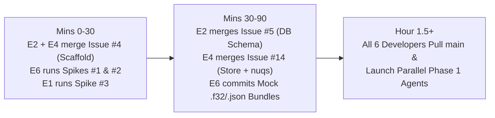

# Spectra Engineering Collaboration & Agent Orchestration Guide

This document defines how our **6-person engineering team** and our **AI coding agents** (`agy`, Claude Code, Cursor, Goose) collaborate on [`LawObare/Spectra`](https://github.com/LawObare/Spectra) without merge conflicts, blocked dependencies, or architectural drift.

---

## 1. Team Role Roster & Territory Map ([`tasks.md`](tasks.md))

Each engineer owns a dedicated role label on GitHub, a strict **1-to-1 Developer-to-Role Identity Lock** (`@github_handle` + `git config user.email`) in [`tasks.md` §0.1](tasks.md), a single-owner list of issues, and an exclusive directory write-fence enforced by [`AGENTS.md`](AGENTS.md) (**1-to-1 Role Bijection & Zero Cross-Role Poaching Rules**):

> **Hard Rule — No Two Developers on the Same Role:**  
> Before writing any code in Minute 0, all 6 developers lock their GitHub handle (`@username`) and Git email into **exactly one row** (`E1`–`E6`) in [`tasks.md` §0.1](tasks.md) and bulk-assign their role's issues on GitHub (`gh issue list --label role:E<k>-*`). AI agents run `gh api user --jq .login` and `gh issue list --label role:E<k>-* --json assignees` before every task and **automatically refuse** if a second developer attempts to act under an already-claimed role.

| Role ID | GitHub Label | Assigned Issues (Single-Owner Lock) | Primary Focus | Exclusive Write Territory |
|---|---|---|---|---|
| **E1** | `role:E1-astro` | `#3, #9, #10, #11, #19, #24` (6) | Scientific Data Pipeline Lead (`WCS-WAVE` smile inversion, wavelength matching, `reproject_exact`, HDU 5 PSF centroiding, synthetic injector) | `backend/science/{wave_match,reproject,centroid,wave,injector}.py`, `backend/api/spectrum.py`, `scripts/spike_s3_*` |
| **E2** | `role:E2-backend` | `#5, #7, #8, #12, #22` (5) | Backend Platform, Network I/O & API Lead (FastAPI `:7860`, IRSA SIA2/S3 async driver, bounded cutout queue, SSE hubs, binary `.f32` streamer, `asyncpg` DB layer, zero-auth session guard) | `backend/main.py`, `backend/db/*`, `backend/cache/*`, `backend/science/ingest.py`, `backend/api/{resolve,cutout,auth,classify}.py` |
| **E3** | `role:E3-webgl` | `#17, #18, #27` (3) | Graphics, GLSL Shaders & 3D Viz Lead (WebGL2 `gl.R32F` shaders, Asinh stretch, signed difference, inverse-variance coadd, Tab 2 Comparator, Web Worker Zstd decoding, Admin Tabs 1–3 WebGL 3D Isosurfaces) | `web-client/src/shaders/*`, `web-client/src/workers/*`, `web-client/src/tabs/TimeDomainComparator.tsx`, `web-client/src/admin/{AdminLayout,TrainingDynamics,ActivationInspector,DecisionBoundaries}.tsx` |
| **E4** | `role:E4-frontend` | `#14, #15, #16, #23, #28` (5) | Frontend Architecture Lead (Vite/React shell, `nuqs` URL state, Zustand store, `<GlobalCommandHeader />`, 5 Benchmark Pills, Tab 1 Aladin 3D Dome, Tab 5 Forum UI, Admin Tabs 4–5 Triage/Exports) | `web-client/src/App.tsx`, `web-client/src/store/*`, `web-client/src/hooks/*`, `web-client/src/components/*`, `CelestialNavigator.tsx`, `ObservationDiscussions.tsx`, `web-client/src/admin/{HardNegativeTriage,DataProductExports}.tsx` |
| **E5** | `role:E5-datasci` | `#20, #21, #25, #26` (4) | Data Science & Astrochemistry Lead (OpenBLAS NumPy cosine similarity, Tab 3 `uPlot` 102-channel lab, NNLS unmixing, photo-$z$, Tab 4 SPLICES Ice Studio, PyTorch ML) | `web-client/src/tabs/SpectrophotometricLab.tsx`, `MolecularIceStudio.tsx`, `backend/science/similarity.py`, `backend/ml/*`, `backend/admin_ws.py` |
| **E6** | `role:E6-devops` | `#1, #2, #4, #6, #13, #29, #30` (7) | DevOps, Spikes & Benchmark QA Lead (Day-0 Spikes S1/S2, monorepo scaffold, `seed_benchmarks.sql`, static `.f32`/`.json` bundles, Dockerfile, HF Spaces, Cloudflare Pages, CI/CD) | `scripts/*`, `benchmarks/*`, `.github/workflows/*`, `Dockerfile`, `start.sh`, `Taskfile.yml`, `web-client/public/benchmarks/*` |

---

## 2. Part I: Rules for AI Coding Agents

All AI agents automatically load [`AGENTS.md`](AGENTS.md) (`GEMINI.md` / `CLAUDE.md`). Every agent session must obey:

1. **One Issue Per Branch (`feat/issue-<N>-<slug>`):**
   - Run `gh issue view <N>` at the start of the session.
   - Implement **only** the files and acceptance criteria specified in Issue `#<N>`.
   - Never commit directly to `main`.
2. **Respect Territory Write-Fences:**
   - Do not edit files outside your role's allowed paths.
   - Once Issue [#4](https://github.com/LawObare/Spectra/issues/4) (Scaffold) and Issue [#14](https://github.com/LawObare/Spectra/issues/14) (Store/URL State) merge, `pyproject.toml`, `uv.lock`, `package.json`, `useTelemetryStore.ts`, and `useSpectraUrlState.ts` are **frozen**.
   - Never run `uv add` or `npm install <pkg>` on feature branches without explicit team approval.
3. **Immutable Contracts:**
   - Binary tensor layout ([`SPECIFICATION.md` §3.2](SPECIFICATION.md#L328-L355)): `[uint32 header_len][UTF-8 JSON header][FLUX f32][VARIANCE f32][FLAGS u32][N_EXPOSURES u16]` (14 B/px).
   - URL query parameters (`nuqs`): `tab`, `ra`, `dec`, `fov`, `cadence`, `mode`, `preset`, `z`, `px`, `py`, `embed`.
   - Zero-Auth headers: `X-Observer-ID` and `X-Observer-Key`. Never import `@supabase/supabase-js` in the browser.
4. **Pre-PR Verification Gate:**
   - Backend agents must run `cd backend && uv run ruff check . && uv run pytest`.
   - Frontend agents must run `cd web-client && npm run build`.
   - Run `git status --short` and `git diff --stat main` to confirm zero stray files or lockfile churn before `gh pr create`.

---

## 3. Part II: Operating Manual for the 6 Human Developers

### 3.1 The First 90 Minutes (Unblocking the Swarm)

Do **not** launch 6 agents on an empty repo simultaneously at minute 0. Execute this exact 3-step launch sequence so frontend and backend agents never block each other:



1. **Minutes 0–30 (Scaffold & Spikes):**
   - **E2 + E4** complete and merge Issue [#4](https://github.com/LawObare/Spectra/issues/4) (`backend/` + `web-client/` scaffold + locked `uv.lock` and `package-lock.json`).
   - **E6** runs Spike S1 ([#1](https://github.com/LawObare/Spectra/issues/1)) & Spike S2 ([#2](https://github.com/LawObare/Spectra/issues/2)); **E1** runs Spike S3 ([#3](https://github.com/LawObare/Spectra/issues/3)).
2. **Minutes 30–90 (Core Contracts & Static Mock Bundles):**
   - **E2** merges Issue [#5](https://github.com/LawObare/Spectra/issues/5) (`schema.sql` + `queries.py` + `test_sql.py`).
   - **E4** merges Issue [#14](https://github.com/LawObare/Spectra/issues/14) (`App.tsx` + `useTelemetryStore.ts` + `useSpectraUrlState.ts` + `tensorWorker.ts`).
   - **E6** commits initial `.f32` and `.json` benchmark bundles in `web-client/public/benchmarks/` so **E3**, **E4**, and **E5** can render real float32 tensors in the browser immediately without waiting for live IRSA queries.
3. **Hour 1.5 Onward (Full Parallel Execution):**
   - All 6 developers pull `main`, run `task setup`, claim their Phase 1 issue (`gh issue edit <N> --add-assignee @me`), and launch their agents in parallel.

### 3.2 How to Prompt Your Agent (The Golden Prompt Pattern)

Never prompt an agent with broad instructions like *"Work on the frontend"* or *"Build Tab 2"*. Always scope the agent to a single GitHub issue:

```text
/plan Read GitHub issue #10 (`gh issue view 10`) and the referenced sections of SPECIFICATION.md.
Strictly follow AGENTS.md. Only create/modify the files listed in Issue #10 (`backend/science/reproject.py` and `backend/tests/test_reproject.py`).
Do not modify pyproject.toml or any files outside backend/science/ and backend/tests/.
```

- **Use `/plan` first** on algorithmic/shader issues (`#9`, `#10`, `#11`, `#12`, `#17`, `#18`, `#19`, `#21`, `#25`). Verify the proposed file list and equations in `<30 seconds` before approving.
- **Use `/goal`** for self-contained implementation + test loops (e.g., *"Implement Issue #7 and iterate until `uv run pytest backend/tests/test_resolve.py` passes 100%"*).
- **Use `/compact`** immediately after your PR merges before starting your next issue so old diffs do not pollute your context window.

### 3.3 The 60-Second Human PR Review Protocol

Pair reviewers by domain adjacency: **E1 $\leftrightarrow$ E2** (Science/Backend), **E3 $\leftrightarrow$ E4** (WebGL/Frontend), **E5 $\leftrightarrow$ E6** (Data/DevOps). Before merging any PR, check 4 things in 60 seconds:

1. **`git diff --stat` Blast Radius:** Did the agent touch any file outside its assigned issue? If an E3 WebGL PR touched `package-lock.json` or `backend/main.py`, reject and revert those files.
2. **Zero-Auth & Bundle Security:** Did the agent add a blocking login modal, hardcode a secret token, or import `@supabase/supabase-js` in `web-client/`?
3. **Scientific Honesty:** Did the agent use `Float32Array` (`gl.R32F`) for image math, enforce wavelength-matched differencing, and preserve honest `[Not Detected at Pass Depth]` states?
4. **Green Checks:** Do `uv run ruff check`, `uv run pytest`, and `npm run build` pass?

### 3.4 Synchronized Milestone Gate Checkpoints

At the end of each Milestone, **all 6 developers pause new issues for 20 minutes**, pull `main`, run `task dev`, and verify the Milestone Gate together:

- **Milestone Gate 1 ([Milestone #2 — Phase 1 P0](https://github.com/LawObare/Spectra/milestone/2)):**
  - Click all 5 NASA benchmark pills (`Barnard's Star`, `WISE 0855`, `Epsilon Indi B`, `RW Aurigae`, `R Draconis`) and enter 1 arbitrary RA/Dec coordinate.
  - Confirm Tab 1 3D Aladin dome dives smoothly into Tab 2, and Tab 2 renders smooth WebGL2 Float32 Asinh stretch, wavelength-matched difference dipoles, coverage matrix, and Gaia centroid pins.
  - **Hard Rule:** Nobody merges Phase 2 or Phase 3 features until Gate 1 is 100% green.
- **Milestone Gate 2 ([Milestone #3 — Phase 2 P1](https://github.com/LawObare/Spectra/milestone/3)):**
  - Click any pixel in Tab 2 $\rightarrow$ verify 102-channel spectrum updates in Tab 3, `<20 ms` NumPy cosine similarity returns top-5 templates, and posting a thread in Tab 5 broadcasts live via FastAPI SSE between two browser windows.
- **Milestone Gate 3 ([Milestone #4 — Phase 3 P2](https://github.com/LawObare/Spectra/milestone/4)):**
  - Verify Tab 4 SPLICES background-star optical depth integration and `/admin` read-only WebSocket telemetry replay.
- **Milestone Gate 4 ([Milestone #5 — Phase 4 Deploy](https://github.com/LawObare/Spectra/milestone/5)):**
  - Verify Hugging Face Space container (`:7860`), Cloudflare Pages CDN, Supabase RLS lockdown, and offline laptop demo mode with Wi-Fi disabled.

### 3.5 Escalation & Cut-Order Rules

1. **20-Minute Blocker Rule:** If you or your agent are stuck on an Astropy WCS transform, WebGL2 texture upload, or Docker error for 20 minutes, post the exact traceback in the team channel immediately and pair up.
2. **Never Fix a Teammate's Module on Your Branch:** If E3 discovers a header bug in E2's `/api/cutout/{id}/tensor` endpoint, E2 ships a 5-minute hotfix PR to `main`—E3 never edits `backend/api/cutout.py` on a WebGL branch.
3. **Strict Cut Order (T-Minus 12 Hours):** If behind schedule, shed scope strictly in this order:
   $$\text{P3 Model Lab} \rightarrow \text{Tab 4 Ice Studio} \rightarrow \text{Admin Triage} \rightarrow \text{Tab 5 Forum Polish} \rightarrow \text{Tab 3 Template Overlays}$$
   **Never cut Phase 1 (P0).** A rock-solid, scientifically honest Phase 1 + Phase 2 beats a half-broken 10-tab app every time.
