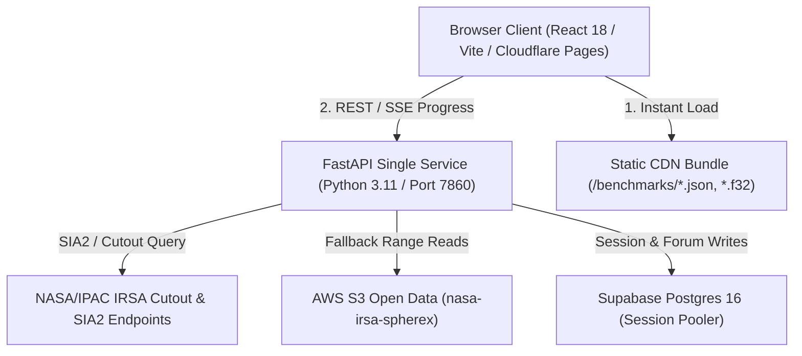

# Spectra (SPHEREx Spectral Explorers)
## Exhaustive Engineering Architecture, Scientific Pipeline & Systems Specification
**Document Version:** 3.0.0-PROD  
**Target Mission:** NASA SPHEREx (Spectro-Photometer for the History of the Universe, Epoch of Reionization and Ices Explorer)  
**Primary Archive:** NASA/IPAC Infrared Science Archive (IRSA) — SPHEREx Quick Release 2 (`spherex_qr2` / prefix `qr2/`) with runtime config `IRSA_COLLECTION`  
**System Repository:** `Spectra`  
**Status:** Ready for Day-0 Spikes & Phase 1 (P0) Implementation  
**Tags Used Throughout:** `[V]` checked against IRSA documentation, `[D]` recomputed in this revision, `[?]` must be verified against real data or SPHEREx Explanatory Supplement before dependent logic is built.

---

## 1. System Vision, Evolution Log & Architectural Philosophy

### 1.1 Mission Background & The Citizen Science Challenge
Launched in early 2025, NASA's SPHEREx mission is mapping the entire celestial sphere every six months across 102 near-infrared spectral channels ranging from $0.75\,\mu\text{m}$ to $5.00\,\mu\text{m}$ with resolving powers $R = 35 - 130$ and a native pixel scale of $\approx 6.2''/\text{pixel}$. Over its planned 2-year nominal baseline, SPHEREx will produce four complete all-sky passes and $>50$ overlapping passes over the North and South Ecliptic Pole Deep Fields ($\approx 100\,\text{deg}^2$ each).

The scientific core of this platform addresses the profound divergence between traditional broadband infrared surveys (such as WISE/NEOWISE, which powered Zooniverse's *Backyard Worlds: Planet 9*) and SPHEREx:
- **Broadband Visual Motion vs. Hyperspectral Data Cubes:** *Backyard Worlds* visually blinked broadband images to detect moving dipoles. SPHEREx adds a continuous hyperspectral dimension: a calibrated 102-channel low-resolution spectrum for *every spatial pixel* on the sky.
- **The Physical Reality of Linear Variable Filters (LVF):** SPHEREx mounts an interference filter directly over each detector array whose bandpass shifts continuously along the array $Y$-axis. Different exposures of the same sky coordinate land on different parts of the detector and therefore view the object at **different wavelengths**.
- **The Core Scientific Imperative (Wavelength-Matched Differencing):** Differencing or blinking two exposures taken at different wavelengths produces massive false variability and spurious dipoles due to chromatic flux gradients. Meaningful time-domain comparison requires **wavelength-matched frames** where exposures are strictly grouped by the wavelength landing on the target pixel.

---

### 1.2 Evolution from v2.5 to v3.0 (The 19 Corrective Audits)

The transition from v2.5.0 to v3.0.0 resolves critical astrophysical errors, memory constraints, and operational bottlenecks:

| # | Topic | v2.5.0 Formulation | v3.0.0-PROD Formulation | Technical Reason & Ground-Truth Justification |
|---|---|---|---|---|
| **1** | **Epoch Differencing** | Exposures coadded and differenced per epoch regardless of wavelength. | **Wavelength-matched frames:** Exposures strictly grouped by wavelength landing on target pixel. | Each pixel sees one wavelength per exposure. Differencing mismatched wavelengths creates false variability and false dipoles. |
| **2** | **Epsilon Indi B RA** | Centre RA $331.0724^\circ$. | **$331.0957^\circ$** (`331.09566^\circ`, `-56.80031^\circ`). | $1/\cos \delta$ factor was omitted in v2.5, placing target $\approx 46''$ ($7.5\,\text{px}$) off on sky. Recomputed using `SkyCoord.apply_space_motion`. |
| **3** | **Archive Release** | Hardcoded `spherex_qr3`, DOI `IRSA662`, `s3://.../qr3/`. | **Configurable release:** Verified names are `spherex_qr2` and prefix `qr2/`. Read via `IRSA_COLLECTION`. | QR3 is unverified in public IRSA docs. Hardcoding risks immediate HTTP 404. |
| **4** | **Data Ingestion** | S3 byte-range slicing as primary path. | **IRSA Cutout Service is primary;** S3 range reads are fallback. | Full detector HDUs are $\approx 16\,\text{MB}$; block caching over S3 pulls near-full frames. IRSA cutouts are server-side and bandwidth-efficient. |
| **5** | **Survey Epochs** | Hard-coded 4 passes with fixed dates. | **Dynamic epochs:** Derived from observation exposure MJDs. | Survey 4 is not complete; visit dates vary across the sky by ecliptic latitude $\beta$. |
| **6** | **Motion Metric** | Difference of Gaussians (DoG) dipole separation $\ge 1\,\text{px}$. | **Native PSF centroid shift;** DoG dipole retained strictly as visual display aid. | Benchmark proper motions are $0.8 - 1.7\,\text{px/yr}$; overlapping lobes invalidate DoG peak separation. |
| **7** | **Reprojection** | `reproject_interp` labelled flux-conserving. | **`reproject_exact`** for display; science measured in native detector space. | `reproject_interp` (bilinear) does not conserve flux and distorts undersampled point sources. |
| **8** | **Payload Gauge** | Stated $\approx 4.2\,\text{MB}$ at $300''$. | **Recomputed: $\approx 0.5\,\text{MB}$** at $300''$ (3 epochs, 6 bands). | Arithmetic error in v2.5. |
| **9** | **Resolving Power** | Hardcoded resolving power table. | **Dynamically read** from Explanatory Supplement / headers in Spike S1. | Hardcoded values conflicted with mission documentation. |
| **10** | **Ice Column Densities** | Averaged diffuse cloud pixels; $\text{CH}_3\text{OH}$ labelled C–O; brown dwarf $\text{CH}_4$ converted with ice $A$-values. | **Point-source background star workflow** (SPLICES-seeded); verified lab $A$-values only. | Extended clouds suffer optical depth/emission ambiguity; gas-phase methane has completely different cross-sections than solid ice. |
| **11** | **Vector Search** | `pgvector` index over $>1\text{M}$ targets on Supabase free tier. | **Dropped from P0;** in-memory NumPy cosine similarity over small template set. | $1\text{M} \times 102$ floats is $\approx 408\,\text{MB}$ raw before index, instantly exceeding 500 MB quota. |
| **12** | **Backend Stack** | Two services: Go gateway (`air`) + Python worker (`uv`). | **Single FastAPI service** (`uvicorn`). | No performance bottleneck justified dual-language complexity, RPC glue, and duplicate models. |
| **13** | **Zero-Auth Security** | Client-set `X-Spectra-Portal: admin` header; observer UUID in RLS; "Science Team" badge. | **Server-held bearer token;** secret `observer_key` hash in DB; mutations off by default; "Moderator" badge. | Prevented trivial admin impersonation and forged verification badges. |
| **14** | **Calibration Set** | Every 10th item uses 5 famous targets. | **Randomized synthetic injections** (movers + flat controls) + held-out gold set. | Famous targets are easily memorized by users, invalidating calibration. |
| **15** | **Performance Claims** | Asserted "<15 ms", "120 FPS", "<2 ms HNSW". | **Measurable empirical targets** validated via Day-0 spikes. | Unsupported marketing numbers replaced with engineering benchmarks. |
| **16** | **Acceptance States** | Expected spectra stated as immutable facts. | **Testable hypotheses;** "not detected" is a first-class accepted state. | Acknowledge that real-world noise, saturation, and pass coverage dictate visibility. |
| **17** | **Machine Learning** | 3-model ML training suite in core challenge. | **Optional P3 "Model Lab"** on synthetic data, labelled as such. | Machine learning models off-challenge; real ground-truth training data does not exist yet. |
| **18** | **URL State Schema** | Mixed URL hash (`#`) and query strings (`?`); `px=64,64`. | **Single query-string schema** managed via `nuqs`. | Eliminates routing desynchronization and browser state fragmentation. |
| **19** | **Institutional Badges** | "Official" data products; "Science Team" stamp. | **"Community" products;** explicit disclaimer: no NASA/SPHEREx endorsement. | Avoids trademark violations and misleading scientific claims. |

---

### 1.3 Core Scientific Principles
1. **Wavelength First:** An exposure is only comparable to another exposure at the same wavelength on the same pixel.
2. **Measure Natively, Display Rectified:** Scientific photometry and centroiding execute on native detector pixels with the empirical HDU 5 PSF. Reprojected tangent images are strictly for visual display.
3. **Never Invent Data:** Every frame and spectrum carries complete provenance: release string, exposure IDs, MJDs, wavelength window, and count of contributing exposures.
4. **Report Absence as a First-Class State:** If no matched exposures exist, or the target is below detection threshold, the UI explicitly renders a "not detected at this depth" state rather than an empty canvas or fake noise.
5. **Constants by Script:** Telescope constants, resolving powers, and bitmasks are extracted from headers and official documentation by build scripts, never committed from memory.

---

## 2. Rigorous Ground-Truth Astrophysical Catalog & Benchmarks

### 2.1 Mission & Archive Facts
#### Verified Facts `[V]`:
- **Level 2 Spectral Images:** Multi-Extension FITS (MEF) containing 6 Header Data Units:
  1. `IMAGE`: 32-bit float calibrated surface brightness in $\text{MJy/sr}$ ($2040 \times 2040$ pixels).
  2. `FLAGS`: 32-bit integer bitmask quality flags.
  3. `VARIANCE`: 32-bit float pixel noise variance $(\text{MJy/sr})^2$ (read noise + photon Poisson noise).
  4. `ZODI`: 32-bit float modeled solar system zodiacal dust background ($\text{MJy/sr}$).
  5. `PSF`: 32-bit float cube representing local empirical 3D Point Spread Function.
  6. `WCS-WAVE`: Tabular FITS WCS (`WAVE-TAB`) mapping detector coordinates $(x, y) \to (\lambda, \Delta\lambda)$.
- **Optical & Geometry:** Native pixel scale is $\approx 6.2''/\text{pixel}$. File naming token `2D3` corresponds to detector 3.
- **Releases:** QR1 delivered weekly from July 2025; QR2 reprocessed from October 2025; QR2 headers corrected on 10 April 2026. Latency is $\approx 2$ months from acquisition.
- **SIA2 Endpoint:** `https://irsa.ipac.caltech.edu/SIA?COLLECTION=<name>&POS=circle+<ra>+<dec>+<radius_deg>`. Verified collections: `spherex_qr`, `spherex_qr_deep`, `spherex_qr_cal`, `spherex_qr2`.
- **Anonymous S3:** Bucket `nasa-irsa-spherex`, region `us-east-1`, prefixes `qr/` and `qr2/` (e.g., `qr2/level2/`).
- **IRSA Cutout Service:** Endpoint provides server-side cutouts from data URL: `<data_url>?center=<ra>,<dec>&size=<deg>`.
- **Ancillary Archives:** IRSA hosts the SPLICES ice-source catalog and the official Spectrophotometry Tool.

#### Facts to Verify in Day-0 Spike S1 `[?]`:
1. Current release name (`spherex_qr2` vs `qr3`), collection string, and DOI.
2. Resolving power per detector (nominal: $\approx 41$ for D1–D3, $35$ for D4, $110$ for D5, $130$ for D6).
3. HDU 2 `FLAGS` bitmask table verification via `build_flags.py`.
4. Whether `IMAGE` HDU is already zodiacal-light subtracted in Level 2.
5. Exact array usable area and upper wavelength cutoff ($5.0\,\mu\text{m}$ vs $5.1\,\mu\text{m}$).
6. Saturation limits and persistence behavior across detector channels.
7. Per-exposure and per-pass depth measurements across ecliptic latitudes.
8. Survey pass boundary MJDs from mission ephemeris.

---

### 2.2 Recomputed NASA Benchmark Targets `[D]`

#### Propagation Rule
Targets are propagated from catalog reference epoch to SPHEREx mission midpoint ($t = 2025.5$) using `astropy.coordinates.SkyCoord.apply_space_motion` including proper motion, parallax, and radial velocity.  
The spherical trigonometry hand-check is:
$$\Delta\alpha = \frac{\mu_\alpha^* \cdot \Delta t}{\cos \delta}, \quad \Delta\delta = \mu_\delta \cdot \Delta t$$
where $\mu_\alpha^* = \mu_\alpha \cos \delta$ (Gaia standard).  
*Notice: For arbitrary user-entered coordinates, do not propagate. Only named targets resolved with proper motion (CDS Sesame/SIMBAD) are propagated to observation epochs. A fixed North-up celestial grid is maintained so moving objects visibly translate across the static background starfield.*

```
============================================================================================================================================
Target Name      Object Class            J2000 Coordinates (ICRS)       Proper Motion (mas/yr)             Epoch 2025.5 Center Coordinates
============================================================================================================================================
Barnard's Star   M4V Red Dwarf           17h 57m 48.50s, +04d 41m 36.1s  pm_ra_cosdec:  -801.60 mas/yr     17h 57m 47.13s, +04d 46m 00.3s
                                          (269.45208 deg, +4.69336 deg)  pm_dec:       +10362.40 mas/yr     (269.44639 deg, +4.76676 deg)
                 * Motion: 10.39"/yr = 1.68 px/yr along PA 355.6° (~1.7 px between Pass 1 and Pass 3).
                   Bright in NIR: saturation flag handling required.
--------------------------------------------------------------------------------------------------------------------------------------------
WISE 0855-0714   Y4 Sub-Brown Dwarf      08h 55m 10.83s, -07d 14m 42.5s  pm_ra_cosdec: -8123.70 mas/yr     08h 54m 56.91s, -07d 14m 25.4s
                 (T_eff ~ 250 K)         (133.79513 deg, -7.24515 deg)  pm_dec:         +673.20 mas/yr     (133.73712 deg, -7.24038 deg)
                 * Motion: 8.15"/yr = 1.31 px/yr along PA 274.7°.
                   Flux: ~0.5 mJy near 4.5 um; undetectable in D1-D3; detected in D5/D6 coadds or honest non-detection.
--------------------------------------------------------------------------------------------------------------------------------------------
Epsilon Indi B   T1 + T6 Brown Dwarf     22h 04m 10.60s, -56d 46m 58.2s  pm_ra_cosdec: +3982.00 mas/yr     22h 04m 22.96s, -56d 48m 01.1s
                 Binary (sep ~ 0.7")     (331.04415 deg, -56.78284 deg) pm_dec:        -2466.80 mas/yr     (331.09566 deg, -56.80031 deg)
                 * Motion: 4.68"/yr = 0.76 px/yr along PA 121.8°.
                   NOTE: v2.5 used 331.0724 deg (omitted 1/cos delta, 46" error). Unresolved binary within single 6.2" pixel.
--------------------------------------------------------------------------------------------------------------------------------------------
RW Aurigae       Classical T Tauri Star  05h 07m 49.55s, +30d 24m 05.2s  pm_ra_cosdec:     +1.40 mas/yr     05h 07m 49.55s, +30d 24m 04.7s
                 with Protoplanetary Disk(76.95646 deg, +30.40144 deg)  pm_dec:          -20.60 mas/yr     (76.95647 deg, +30.40130 deg)
                 * Motion: 0.02"/yr (stationary). Displays >1.5 mag brightness changes. Difference mode yields stationary flashing monopole.
--------------------------------------------------------------------------------------------------------------------------------------------
R Draconis       Mira-type Pulsating     16h 32m 40.23s, +66d 45m 17.9s  pm_ra_cosdec:     +6.10 mas/yr     16h 32m 40.26s, +66d 45m 18.1s
                 AGB Variable (P=245d)   (248.16763 deg, +66.75497 deg) pm_dec:           +9.80 mas/yr     (248.16773 deg, +66.75504 deg)
                 * Motion: 0.012"/yr (stationary). Great-circle angular distance to NEP is 8.61 degrees. Pulsates across epochs.
============================================================================================================================================
```

---

### 2.3 SPHEREx HDU 2 (`FLAGS`) Bitmask Specification
Flags are generated via `scripts/build_flags.py` from official telemetry tables. The standard mask values are:
- `Bit 0` ($1$): `TRANSIENT` — Cosmic ray hit or sudden single-read glitch during Sample-Up-The-Ramp (SUR) regression.
- `Bit 1` ($2$): `OVERFLOW` — Detector well saturation ($>85\%$ full well capacity).
- `Bit 2` ($4$): `SUR_ERROR` — Onboard fit failure during Sample-Up-The-Ramp regression.
- `Bit 4` ($16$): `PHANTOM` — Interleaved non-physical readout test channels.
- `Bit 5` ($32$): `REFERENCE` — Non-illuminated reference border pixels (outer 4 rows/columns).
- `Bit 6` ($64$): `NONFUNC` — Factory dead, hot, or disconnected pixels.
- `Bit 7` ($128$): `DICHROIC` — Optical boundary zone where beam splitter transmission drops below $50\%$.
- `Bit 9` ($512$): `MISSING_DATA` — Telemetry loss or frame drop.
- `Bit 10` ($1024$): `HOT` — Excess dark current ($>5\sigma$ above array mean).
- `Bit 11` ($2048$): `COLD` — Low quantum efficiency ($<20\%$ nominal).

---

## 3. Scientific Processing Pipeline & Image Science

### 3.1 Cutout Pipeline (`GET /api/cutout`)
Execution sequence for any requested target coordinate $(\alpha, \delta)$ and field-of-view $\text{FoV}$:
1. **Target Resolution:** Parse coordinates (decimal degrees, sexagesimal, or CDS Sesame name resolution with 350 ms debounce).
2. **SIA2 Query:** Discover all intersecting exposures via IRSA SIA2 (`COLLECTION=spherex_qr2&POS=circle+<ra>+<dec>+<radius_deg>`), cone padded by field-of-view diagonal. Returns exposure IDs, observation MJDs, detector ID, footprints, and cutout URLs.
3. **Dynamic Epoch Grouping:** Group exposures into survey passes using configured mission survey boundaries (`config/survey_passes.json`), not hardcoded dates. Each pass displays actual MJD range.
4. **Server-Side Cutout Ingestion:** Request cutouts of required HDUs (`IMAGE`, `FLAGS`, `VARIANCE`, `WCS-WAVE`, `PSF`) from IRSA Cutout Service (`<data_url>?center=<ra>,<dec>&size=<deg>`). Fallback: S3 byte-range slicing using `fsspec` block caching.
5. **Wavelength Mapping:** Evaluate HDU 6 `WAVE-TAB` at every pixel in the cutout to compute exact central wavelength $\lambda(x, y)$ and bandpass width $\Delta\lambda(x, y)$.
6. **Wavelength Window Selection:** Select exposures whose central wavelength at the target pixel falls within the target band window $[\lambda_0(1-w), \lambda_0(1+w)]$ (see Section 3.2). Mask pixels outside window.
7. **Master Tangent Reprojection:** Reproject each exposure to a master tangent grid centered on target $(\alpha, \delta)$, $6.2''/\text{pixel}$, `RA---TAN`, North-Up, East-Left. Use `reproject.reproject_exact` for `IMAGE` and `VARIANCE` (conserving surface brightness), and nearest-neighbor for `FLAGS`.
8. **Inverse-Variance Coaddition:** For each pass $e$ and band $b$, compute the inverse-variance coadded frame:
   $$I_{\text{coadd}}(x, y) = \frac{\sum_{i \in S(e, b)} I_i(x, y) / \sigma_i^2(x, y)}{\sum_{i \in S(e, b)} 1 / \sigma_i^2(x, y)}, \quad \sigma_{\text{coadd}}^2(x, y) = \frac{1}{\sum_{i \in S(e, b)} 1 / \sigma_i^2(x, y)}$$
   Pixels with fatal flags (`OVERFLOW`, `NONFUNC`, `TRANSIENT`) are excluded. Keep per-pixel exposure count plane $N_{\text{exp}}(x, y)$.
9. **Binary Tensor Packaging:** Output little-endian binary tensor payload (Section 3.6) with JSON metadata.

---

### 3.2 Analysis Bands & Wavelength Windows
One primary analysis band is established per detector array:

| Band | Detector | Default Central $\lambda_0$ ($\mu\text{m}$) | Default Window Half-Width ($w = 1/R_{\text{band}}$) | Physical Tracing |
|---|---|---|---|---|
| **B1** | D1 | $0.90\,\mu\text{m}$ | $\approx 2.4\%$ | Stellar continuum, optical-NIR turnover |
| **B2** | D2 | $1.35\,\mu\text{m}$ | $\approx 2.4\%$ | Water vapor vapor absorption, low-mass stars |
| **B3** | D3 | $2.05\,\mu\text{m}$ | $\approx 2.4\%$ | Brown dwarf absorption, stellar continuum |
| **B4** | D4 | $3.30\,\mu\text{m}$ | $\approx 2.9\%$ | PAH emission feature, aliphatic hydrocarbons |
| **B5** | D5 | $4.10\,\mu\text{m}$ | $\approx 0.9\%$ | Sub-stellar peak, brown dwarf thermal window |
| **B6** | D6 | $4.60\,\mu\text{m}$ | $\approx 0.8\%$ | CO gas / fundamental ice absorption |

*Window widening up to $10\%$ is user-adjustable in the UI. When widened beyond $1/R_{\text{band}}$, the UI displays a yellow `[Wavelength-Mismatch Residuals Possible]` warning badge.*

---

### 3.3 Wavelength-Matched Frames & The Coverage Matrix
Let $S(e, b)$ represent the set of exposures acquired during pass $e$ using detector $b$ whose central wavelength $\lambda$ at the target coordinate falls within $[\lambda_0(1-w), \lambda_0(1+w)]$.
- **The Coverage Matrix:** Displayed prominently in Tab 2 as a 2D grid: Rows = Survey Epochs ($e = 1 \dots N$), Columns = Bands (B1–B6).
- Each cell displays the integer count $|S(e, b)|$ of contributing exposures.
- Cells with $|S(e, b)| = 0$ are rendered disabled/greyed out.
- **Scientific Difference Mode:** Time-domain differencing ($I_{\text{epoch } N} - I_{\text{epoch } 0}$) is strictly permitted **only between cells within the same column (same band)**. Differencing across different columns or across cells with zero coverage is physically prohibited by the UI.

---

### 3.4 Motion Measurement (Native PSF Centroiding)
1. In native detector pixel space, fit the target centroid using the empirical HDU 5 Point Spread Function at the predicted coordinates:
   $$I_{\text{model}}(x, y) = F_0 \cdot \text{PSF}(x - x_0, y - y_0) + B_0$$
   where $F_0$ is source flux, $(x_0, y_0)$ is the free centroid, and $B_0$ is local sky background.
2. Calculate the astrometric shift vector $\Delta\vec{r} = (x_0(t_2) - x_0(t_1), y_0(t_2) - y_0(t_1))$ and propagate the full covariance matrix $\mathbf{\Sigma}$.
3. Compare measured motion against catalog proper motion $\vec{\mu}$.
4. Tab 2 renders the measured centroid with $1\sigma$ and $2\sigma$ uncertainty ellipses alongside catalog-predicted positions.
5. Automated mover detection requires centroid-shift $\text{SNR} \ge 3\sigma$ relative to stationary background control stars. Difference of Gaussians (DoG) filter is retained strictly as an optional visual aid.

---

### 3.5 Hyperspectral Extraction Pipeline (`GET /api/spectrum`)
1. **Coordinate Mapping:** Map target sky position $(\alpha, \delta)$ into each overlapping exposure's native detector coordinates $(x, y)$ using the TAN-SIP polynomial WCS.
2. **Dispersion Evaluation:** Query the HDU 6 `WAVE-TAB` table at $(x, y)$ using bilinear interpolation to obtain exact wavelength $\lambda$ and spectral resolution element $\Delta\lambda$.
3. **PSF Point-Source Photometry:** Measure point-source flux density $F_\nu(\lambda)$ via PSF fitting (HDU 5). An aperture flux (with local background annulus) is permitted only for isolated bright sources. Convert surface brightness ($	ext{MJy/sr}$) to Janskys ($10^{-26}\text{ W m}^{-2}\text{ Hz}^{-1}$).
4. **Flag Bitmask Aggregation:** Bitwise-OR all contributing pixel flags to populate flag channels per wavelength sample.
5. **Non-Simultaneity Tracking:** SPHEREx spectra assembled across a pass are built from exposures spanning up to weeks. The API returns the exact MJD range $[t_{\text{min}}, t_{\text{max}}]$, and the UI attaches a `[Non-Simultaneous Spectrum]` badge for high-variability targets (e.g., Miras, T Tauri stars).
6. **Continuum Normalization:** User-selectable polynomial continuum fitting is provided with explicit visual display of fitting windows.

---

### 3.6 Binary Tensor Format (`application/octet-stream`)
The API returns a compact, high-performance binary stream avoiding base64 and JSON bloat:

```
+-------------------------------------------------------------------------------+
| Byte 0 - 3: Little-Endian uint32 (Length L of JSON Header)                   |
+-------------------------------------------------------------------------------+
| Byte 4 to (4 + L - 1): UTF-8 Encoded JSON Metadata Header                     |
| {                                                                             |
|   "shape": [N_epochs, N_bands, Height, Width],                                |
|   "crval": [ra_deg, dec_deg],                                                 |
|   "cdelt": [-0.001722, 0.001722],  // 6.2 arcsec/pixel in deg                 |
|   "mjd_ranges": [[[mjd_start, mjd_end], ...]],                               |
|   "exposure_ids": [...],                                                      |
|   "release": "spherex_qr2",                                                   |
|   "source_badge": "NASA Benchmark" | "IRSA Live" | "Synthetic Injection"      |
| }                                                                             |
+-------------------------------------------------------------------------------+
| Contiguous IEEE-754 Little-Endian Tensor Buffers:                             |
| Plane 1: FLUX         (float32) [N_epochs, N_bands, Height, Width]            |
| Plane 2: VARIANCE     (float32) [N_epochs, N_bands, Height, Width]            |
| Plane 3: FLAGS        (uint32)  [N_epochs, N_bands, Height, Width]            |
| Plane 4: N_EXPOSURES  (uint16)  [N_epochs, N_bands, Height, Width]            |
+-------------------------------------------------------------------------------+
```

#### Payload Sizing
$$\text{Size} = N_{\text{epochs}} \times N_{\text{bands}} \times \left(\frac{\text{FoV}}{6.2''}\right)^2 \times (4 + 4 + 4 + 2)\,\text{bytes}$$
- For 3 epochs and 6 bands:
  - $180''$ cutout ($29 \times 29\,\text{px}$): $\approx 0.18\,\text{MB}$
  - $300''$ cutout ($48 \times 48\,\text{px}$): $\approx 0.50\,\text{MB}$
  - $600''$ cutout ($97 \times 97\,\text{px}$): $\approx 2.05\,\text{MB}$  
*No bandwidth warning is required below $600''$.*

---

### 3.7 WebGL2 Shader Pipeline & Inverse Hyperbolic Sine (Asinh) Stretch
To render 32-bit floating-point flux planes with high dynamic range in real time:

$$\tilde{I}(x, y) = \frac{\text{asinh}\left(\frac{I(x, y) - I_{\text{black}}}{\beta}\right)}{\text{asinh}\left(\frac{I_{\text{white}} - I_{\text{black}}}{\beta}\right)}$$
where $\beta = \text{softening parameter}$, $I_{\text{black}} = \text{black point} \approx \text{median} - 1.5\sigma$, and $I_{\text{white}} = \text{white point} \approx \text{median} + 15\sigma$.

```glsl
#version 300 es
precision highp float;
in vec2 v_texCoord;
out vec4 fragColor;

uniform sampler2D u_fluxTexture;    // R32F texture
uniform float u_black;
uniform float u_white;
uniform float u_softening;
uniform int u_invert;

float asinh_approx(float x) {
    return log(x + sqrt(x * x + 1.0));
}

void main() {
    float raw = texture(u_fluxTexture, v_texCoord).r;
    if (isnan(raw)) {
        fragColor = vec4(0.0, 0.0, 0.0, 1.0);
        return;
    }
    float norm = (raw - u_black) / max(u_softening, 1e-6);
    float denom = (u_white - u_black) / max(u_softening, 1e-6);
    float stretched = asinh_approx(norm) / max(asinh_approx(denom), 1e-6);
    stretched = clamp(stretched, 0.0, 1.0);
    if (u_invert == 1) {
        stretched = 1.0 - stretched;
    }
    fragColor = vec4(vec3(stretched), 1.0);
}
```

---

## 4. System Architecture & Backend Specification

### 4.1 Topology & Single FastAPI Service
The production deployment uses a lean, unified single-service architecture:
- **Frontend:** React 18, TypeScript, Vite, Tailwind CSS, Zustand, `nuqs`, TanStack Query, Aladin Lite v3, `uPlot`, WebGL2. Hosted on Cloudflare Pages.
- **Backend Service:** Single FastAPI service running on Python 3.11 with `uvicorn` on port 7860 (Hugging Face Spaces standard).
- **Core Dependencies:** `fastapi`, `uvicorn`, `astropy`, `pyvo`, `reproject`, `scikit-learn`, `numpy`, `scipy`.
- **Database:** Supabase PostgreSQL 16 accessed via Session Pooler (IPv4, port 5432, session mode, `sslmode=require`). Browser has zero database credentials.



---

### 4.2 Endpoint Contract
- `GET /api/resolve?q=<name>`: Resolves target coordinates via CDS Sesame.
- `GET /api/cutout?ra=<deg>&dec=<deg>&fov=<arcsec>&band=<B1..B6>&win=<w>`: Streams binary tensor.
- `GET /api/spectrum?ra=<deg>&dec=<deg>`: Returns 102-channel calibrated point spectrum with covariance and flag masks.
- `GET /api/similarity?target_id=<id>`: In-memory NumPy cosine similarity over reference spectral libraries ($<20\,\text{ms}$).
- `GET /api/progress/{task_id}`: Server-Sent Events (SSE) stream reporting live progress (`discovering`, `fetching n/m`, `reprojecting`).
- `GET /api/forum/threads`: Returns paginated discussion threads with state snapshots.
- `POST /api/forum/threads`: Creates new thread requiring valid `X-Observer-ID` and `X-Observer-Key`.
- `GET /api/health/live`: Container process health check.
- `GET /api/health`: Database heartbeat ping and IRSA connectivity test.

---

### 4.3 Caching & Performance Standards
- **Two-Tier Cache:** In-memory LRU cache (bounded by bytes, max 1.5 GB) + on-disk cache keyed by `sha256(ra, dec, fov, band, win, release, collection)`.
- **Performance Targets (Empirically Measured):**
  - Static CDN Benchmark Load: $<100\,\text{ms}$ Time-To-First-Byte (TTFB).
  - API Cache Hit: $p50 < 250\,\text{ms}$.
  - Live Cold IRSA Query: $<30\,\text{s}$ with active SSE progress updates.
  - Spectrum Interaction: 60 FPS in `uPlot` on standard hardware.
  - In-Memory Spectral Similarity: $<20\,\text{ms}$ across $10^4$ template spectra.

---

## 5. Complete Database Schema & Security Specification

### 5.1 Zero-Auth Session Security Model
Hackathon evaluators require zero barrier to entry. Blocking login dialogs are prohibited.
- **Client Key Generation:** On first load, browser creates:
  1. `observer_id`: Public UUIDv4 stored in `localStorage.getItem('spx_observer_id')`.
  2. `observer_key`: Secret 32-byte cryptographic random string in `localStorage.getItem('spx_observer_key')`.
  3. `observer_handle`: Callsign (e.g., `Observer-Vega-409`).
- **Server Verification:** All mutating API requests send `X-Observer-ID` and `X-Observer-Key`. The backend stores only `sha256(observer_key)` in the `observers` table.
- **No Data Leaks:** Raw `observer_key` and internal `observer_id` UUIDs are never exposed in read endpoints. Discussions display only `author_handle`.
- **Database Row Level Security (RLS):** Enabled across all tables with zero `anon` policies. All database access flows through the backend service role.

---

### 5.2 Production SQL DDL Migrations

```sql
-- Migration: 20261101_v3_init.sql
CREATE EXTENSION IF NOT EXISTS "uuid-ossp";

-- Observers Table with Hashed Secret Key
CREATE TABLE observers (
  id BIGSERIAL PRIMARY KEY,
  observer_id UUID UNIQUE NOT NULL,
  key_hash TEXT NOT NULL,
  handle TEXT NOT NULL,
  total_classifications INT NOT NULL DEFAULT 0,
  calibration_seen INT NOT NULL DEFAULT 0,
  calibration_correct INT NOT NULL DEFAULT 0,
  reliability_weight DOUBLE PRECISION NOT NULL DEFAULT 0.85,
  created_at TIMESTAMPTZ NOT NULL DEFAULT NOW()
);

-- Discussion Threads with State Query Snapshots
CREATE TABLE discussion_threads (
  thread_id BIGSERIAL PRIMARY KEY,
  subject_id TEXT,
  observer_ref BIGINT NOT NULL REFERENCES observers(id),
  author_handle TEXT NOT NULL,
  channel TEXT NOT NULL,
  title TEXT NOT NULL CHECK (char_length(title) <= 120),
  body TEXT NOT NULL CHECK (char_length(body) <= 4000),
  hashtags JSONB NOT NULL DEFAULT '[]',
  ra DOUBLE PRECISION NOT NULL,
  dec DOUBLE PRECISION NOT NULL,
  state_query TEXT NOT NULL,
  preview_metrics JSONB NOT NULL DEFAULT '{}',
  upvotes INT NOT NULL DEFAULT 0,
  moderator_verified BOOLEAN NOT NULL DEFAULT FALSE,
  created_at TIMESTAMPTZ NOT NULL DEFAULT NOW()
);

-- Discussion Replies
CREATE TABLE discussion_replies (
  reply_id BIGSERIAL PRIMARY KEY,
  thread_id BIGINT NOT NULL REFERENCES discussion_threads(thread_id) ON DELETE CASCADE,
  observer_ref BIGINT NOT NULL REFERENCES observers(id),
  author_handle TEXT NOT NULL,
  body TEXT NOT NULL CHECK (char_length(body) <= 2000),
  moderator_verified BOOLEAN NOT NULL DEFAULT FALSE,
  created_at TIMESTAMPTZ NOT NULL DEFAULT NOW()
);

-- Citizen Science Classifications
CREATE TABLE classifications (
  classification_id BIGSERIAL PRIMARY KEY,
  subject_id TEXT NOT NULL,
  observer_ref BIGINT NOT NULL REFERENCES observers(id),
  class_label TEXT NOT NULL,
  confidence DOUBLE PRECISION NOT NULL CHECK (confidence >= 0.0 AND confidence <= 1.0),
  is_control BOOLEAN NOT NULL DEFAULT FALSE,
  was_correct BOOLEAN,
  created_at TIMESTAMPTZ NOT NULL DEFAULT NOW()
);

-- Enable RLS with zero anon policies
ALTER TABLE observers ENABLE ROW LEVEL SECURITY;
ALTER TABLE discussion_threads ENABLE ROW LEVEL SECURITY;
ALTER TABLE discussion_replies ENABLE ROW LEVEL SECURITY;
ALTER TABLE classifications ENABLE ROW LEVEL SECURITY;
```

---

### 5.3 Consensus Scoring & Synthetic Injections
- **Reliability-Weighted Vote Share:**
  $$P(c \mid s) = \frac{\sum_{i} w_i \cdot k_i \cdot [\text{class}_i = c]}{\sum_{i} w_i \cdot k_i}$$
  where $w_i \in [0.1, 1.0]$ is observer reliability weight, and $k_i \in [0, 1]$ is self-reported confidence.
- **Queue Priority via Shannon Entropy:**
  $$H(s) = -\sum_{c} P(c \mid s) \log_2 P(c \mid s)$$
  Ambiguous subjects ($H \approx \max$) are prioritized in classification queues.
- **Calibration Loop:** With $10\%$ randomized probability, the queue injects a synthetic control subject (simulated proper-motion mover or flat-spectrum source) or a held-out gold target:
  - Match: $w \leftarrow \min(1.0, w + 0.05(1 - w))$
  - Miss: $w \leftarrow \max(0.1, w - 0.10 \cdot w)$

---

## 6. Frontend Component Architecture & 5 Workspaces

### 6.1 State Management & URL Schema (`nuqs`)
State is synchronized strictly via standard URL query parameters without URL hash mixing:
```
/explore?tab=<navigator|comparator|spectra|ices|discussions>&ra=<deg>&dec=<deg>&fov=<arcsec>&band=<B1..B6>&win=<w>&mode=<blink|diff|coadd>&epoch=<i>&px=<x>&py=<y>&z=<redshift>&embed=<0|1>
```

---

### 6.2 Global Header
- **Universal Coordinate Resolver:** Accepts decimal degrees (`269.4464, 4.7668`), sexagesimal (`17h57m47.14s +04d46m00.7s`), or object names (`Barnard's Star`) with 350 ms debouncing.
- **5 NASA Benchmark Quick-Pills:** Quick jump to Barnard's Star, WISE 0855, Epsilon Indi B, RW Aurigae, R Draconis.
- **FoV Selector:** Discrete choices ($60'', 120'', 180'', 300'', 600''$; banner notice on $600''$).
- **Institutional Source Badge:** Displays `[NASA Benchmark (Pre-cached)]`, `[IRSA Live (<collection>)]`, or `[Synthetic Injection Mode]`.
- **Backend Status Dot:** Green (live API connection) or Amber (CDN static demo mode).

---

### 6.3 Workspace Tabs Specification

#### Tab 1: Celestial Navigator (P0 - Must-Have)
- Aladin Lite v3 planetarium dome with AllWISE color HiPS background.
- SPHEREx survey coverage MOC overlay (generated via `scripts/build_moc.py` with `mocpy`).
- NEP and SEP Deep Field boundaries ($pprox 100\,\text{deg}^2$ circles at ecliptic poles).
- Gaia DR3 proper motion arrow overlays.
- Dynamic FOV reticle with "Dive into Time-Domain" action triggering transition to Tab 2.

#### Tab 2: Time-Domain Comparator (P0 - Must-Have)
- Analysis Band selector (B1–B6) with interactive **Coverage Matrix** (Epochs $\times$ Bands).
- Player controls: Discrete epoch stepping, Play/Pause, Blink, Coadd, and **Wavelength-Matched Difference Mode**.
- Asinh contrast stretch sliders (black point, white point, softening parameter).
- Rectified North-Up tangent view vs. raw detector sensor view toggle.
- Overlays: Gaia catalog predicted track, measured centroid fit with $1\sigma/2\sigma$ covariance ellipses, and 12-bit FLAGS bitmask overlays.
- Honest non-detection state for targets below local detection limit.
- WebGL2 Float32 shader canvas with Canvas 2D fallback.

#### Tab 3: Spectrophotometric Lab (P1 - Differentiator)
- 102-channel calibrated spectrum rendered at 60 FPS with `uPlot`.
- Scatter points representing raw exposures colored by observation MJD.
- `VARIANCE` error bars and `FLAGS` masking markers.
- Non-simultaneity MJD span badge.
- Interactive rest-frame redshift ruler: $\lambda_{\text{obs}} = \lambda_{\text{rest}}(1 + z)$.
- In-memory NumPy spectral similarity search ($<20\,\text{ms}$) against reference brown dwarf and stellar libraries.
- Two-component non-negative matrix unmixing with explicit residual $\chi^2$ display and template provenance disclosure.

#### Tab 4: Molecular & Ice Studio (P2 - Polish)
- Point-source background star workflow seeded from the IRSA SPLICES list.
- Local continuum normalization around molecular bands: $\tau(\lambda) = -\ln(F(\lambda) / F_{\text{cont}}(\lambda))$.
- Optical depth integration over wavenumber $\nu = 10^4 / \lambda[\mu\text{m}]$:
  $$N = \frac{1}{A} \int \tau(\nu) d\nu$$
- Verified laboratory band absorption strengths ($A$-values):
  - $\text{H}_2\text{O}$ ($3.05\,\mu\text{m}$): $A = 2.0 \times 10^{-16}\,\text{cm/molecule}$
  - $\text{CO}_2$ ($4.27\,\mu\text{m}$): $A = 7.6 \times 10^{-17}\,\text{cm/molecule}$
  - $^{13}\text{CO}_2$ ($4.38\,\mu\text{m}$): $A = 7.8 \times 10^{-17}\,\text{cm/molecule}$
  - $\text{CO}$ ($4.67\,\mu\text{m}$): $A = 1.1 \times 10^{-17}\,\text{cm/molecule}$
- Explicit warning: Gas-phase brown dwarf methane absorption is strictly quarantined from ice column calculations.

#### Tab 5: Community Discussions & Peer Review (P1 - Differentiator)
- Three-pane layout: Channel directory, Thread feed, and Context inspection panel.
- Threads store complete state snapshots (`state_query`) with "Load in Workbench" button.
- Real-time updates delivered via backend Server-Sent Events (SSE).
- One-click external catalog cross-matches: SIMBAD, VizieR Gaia DR3, Legacy Survey, WiseView.

---

## 7. Admin Mission Control & Moderation Architecture

- **Route Isolation:** Hosted under `/admin/*`.
- **Default State:** Read-only demo mode (`ADMIN_MUTATIONS_ENABLED=false`).
- **Authorization:** Mutating operations require `Authorization: Bearer <ADMIN_TOKEN>` where the token is set strictly in Hugging Face Space secrets.
- **Badge Integrity:** Verified admin responses render the gold `[Moderator]` badge. The label "Science Team" is reserved strictly for authenticated mission personnel.
- **Community Branding:** All exported candidate catalogs, ice lists, and data products carry the explicit label `Community Product` with release DOI, without claiming official NASA endorsement.

---

## 8. Implementation Roadmap & Execution Sequence


### Day-0 Spikes (Mandatory Gating Phase)
- **Spike S1:** Resolve IRSA collection naming, verify resolving power table from Explanatory Supplement, generate `flags.json`.
- **Spike S2:** Pull real exposures for all 5 NASA benchmark targets; measure coverage matrices, saturation flags, and detectability.
- **Spike S3:** Benchmark IRSA Cutout API vs S3 byte-range reads for latency and payload bytes; finalize primary path.

### Phase 1: P0 Core NASA Challenge Foundation
- **Backend:** FastAPI cutout pipeline, wavelength-matched frame selection, binary tensor streaming, static benchmark bundle generator (`benchmarks/build.py`).
- **Frontend:** App shell, query string sync via `nuqs`, universal search header, Tab 1 (Aladin Lite v3 with MOC), Tab 2 (Time-Domain Comparator with coverage matrix, WebGL2 Asinh stretch, and honest non-detection state).
- **Gate 1 Milestone:** Arbitrary coordinates or benchmark pills render wavelength-matched blink and difference frames with complete provenance.

### Phase 2: P1 Science & Community Intelligence
- **Backend:** Hyperspectral extraction (`/api/spectrum`), in-memory NumPy cosine similarity, observer secret key session middleware, discussion SSE stream.
- **Frontend:** Tab 3 (Spectrophotometric Lab with `uPlot`, rest-frame ruler, unmixing), Tab 5 (Discussions with state snapshots and live SSE feed).
- **Gate 2 Milestone:** Pixel click in Tab 2 updates Tab 3 spectrum; discussion thread round-trips live between two separate browsers.

### Phase 3: P2 Institutional Polish & Mission Control
- **Backend:** SPLICES target list ingestion, synthetic injection calibration loop, read-only `/admin` telemetry triage.
- **Frontend:** Tab 4 (Molecular & Ice Studio with verified laboratory $A$-values), `/admin` mission control dashboards.
- **Gate 3 Milestone:** Ice column density workflow completes on SPLICES sources; calibration injections adjust user reliability weights.

### Phase 4: Production Packaging & Hardening
- Hugging Face Space Dockerfile packaging, Cloudflare Pages CDN routing, Supabase RLS security audit, cron-job keep-alive ping setup, offline venue demo mirror.

---

## 9. Acceptance Criteria for the 5 NASA Benchmark Targets

| Target Name | Scientific Hypothesis to Test | Strict Acceptance Criteria |
|---|---|---|
| **Barnard's Star** | Northward proper motion shift of $\approx 1.7\,\text{px}$ between Pass 1 and Pass 3; high flux. | If unsaturated: measured centroid shift is within $2\sigma$ of catalog PM. If saturated: UI renders saturation flag badge and overlays catalog-predicted track. |
| **WISE 0855-0714** | Faint sub-stellar thermal emission; detected primarily in D5/D6 coadds. | Measured centroid shift matches catalog PM within $2\sigma$ in B5/B6 coadd, OR system renders a documented non-detection state indicating the limiting depth reached. |
| **Epsilon Indi B** | Blended sub-pixel motion of $\approx 0.76\,\text{px/yr}$; unresolved binary. | Measured astrometric shift is consistent with catalog proper motion; Ba/Bb are marked as unresolved within single pixel; spectral unmixing is explicitly labelled "Illustrative". |
| **RW Aurigae** | Stationary variable star; substantial photometric dimming between epochs. | Measured centroid shift is $<0.3\,\text{px}$ (stationary); light curve per band displays significant flux change with error bars. |
| **R Draconis** | Stationary Mira-type pulsating variable ($8.61^\circ$ from NEP). | Measured centroid shift is $<0.3\,\text{px}$; spectrum points are colored by MJD to demonstrate non-simultaneity of the spectral assembly across passes. |

---

## 10. Production Deployment (Single-Service Topology)

```dockerfile
# Hugging Face Space Dockerfile (python:3.11-slim)
FROM python:3.11-slim

ENV DEBIAN_FRONTEND=noninteractive \
    PYTHONUNBUFFERED=1 \
    PORT=7860

WORKDIR /app

RUN apt-get update && apt-get install -y --no-install-recommends \
    curl git libgomp1 && \
    rm -rf /var/lib/apt/lists/*

# Install uv for ultra-fast dependency management
COPY --from=ghcr.io/astral-sh/uv:latest /uv /bin/uv

COPY pyproject.toml uv.lock ./
RUN uv sync --frozen --no-dev

COPY . .

# Ensure non-root user UID 1000 for Hugging Face Spaces
RUN useradd -m -u 1000 user && chown -R user:user /app
USER user

EXPOSE 7860
CMD ["uv", "run", "uvicorn", "backend.main:app", "--host", "0.0.0.0", "--port", "7860", "--workers", "1"]
```

- **Database Connectivity:** Connects to Supabase via Session Pooler (`IPv4`, port 5432, session mode) to avoid IPv6 free-tier connection failures.
- **Keep-Alive Configuration:** HTTPS ping to `/api/health` every 5 minutes from `cron-job.org` (with 15-minute GitHub Actions workflow backup) to prevent cold starts.
- **Offline Venue Mirror:** Standalone Docker container loaded on demo laptop pre-seeded with static `/benchmarks/*` bundles to guarantee 100% presentation uptime during judging.

---

## 11. Risk Management & Open Questions

| Risk | Impact | Mitigation Strategy |
|---|---|---|
| **Archive Release Renaming (QR2 vs QR3)** | Broken queries / HTTP 404. | Configuration-driven collection names via `IRSA_COLLECTION` env var; validate in Spike S1. |
| **Sparse Coverage at Sky Coordinates** | Empty canvas or incomplete matrix. | Visual Coverage Matrix (Epochs $\times$ Bands); honest non-detection empty states; optional window widening. |
| **Target Saturation (Barnard's Star)** | Corrupted centroiding and photometry. | HDU 2 `FLAGS` parsing; automatic saturation badges and predicted-track overlays. |
| **WISE 0855 Undetectable in Single Pass** | No source visible to user. | Inverse-variance multi-exposure coadds in B5/B6; explicit documented non-detection state. |
| **IRSA API Latency or Outage** | Slow response during judging. | Pre-cached static CDN benchmark bundle; SSE progress streaming; 60s hard timeout with partial return. |
| **Zero-Auth Security Abuse** | Spam or forged badges. | Cryptographic secret `observer_key` hash in DB; read-only `/admin` default; mutations behind Space secret token. |

---
*End of Spectra Engineering Specification v3.0.0-PROD.*
