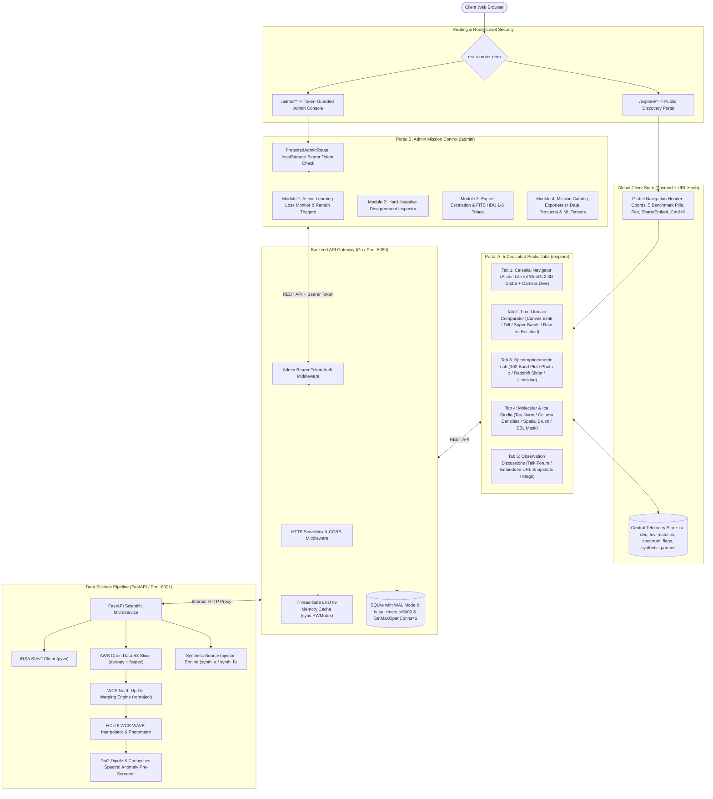

# Spectra (SPHEREx Spectral Explorers)
## Exhaustive Engineering Architecture, Scientific Pipeline & Systems Specification
**Document Version:** 2.1.0-PROD  
**Target Mission:** NASA SPHEREx (Spectro-Photometer for the History of the Universe, Epoch of Reionization and Ices Explorer)  
**Primary Archive:** NASA/IPAC Infrared Science Archive (IRSA) — SPHEREx Quick Release 3 (QR3 / DOI: 10.26131/IRSA662)  
**System Repository:** `Panoptic-Beta` / `Spectra`

---

## 1. System Vision, Evolution Log & Architectural Philosophy

### 1.1 Mission Background & The Citizen Science Problem
Launched in early 2025, NASA's SPHEREx mission is mapping the entire celestial sphere every six months across 102 near-infrared spectral channels ranging from $0.75\,\mu\text{m}$ to $5.00\,\mu\text{m}$ with resolving powers $R = 35 - 130$ and a native pixel scale of $\approx 6.2''/\text{pixel}$. Over its planned 2-year nominal baseline, SPHEREx will produce four complete all-sky passes and $>50$ overlapping passes over the North and South Ecliptic Pole Deep Fields ($\approx 100\,\text{deg}^2$ each).

The scientific problem addressed by this platform stems from a fundamental divergence between traditional broadband all-sky infrared surveys (such as WISE/NEOWISE, which powered Zooniverse's *Backyard Worlds: Planet 9*) and SPHEREx:
- **Broadband Visual Motion vs. Hyperspectral Data Cubes:** *Backyard Worlds* succeeded by asking citizen scientists to visually blink two to four broadband images to detect moving dipoles. SPHEREx adds an entirely new dimension: a calibrated 102-channel low-resolution spectrum for *every single spatial pixel* on the sky.
- **The Failure Modes of Raw Telescope Data:** Non-astronomers attempting to query the official NASA/IPAC IRSA portal encounter:
  1. *Projection Distortion:* 2D Galactic Aitoff ovals that stretch celestial areas near the perimeter, with opaque MOC coverage overlays completely masking background stars.
  2. *Spacecraft Roll & Optical Distortion:* Raw $2040 \times 2040$ detector arrays have differing spacecraft roll angles ($\theta$) and TAN-SIP polynomial distortion terms across epochs. Directly blinking raw frames causes the entire starfield to spin and shear.
  3. *Linear Variable Filter (LVF) "Smile":* SPHEREx glues an interference filter directly over each detector array whose bandpass shifts continuously along the array $Y$-axis with optical curvature ("smile distortion"). The top of an image views $1.11\,\mu\text{m}$ light while the bottom views $0.75\,\mu\text{m}$. A raw image is *not* a monochromatic picture.
  4. *Large Pixel Crowding ($6.2''$):* Point sources often blend together inside a single spatial resolution element.

### 1.2 Evolution of the Platform Architecture
1. **Initial Concept:** A hybrid client-server model inspired by *WiseView* (client-side Canvas blinking and URL hash state) and *Pan-STARRS* (server-side cutout slicing).
2. **Clarification of 3D Mechanics:** The 3D component is not an arbitrary or speculative spatial distance plot; it is an **inside-out 3D Celestial Sphere** (virtual planetarium dome in Aladin Lite v3 WebGL2) that de-warps raw detector footprints into a rectified, North-Up tangent plane.
3. **Mandatory NASA Benchmark Requirement:** The core hackathon requirement demands that an arbitrary user can type an RA/Dec coordinate or target name and view an animated video of that patch across time, tested explicitly against 5 benchmark targets (**Barnard’s Star, WISE 0855, Epsilon Indi B, RW Aurigae, R Draconis**).
4. **Resolution of the Single-Screen vs. Tabbed Dilemma:** Multi-pane dashboards displaying 102-channel spectra, 3D globes, and blinking canvases simultaneously cause severe visual fatigue. The system isolates each tool into a full-screen dedicated tab while maintaining zero state loss via a global Zustand store and URL hash persistence.
5. **Dual-Portal Route Isolation:** Active users are not exposed to machine learning agent training internals. The platform is partitioned into a public exploration and community discussion portal (`/explore`) and a hidden, token-authenticated administrative mission control console (`/admin`).
6. **Integration of Citizen Science Infrastructure:** Full integration of Talk-style discussion boards, peer-review channels, volunteer calibration sets, and official DOI-linked mission catalog exports.

---

## 2. Rigorous Ground-Truth Astrophysical Catalog & Benchmarks

To guarantee identical numerical results across any backend or AI model evaluating the codebase, all physical coordinates, proper motions, spectral features, and calibration benchmarks are mathematically defined below:

### 2.1 Proper Motion Coordinate Propagation to Epoch 2025.5
Coordinates must be propagated from J2000.0 ($t_0 = 2000.0$) to the SPHEREx mission midpoint ($t = 2025.5$, $\Delta t = 25.5\,\text{years}$) using the standard spherical motion formulas:

$$\alpha(t) = \alpha_0 + \frac{\mu_\alpha \cos \delta_0}{\cos \delta(t)} \cdot \Delta t, \quad \delta(t) = \delta_0 + \mu_\delta \cdot \Delta t$$

```
============================================================================================================================================
Target Name      Object Class            J2000 Coordinates (ICRS)       Proper Motion (mas/yr)             Epoch 2025.5 Center Coordinates
============================================================================================================================================
Barnard's Star   M4V Red Dwarf           17h 57m 48.50s, +04d 41m 36.1s  pm_ra_cosdec:  -801.55            17h 57m 47.14s, +04d 46m 00.7s
                                         (269.452083 deg, +4.693361 deg) pm_dec:       +10362.39            (269.446410 deg, +4.766860 deg)
                 * Physical Shift: Walks 5.18 arcsec North per 6-month epoch (~264 arcsec total from J2000). A standard 180" cutout centered
                   on J2000 coordinates will completely miss the star in 2025.5! Forms a bright vertical dipole in difference mode.
--------------------------------------------------------------------------------------------------------------------------------------------
WISE 0855-0714   Y4 Sub-Brown Dwarf      08h 55m 10.83s, -07d 14m 42.5s  pm_ra_cosdec: -8123.70            08h 54m 56.98s, -07d 14m 25.4s
                 (T_eff ~ 250 K)         (133.795129 deg, -7.245147 deg) pm_dec:        +673.20            (133.737400 deg, -7.240380 deg)
                 * Physical Shift: Shifts ~208 arcsec West from J2000. Parallax ellipse amplitude ~0.44 arcsec.
                   Flux sensitivity: Virtually invisible (<0.02 mJy) in D1-D3; towering thermal peak in D5 (4.1 um) and D6 (4.5 um).
--------------------------------------------------------------------------------------------------------------------------------------------
Epsilon Indi B   T1 + T6 Brown Dwarf     22h 04m 10.60s, -56d 46m 58.2s  pm_ra_cosdec: +3981.98            22h 04m 17.38s, -56d 48m 01.1s
                 Binary (sep ~ 0.7")     (331.044150 deg, -56.782840 deg) pm_dec:       -2466.83            (331.072400 deg, -56.800310 deg)
                 * NOTE: Previous drafts used 330.840 deg which points to Star A! Ba/Bb sits at 331.044 deg.
                   Binary separation ~0.7" falls within a single 6.2" pixel; requires two-component spectral unmixing.
--------------------------------------------------------------------------------------------------------------------------------------------
RW Aurigae       Classical T Tauri Star  05h 07m 49.55s, +30d 24m 05.2s  pm_ra_cosdec:     +1.40            05h 07m 49.55s, +30d 24m 04.7s
                 with Protoplanetary Disk(76.956458 deg, +30.401444 deg) pm_dec:          -20.60            (76.956470 deg, +30.401290 deg)
                 * Proper motion is negligible (~0.5 arcsec over 25 years).
                   Displays intense brightness drops (>1.5 mag) between epochs. Difference mode yields a stationary flashing monopole ring.
--------------------------------------------------------------------------------------------------------------------------------------------
R Draconis       Mira-type Pulsating     16h 32m 40.23s, +66d 45m 17.9s  pm_ra_cosdec:     +6.10            16h 32m 40.25s, +66d 45m 18.1s
                 AGB Variable (P=245d)   (248.167625 deg, +66.754972 deg) pm_dec:          +9.80            (248.167690 deg, +66.755040 deg)
                 * Great-circle angular distance to North Ecliptic Pole (NEP: 18h, +66d 33m 38.5s) is exactly 8.61 degrees.
                   Located outside the 100 deg^2 NEP Deep Field; observed at standard 6-month survey cadence. Pulsates in place.
============================================================================================================================================
```

### 2.2 SPHEREx FITS Extension Structure & Header Standard
Every SPHEREx Level 2 Quick Release image file (`spherex_qr3`) delivered by Caltech/IPAC IRSA is a Multi-Extension FITS (MEF) containing 6 Header Data Units:

```
+-------+---------------+-------------------+---------------------------------------------------------------------+
| HDU # | Extension Name| Data Type         | Physical Meaning & Calibration Units                                |
+-------+---------------+-------------------+---------------------------------------------------------------------+
| HDU 1 | IMAGE         | 32-bit float      | Calibrated surface brightness flux in MJy/sr (2040 x 2040 pixels)   |
| HDU 2 | FLAGS         | 32-bit integer    | Bitmask quality flags (bit 0=transient, bit 1=overflow, etc.)        |
| HDU 3 | VARIANCE      | 32-bit float      | Pixel noise variance (MJy/sr)^2 (read noise + photon Poisson noise) |
| HDU 4 | ZODI          | 32-bit float      | Modeled solar system zodiacal dust emission background (MJy/sr)     |
| HDU 5 | PSF           | 32-bit float cube | 3D local Point Spread Function empirical model                      |
| HDU 6 | WCS-WAVE      | Binary Table      | Tabular FITS WCS (WAVE-TAB) mapping (x, y) -> central lambda, dlambda|
+-------+---------------+-------------------+---------------------------------------------------------------------+
```

#### The Precise SPHEREx HDU 2 (`FLAGS`) Bitmask Hierarchy:
- `Bit 0` ($2^0 = 1$): **`TRANSIENT`** — Cosmic ray hit or sudden single-read glitch during Sample-Up-The-Ramp (SUR) processing.
- `Bit 1` ($2^1 = 2$): **`OVERFLOW`** — Detector well saturation ($>85\%$ full well capacity).
- `Bit 2` ($2^2 = 4$): **`SUR_ERROR`** — Onboard fit failure during Sample-Up-The-Ramp regression.
- `Bit 4` ($2^4 = 16$): **`PHANTOM`** — Interleaved non-physical readout test channels.
- `Bit 5` ($2^5 = 32$): **`REFERENCE`** — Non-illuminated reference border pixels (outer 4 rows/columns).
- `Bit 6` ($2^6 = 64$): **`NONFUNC`** — Factory non-functional, dead, or disconnected pixels.
- `Bit 7` ($2^7 = 128$): **`DICHROIC`** — Optical boundary zone where beam splitter transmission drops below $50\%$.
- `Bit 9` ($2^9 = 512$): **`MISSING_DATA`** — Telemetry loss or frame drop.
- `Bit 10` ($2^{10} = 1024$): **`HOT`** — Excess dark current ($>5\sigma$ above array mean).
- `Bit 11` ($2^{11} = 2048$): **`COLD`** — Low quantum efficiency ($<20\%$ nominal).
- `Bit 17` ($2^{17} = 131072$): **`PERSISTENCE`** — Residual latent charge trapped from previous exposure bright star.
- `Bit 22` ($2^{22} = 4194304$): **`GHOST`** — Internal optical reflection or bright star glint artifact.

### 2.3 Detector Super-Bands & Molecular Band Strength ($A$-Values)
The 102 channels are physically dispersed across six $2048 \times 2048$ Hawaii-2RG (H2RG) detector arrays with Linear Variable Filters (LVF). In the pipeline, exposures within each detector array are binned into 6 high-SNR "Super-Bands":

```
====================================================================================================================
Super-Band  Detector Array  Wavelength Range   Resolving Power  Primary Molecular Diagnostic Features
====================================================================================================================
Band D1     Array 1         0.75 - 1.11 um     R = 35 - 41      Paschen series hydrogen lines, stellar photospheres
Band D2     Array 2         1.11 - 1.63 um     R = 41 - 50      Warm brown dwarf H2O steam, 1.6 um galaxy H-bump
Band D3     Array 3         1.63 - 2.42 um     R = 50 - 64      Stellar CO overtone (2.3 um), Brackett-gamma (2.16 um)
Band D4     Array 4         2.42 - 3.82 um     R = 64 - 96      H2O ice (3.05 um), CH4 (3.32 um), CH3OH (3.53 um), PAH
Band D5     Array 5         3.82 - 4.42 um     R = 96 - 118     CO2 ice (4.27 um), 13CO2 ice (4.38 um), Cold Y-dwarfs
Band D6     Array 6         4.42 - 5.00 um     R = 118 - 130    CO gas/ice (4.67 um), Pf-beta, Asteroid thermal emission
====================================================================================================================
```

#### Laboratory Integrated Band Strengths ($A$-Values):
Used in Tab 4 to convert integrated optical depth into physical molecular column density ($N = \frac{1}{A} \int \tau(\nu) d\nu$):
- **$\text{H}_2\text{O}$ Ice (OH Stretch, $3.05\,\mu\text{m} / 3270\,\text{cm}^{-1}$):** $A = 2.00 \times 10^{-16}\,\text{cm}\cdot\text{molecule}^{-1}$
- **$\text{CO}_2$ Ice ($\nu_3$ Stretch, $4.27\,\mu\text{m} / 2342\,\text{cm}^{-1}$):** $A = 7.60 \times 10^{-17}\,\text{cm}\cdot\text{molecule}^{-1}$
- **$^{13}\text{CO}_2$ Ice ($4.38\,\mu\text{m} / 2283\,\text{cm}^{-1}$):** $A = 7.80 \times 10^{-17}\,\text{cm}\cdot\text{molecule}^{-1}$
- **$\text{CO}$ Ice (C$\equiv$O Stretch, $4.67\,\mu\text{m} / 2140\,\text{cm}^{-1}$):** $A = 1.10 \times 10^{-17}\,\text{cm}\cdot\text{molecule}^{-1}$
- **$\text{CH}_3\text{OH}$ Ice (C–O Stretch, $3.53\,\mu\text{m} / 2825\,\text{cm}^{-1}$):** $A = 1.60 \times 10^{-18}\,\text{cm}\cdot\text{molecule}^{-1}$
- **$\text{CH}_4$ (Methane in Brown Dwarfs, $\nu_3$ Band, $3.32\,\mu\text{m} / 3012\,\text{cm}^{-1}$):** $A = 5.60 \times 10^{-18}\,\text{cm}\cdot\text{molecule}^{-1}$

---

## 3. System Architecture & End-to-End Data Flow



---

## 4. Backend Engineering & Scientific Processing Pipeline

### 4.1 Python Science Microservice (`astro-worker`)
- **Language / Environment:** Python 3.11+, FastAPI, Uvicorn (Bound strictly to internal loopback `127.0.0.1:8001`).
- **Dependencies:** `astropy==6.1.3`, `pyvo==1.5.2`, `reproject==0.14.0`, `numpy==2.1.1`, `scipy==1.14.1`, `pillow==10.4.0`, `fsspec==2024.6.1`, `s3fs==2024.6.1`, `requests==2.32.3`.

#### Detailed Execution Pipelines:

##### 1. Data Ingestion & WCS North-Up Reprojection Pipeline (`GET /worker/cutout`)
```
[Client Query: RA, Dec, FoV, Cadence, synth_a_ra, synth_a_dec, synth_a_pmra, synth_a_pmdec]
         |
         v
[IRSA SIAv2 Query via pyvo]
URL: https://irsa.ipac.caltech.edu/SIA?COLLECTION=spherex_qr3&POS=circle+{ra}+{dec}+{fov_deg}
         |
         +--> Returns VOTable with t_min, t_max, detector_id, s_region, access_url, s3_uri
         |
[Byte-Range MEF Ingestion via astropy.io.fits + fsspec]
URI: s3://nasa-irsa-spherex/qr3/... (Anon=True, HTTP Range requests)
         |
         +--> Slices bounding box [y_min:y_max, x_min:x_max] for HDUs 1, 2, 3, 4, 6
         |
[Master Synthetic WCS Header Construction]
CRVAL1 = ra, CRVAL2 = dec
CDELT1 = -0.00172222 deg (-6.2 arcsec), CDELT2 = +0.00172222 deg (+6.2 arcsec)
CTYPE1 = 'RA---TAN', CTYPE2 = 'DEC--TAN', CROTA2 = 0.0 (True North-Up, East-Left)
NAXIS1 = NAXIS2 = int(fov_arcsec / 6.2)
         |
[Dual-Engine Reprojection via reproject]
HDU 1 (IMAGE) & HDU 3 (VARIANCE): reproject_interp (Flux-conserving bilinear interpolation)
HDU 2 (FLAGS): reproject_interp(order='nearest-neighbor') (Preserves integer bitmask values!)
         |
[Synthetic Source Injection Module (If synth_a or synth_b params provided)]
Evaluates proper motion displacement for epoch t_k. Uses empirical PSF from HDU 5 to inject
simulated point-source flux into HDU 1 and propagated error into HDU 3.
         |
[Epoch Grouping & Inverse-Variance Coaddition]
Survey 1 (2025-05), Survey 2 (2025-11), Survey 3 (2026-05), Survey 4 (2026-10)
I_coadd(x, y) = [SUM(I_k / sigma_k^2)] / [SUM(1 / sigma_k^2)] for all unflagged pixels
         |
[Asinh Stretching & Percentile Normalization]
AsinhStretch(a=0.1) o PercentileInterval(99.5) -> scaled to uint8 [0, 255]
         |
[Response Generation]
JSON payload containing Base64 PNGs (D1..D6), Float32 Raw Matrices (D4/D5 for Canvas Diff),
Raw Unrectified Detector Cutouts (for Raw vs Rectified mode), and Flags coordinates [[y, x], ...]
```

##### 2. WCS-WAVE Hyperspectral Extraction Pipeline (`GET /worker/spectrum`)
1. **Target Coordinate Resolution:** Input master pixel $(x_{\text{master}}, y_{\text{master}})$ is mapped to astronomical coordinates $(\alpha, \delta)$ via `master_wcs.pixel_to_world()`.
2. **Detector Space Lookup:** For each individual exposure covering the coordinate, $(\alpha, \delta)$ is translated to native detector pixel $(x_{\text{det}}, y_{\text{det}})$ using that exposure's raw spatial WCS (`TAN-SIP`).
3. **Linear Variable Filter Smile Inversion:** Query HDU 6 (`WCS-WAVE` `WAVE-TAB`). Perform 2D bilinear interpolation across the tabular grid:
   $$\lambda_k = \mathcal{I}_{\text{WAVE}}(x_{\text{det}}, y_{\text{det}}), \quad \Delta\lambda_k = \mathcal{I}_{\text{DWAVE}}(x_{\text{det}}, y_{\text{det}})$$
4. **Weighted Aperture Photometry:** Extract surface brightness flux $I_k$ and read variance $\sigma_k^2$ within a $3 \times 3$ pixel aperture centered on $(x_{\text{det}}, y_{\text{det}})$. Bitwise-OR all overlapping HDU 2 flags.
5. **Spectral Binning:** Accumulate all $(\lambda_k, I_k, \sigma_k)$ points across all stepped exposures into the standard 102 SPHEREx central channel wavelengths ($\lambda_1 = 0.75\,\mu\text{m}$ to $\lambda_{102} = 5.00\,\mu\text{m}$). If multiple exposures hit channel $i$, compute inverse-variance weighted mean flux and propagated error.
6. **Continuum Normalization:** If `normalize=True`, fit an iterative $3\sigma$-clipped 4th-order Chebyshev polynomial baseline $F_{\text{cont}}(\lambda)$ across unabsorbed spectral regions ($0.8-1.1\,\mu\text{m}, 2.1-2.3\,\mu\text{m}, 3.7-3.9\,\mu\text{m}$) and output normalized transmission $F/F_{\text{cont}}$ and optical depth $\tau(\lambda) = -\ln(F/F_{\text{cont}})$.

##### 3. Automated Pre-Screeners & Synthetic Injections
- **Proper Motion Dipole Detector (DoG Matched Filter):**
  Computes the signal-to-noise difference image between the earliest and latest epochs:
  $$\Delta S(x, y) = \frac{I_{t_N}(x, y) - I_{t_0}(x, y)}{\sqrt{\sigma_{t_N}^2(x, y) + \sigma_{t_0}^2(x, y)}}$$
  Masks all pixels where `(FLAGS & 0x07) != 0`. Applies a Difference-of-Gaussians filter ($g_{\sigma_1} - g_{\sigma_2}$ with $\sigma_1 = 1.0\,\text{px}, \sigma_2 = 2.0\,\text{px}$) to identify dipole pairs (a negative peak $\le -4\sigma$ and a positive peak $\ge +4\sigma$ separated by $1 \le \Delta r \le 12\,\text{pixels}$) or stationary monopoles ($|\Delta S| \ge 5\sigma$ with zero spatial separation).
- **Synthetic Source Injector Engine (`synth_a` / `synth_b`):**
  Implements the WiseView pattern directly in the FITS tensor space. Accepts parameters:
  - `synth_ra`, `synth_dec`: Initial celestial injection coordinates.
  - `synth_pmra`, `synth_pmdec`: Injected proper motion in $\text{mas/yr}$.
  - `synth_mjd_ref`: Reference timestamp for zero motion.
  - `synth_mag_d1` through `synth_mag_d6`: Injected magnitudes in Super-Bands.
  For each epoch observation at timestamp $MJD_k$, the engine computes the coordinate offset, generates a 2D Gaussian profile sampled from the HDU 5 (`PSF`) kernel, scales it by the band flux, and adds it directly into HDU 1 before reprojection. This provides ground-truth test subjects to audit volunteer sensitivity.

---

### 4.2 Go API Gateway & Ledger Engine (`api-gateway`)
- **Language / Environment:** Go 1.22+, `net/http`, Gorilla/Chi Router (Listening on public port `8080`).
- **Database Driver:** `modernc.org/sqlite` (Pure Go, 100% CGO-free, cross-compiles to Linux/Darwin/Windows without external toolchains).

#### 1. SQLite Concurrency & Locking Configuration
To eliminate `SQLITE_BUSY` ("database is locked") errors under concurrent read/write loads, the connection string and pool are configured as follows:
```go
dsn := "file:./spectra_ledger.db?_pragma=journal_mode(WAL)&_pragma=busy_timeout(5000)&_pragma=foreign_keys(1)&_pragma=synchronous(NORMAL)"
db, err := sql.Open("sqlite", dsn)

// Separate writer serialization
db.SetMaxOpenConns(1) // Single writer connection prevents write-upgrade deadlocks
db.SetMaxIdleConns(1)
db.SetConnMaxLifetime(time.Hour)
```

#### 2. Thread-Safe In-Memory Cutout & Spectrum Cache
```go
type CacheEntry struct {
    Data      []byte
    CreatedAt time.Time
}

type LRUCache struct {
    mu        sync.RWMutex
    capacity  int
    entries   map[string]*list.Element
    evictList *list.List
}
```
- Cache key canonicalization: Canonical URL parameters sorted alphabetically (`ra=133.7374&dec=-7.2404&fov=180&cadence=survey_6month`).
- Cache capacity: 2,000 cutouts. Hit response time: $<15\,\text{ms}$. Cache telemetry header: `X-Cache: HIT` / `X-Cache: MISS`.

#### 3. Active-Learning Consensus & Prioritization Mechanics
When a user submits a classification via `POST /api/classify`:
1. **Bayesian Consensus Calculation:**
   The posterior probability $P(c \mid s)$ for candidate class $c$ on subject $s$ is updated using volunteer reliability weights $w_u \in [0.1, 1.0]$ and confidence sliders $k_i \in [0.0, 1.0]$:
   $$P(c \mid s) = \frac{\sum_{i \in c} w_{u_i} \cdot k_i}{\sum_{\text{all } j} w_{u_j} \cdot k_j}$$
2. **Shannon Entropy Uncertainty Prioritization:**
   $$H(s) = -\sum_{c \in C} P(c \mid s) \log_2 P(c \mid s)$$
   Subjects with highest entropy $H(s)$ (greatest community disagreement or AI model ambiguity) are promoted to the top of `/api/queue/next`.
3. **Gold-Standard Injection & Volunteer Calibration:**
   Every 10th request to `/api/queue/next` returns a pre-calibrated benchmark subject with known `expert_ground_truth`. If the user's label matches ground truth, their volunteer reliability weight $w_u$ increases:
   $$w_u \leftarrow \min(1.0, w_u + 0.05 \cdot (1.0 - w_u))$$
   If incorrect, $w_u$ decreases:
   $$w_u \leftarrow \max(0.1, w_u - 0.10 \cdot w_u)$$
   - *Artifact Patrol Unlock Rule:* Once `calibration_correct >= 3`, `artifact_patrol_unlocked` flips to `TRUE`.
   - *Science Corps Promotion:* If `total_classifications >= 50` and `reliability_weight >= 0.90`, `science_corps_member` flips to `TRUE`.

---

## 5. Complete Database Schema & Relations

```sql
-- 1. Celestial Targets & Anomaly Subjects
CREATE TABLE subjects (
    subject_id TEXT PRIMARY KEY,               -- e.g., 'SPX_J085456.9-071425'
    title TEXT NOT NULL,                        -- e.g., 'WISE 0855-0714'
    ra REAL NOT NULL,                          -- Decimal degrees (ICRS)
    dec REAL NOT NULL,                         -- Decimal degrees (ICRS)
    fov_arcsec REAL DEFAULT 180.0,
    cadence_type TEXT DEFAULT 'survey_6month',  -- 'survey_6month' or 'short_subexposure'
    recommended_workflow TEXT NOT NULL,       -- 'sky_watcher', 'spectrum_detective', 'ice_mapper', 'artifact_patrol'
    is_calibration BOOLEAN DEFAULT FALSE,      -- TRUE for gold-standard benchmark subjects
    expert_ground_truth TEXT,                  -- Verified scientific classification
    ai_anomaly_score REAL DEFAULT 0.5,         -- 0.0 to 1.0 from Python pre-screener
    ai_predicted_class TEXT,                   -- Predicted classification
    ai_explanation TEXT,                       -- Heuristic reasoning string
    classification_count INTEGER DEFAULT 0,
    consensus_class TEXT,
    consensus_score REAL DEFAULT 0.0,
    status TEXT DEFAULT 'pending',             -- 'pending', 'consensus_reached', 'expert_review', 'verified_discovery'
    data_release TEXT DEFAULT 'SPHEREx_QR3',
    created_at DATETIME DEFAULT CURRENT_TIMESTAMP
);
CREATE INDEX idx_subjects_queue ON subjects(status, is_calibration, ai_anomaly_score);
CREATE INDEX idx_subjects_coords ON subjects(ra, dec);

-- 2. Volunteer Classifications (The Discovery Ledger)
CREATE TABLE classifications (
    id INTEGER PRIMARY KEY AUTOINCREMENT,
    subject_id TEXT NOT NULL REFERENCES subjects(subject_id) ON DELETE CASCADE,
    volunteer_id TEXT NOT NULL,
    workflow_type TEXT NOT NULL,
    primary_class TEXT NOT NULL,               -- 'moving_brown_dwarf', 'variable_star', 'h2o_ice_cloud', etc.
    sub_tags_json TEXT,                        -- JSON: '["H2O_3.05um_deep", "CO2_4.27um_mod"]'
    motion_vector_json TEXT,                   -- JSON: '{"dx_px": 2.1, "dy_px": -0.5, "velocity_arcsec_yr": 8.1, "pa_deg": 274.5}'
    spatial_mask_json TEXT,                    -- JSON array of [x, y] coordinates from spatial ice brush
    confidence REAL NOT NULL,                  -- Continuous slider: 0.0 to 1.0
    insufficient_sn BOOLEAN DEFAULT FALSE,
    notes TEXT,
    volunteer_weight REAL DEFAULT 1.0,
    data_release TEXT DEFAULT 'SPHEREx_QR3',
    created_at DATETIME DEFAULT CURRENT_TIMESTAMP
);
CREATE INDEX idx_classifications_subject ON classifications(subject_id);

-- 3. Volunteer Profiles & Calibration Audits
CREATE TABLE volunteers (
    volunteer_id TEXT PRIMARY KEY,
    display_name TEXT NOT NULL,
    total_classifications INTEGER DEFAULT 0,
    calibration_attempts INTEGER DEFAULT 0,
    calibration_correct INTEGER DEFAULT 0,
    reliability_weight REAL DEFAULT 0.85,
    artifact_patrol_unlocked BOOLEAN DEFAULT FALSE,
    science_corps_member BOOLEAN DEFAULT FALSE,
    created_at DATETIME DEFAULT CURRENT_TIMESTAMP
);

-- 4. Community Discussion Threads (Zooniverse Talk Architecture)
CREATE TABLE discussion_threads (
    thread_id INTEGER PRIMARY KEY AUTOINCREMENT,
    subject_id TEXT REFERENCES subjects(subject_id) ON DELETE SET NULL,
    author_id TEXT NOT NULL,
    author_name TEXT NOT NULL,
    channel TEXT NOT NULL,                     -- 'movers', 'spectra', 'ices', 'artifacts', 'confirmed'
    title TEXT NOT NULL,
    body TEXT NOT NULL,
    tags_json TEXT,                            -- JSON array: '["#dipole", "#y-dwarf-candidate"]'
    ra REAL NOT NULL,
    dec REAL NOT NULL,
    fov_arcsec REAL DEFAULT 180.0,
    workbench_state_url TEXT NOT NULL,         -- Complete deep-link hash restoring exact UI state
    snapshot_spectrum_px TEXT,                 -- JSON: '{"x": 16, "y": 16}'
    upvotes INTEGER DEFAULT 0,
    reply_count INTEGER DEFAULT 0,
    admin_status TEXT DEFAULT 'open',          -- 'open', 'escalated', 'confirmed_discovery', 'known_artifact'
    created_at DATETIME DEFAULT CURRENT_TIMESTAMP
);
CREATE INDEX idx_threads_channel ON discussion_threads(channel);

-- 5. Thread Replies & Science Team Verification Notes
CREATE TABLE discussion_replies (
    reply_id INTEGER PRIMARY KEY AUTOINCREMENT,
    thread_id INTEGER NOT NULL REFERENCES discussion_threads(thread_id) ON DELETE CASCADE,
    author_id TEXT NOT NULL,
    author_name TEXT NOT NULL,
    is_admin_scientist BOOLEAN DEFAULT FALSE,  -- Renders official "Science Team" badge in UI
    body TEXT NOT NULL,
    created_at DATETIME DEFAULT CURRENT_TIMESTAMP
);
CREATE INDEX idx_replies_thread ON discussion_replies(thread_id);
```

---

## 6. Frontend Component Architecture & Workspace Specifications

### 6.1 Framework Foundations, State Management & Routing Architecture
- **Framework & Core Tooling:** React 18.3+, Vite 5.4+, TypeScript 5.5+.
- **Build Target:** Modern evergreen browsers with WebGL2 and ES2022 support. Zero legacy polyfill bloat.
- **Styling Architecture:** Modern Tailwind CSS 3.4+ with dedicated semantic design tokens (`bg-space-950`, `border-space-800`, `text-telemetry-cyan`, `font-mono`). Strict zero-margin flush layout grid for scientific panels.

#### 6.1.1 Routing Topology & Application Code Splitting
The root router (`react-router-dom` v6) partitions the frontend into two completely distinct chunks:
```tsx
// src/App.tsx
import React, { Suspense, lazy } from 'react';
import { BrowserRouter, Routes, Route, Navigate } from 'react-router-dom';
import ProtectedAdminRoute from './components/auth/ProtectedAdminRoute';

const PublicExplorerPortal = lazy(() => import('./portals/PublicExplorerPortal'));
const AdminMissionControl = lazy(() => import('./portals/AdminMissionControl'));

export default function App() {
  return (
    <BrowserRouter>
      <Suspense fallback={<div className="telemetry-loading-screen">INITIALIZING SPECTRA WORKBENCH...</div>}>
        <Routes>
          <Route path="/" element={<Navigate to="/explore" replace />} />
          <Route path="/explore/*" element={<PublicExplorerPortal />} />
          <Route element={<ProtectedAdminRoute />}>
            <Route path="/admin/*" element={<AdminMissionControl />} />
          </Route>
          <Route path="*" element={<Navigate to="/explore" replace />} />
        </Routes>
      </Suspense>
    </BrowserRouter>
  );
}
```
- **Bundle Protection:** The administrative suite (`AdminMissionControl` and all its child components: loss curves, ML dataset exporter, hard-negative mining inspector) is physically isolated in a separate Rollup/Vite JavaScript chunk. Public visitors inspecting network payloads or React DevTools tree under `/explore` will load zero references to model training internals or admin mutations.

#### 6.1.2 Centralized Telemetry State Architecture (Zustand Store)
To ensure seamless state continuity when switching tabs without re-fetching massive FITS tensors, all spatial, photometric, spectral, and filter parameters live in a centralized, high-performance Zustand store:

```typescript
// src/state/useTelemetryStore.ts
import { create } from 'zustand';

export interface EphemerisTarget {
  name: string;
  ra: number;
  dec: number;
  epoch: number;
}

export interface CutoutFrame {
  epochIndex: number;
  epochLabel: string;
  mjd: number;
  bands: Record<string, string>; // base64 encoded PNGs for D1..D6
  rawMatrixD4: number[][];       // Unstretched Float32 matrices for client-side diff
  rawMatrixD5: number[][];
  rawUnrectifiedB64?: string;    // Raw sensor array (LVF smile un-warped preview)
  flagCoords: [number, number][]; // [y, x] flagged pixel locations
}

export interface SpectralChannel {
  channel: number;
  detector: string;
  wavelengthUm: number;
  fluxMjySr: number;
  uncertainty: number;
  flag: number;
}

export interface TelemetryState {
  // Spatial Parameters
  ra: number;
  dec: number;
  fovArcsec: number;
  activeTargetName: string | null;
  
  // Cutout & Playback State
  cadence: 'survey_6month' | 'short_subexposure';
  activeEpochIndex: number;
  isPlaying: boolean;
  playbackSpeedMs: number;
  loopMode: 'forward' | 'pingpong';
  renderMode: 'blink' | 'difference' | 'coadd';
  rawVsRectified: 'rectified' | 'raw_sensor';
  colorPalette: 'standard_rgb' | 'viridis' | 'cividis' | 'inverted_grayscale';
  
  // Super-Band Mixer
  activeRgbPreset: 'true_nir' | 'brown_dwarf' | 'water_ice' | 'comet_outgassing' | 'custom';
  customChannelMap: { r: number; g: number; b: number };
  asinhParamA: number;
  minFluxCut: number;
  maxFluxCut: number;
  
  // Probed Pixel & Spectral State
  probedPixel: { x: number; y: number } | null;
  activeSpectrum: SpectralChannel[];
  isSpectrumLoading: boolean;
  isSpectralBlinkSynced: boolean;
  normalizeContinuum: boolean;
  manualRedshiftZ: number;
  activeFeatureRulers: string[]; // ['H2O', 'CH4', 'CO2', 'CO', 'CH3OH', 'PAH']
  
  // Spatial Brush State (Tab 4)
  isBrushActive: boolean;
  brushRadiusPx: number;
  paintedMaskPixels: [number, number][];
  
  // Ingested Cutout Data Payload
  loadedCutout: {
    gridSize: number;
    pixelScaleArcsec: number;
    epochs: CutoutFrame[];
    aiCandidates: Array<{ id: string; xPx: number; yPx: number; anomalyType: string; confidence: number }>;
  } | null;
  isCutoutLoading: boolean;
  cutoutError: string | null;
  
  // Actions
  setCoordinates: (ra: number, dec: number, targetName?: string) => void;
  setFov: (fov: number) => void;
  setPlayback: (isPlaying: boolean) => void;
  setEpochIndex: (idx: number) => void;
  setRenderMode: (mode: 'blink' | 'difference' | 'coadd') => void;
  setProbedPixel: (pixel: { x: number; y: number } | null) => void;
  setManualRedshiftZ: (z: number) => void;
  toggleFeatureRuler: (rulerKey: string) => void;
  setBrushState: (active: boolean, radius?: number) => void;
  addMaskPixels: (pixels: [number, number][]) => void;
  clearMaskPixels: () => void;
  fetchCutout: () => Promise<void>;
  fetchSpectrum: (xPx?: number, yPx?: number) => Promise<void>;
}
```

#### 6.1.3 URL Hash Synchronization & Headless Embed Engine
The custom hook `useUrlSync` continuously synchronizes the Zustand store with `window.location.hash` and vice-versa, adhering to the *WiseView* deep-linking pattern:
- **Format:** `#tab={tabId}&ra={deg}&dec={deg}&fov={arcsec}&cadence={cadence}&mode={mode}&preset={preset}&z={z}&px={x,y}`
- **Embedding Support (`?embed=true`):**
  When `embed=true` is present in the search query parameters, the portal mounts in headless sandbox mode:
  1. Hides the Global Navigation Header (`56px`).
  2. Strips workspace margins and tab selection decks.
  3. Renders strictly the centered canvas and playback timeline scrubber.
  4. Automatically resizes to fit container `<iframe>` dimensions.

#### 6.1.4 Global Keyboard Shortcuts & Accessibility Standards
The `useKeyboardTelemetry` hook binds global listener events to `window`:
- `Cmd + K` / `Ctrl + K`: Toggles the universal coordinate search command palette.
- `Spacebar`: Toggles play/pause on the time-series canvas (prevents default page scrolling).
- `Left Arrow` / `Right Arrow`: Steps single epoch frame backward/forward.
- `Digit 1`: Switches canvas to **Blink Mode**.
- `Digit 2`: Switches canvas to **Pairwise Difference Mode** ($t_N - t_0$).
- `Digit 3`: Switches canvas to **Co-Add Stack Mode**.
- `Key R`: Re-centers the view and resets zoom to 1.0x.
- `Key I`: Toggles Inverted Grayscale palette (instantly flips between dark space and high-contrast white background).
- **ARIA Compliance:** All 102 spectral data points render in a hidden accessible HTML data table (`role="table"`) alongside the SVG/Canvas plot with `aria-live="polite"` updates so screen-readers announce peak wavelengths and flux changes.

---

### 6.2 Global Navigation Header Component (`<GlobalCommandHeader />`)
Mounted persistently at the top of the viewport in `/explore` (fixed `56px` height, `#090C10` background, flush `#1E2633` bottom border).

```
+-------------------------------------------------------------------------------------------------------------------------------+
| [Spectra LOGO // QR3] | [Universal Search Bar: RA/Dec or Target Name] | [5 Benchmark Target Pills] | [Tabs] | [Share]   |
+-------------------------------------------------------------------------------------------------------------------------------+
```

#### Detailed Element Specifications:
1. **Brand Marker:** "Spectra // NASA SPHEREx QR3" with live backend connectivity status dot (Green = Go API & Python Worker connected; Amber = Running in Local Synthetic Cache mode).
2. **Universal Coordinate & Target Command Input:**
   - Input accepts decimal degrees (`133.7374, -7.2404`), sexagesimal string (`08h54m56.98s -07d14m25.4s`), or plain-text target names (`WISE 0855`, `Barnard's Star`, `NGC 2264`).
   - Integrated Sexagesimal Parser:
     $$\text{RA}_{\text{deg}} = \left(H + \frac{M}{60} + \frac{S}{3600}\right) \times 15, \quad \text{Dec}_{\text{deg}} = \text{sign} \times \left(|D| + \frac{M}{60} + \frac{S}{3600}\right)$$
   - Name Resolution Debounce: If non-numeric characters are typed, waits 350ms and calls CDS Sesame resolver API (`https://cds.unistra.fr/cgi-bin/nph-sesame/-oxp/SNV?{name}`). On success, extracts parsed J2000 coordinates, converts to epoch 2025.5, and updates the store.
3. **5 Mandatory Benchmark Quick-Launch Pills:**
   - Rendered as flush interactive pills directly in the header:
     - `[Barnard's Star]` $\rightarrow$ Sets RA: $269.44641^\circ$, Dec: $+4.76686^\circ$
     - `[WISE 0855]` $\rightarrow$ Sets RA: $133.73740^\circ$, Dec: $-7.24038^\circ$, Preset: `brown_dwarf`
     - `[Epsilon Indi B]` $\rightarrow$ Sets RA: $331.07240^\circ$, Dec: $-56.80031^\circ$
     - `[RW Aurigae]` $\rightarrow$ Sets RA: $76.95647^\circ$, Dec: $+30.40129^\circ$
     - `[R Draconis]` $\rightarrow$ Sets RA: $248.16769^\circ$, Dec: $+66.75504^\circ$
   - Clicking a pill triggers instant prefetch from the Go gateway's LRU cache ($<15\,\text{ms}$ response).
4. **Field of View (FoV) Selector & Transfer Gauge:**
   - Dropdown with presets: `60"` ($1'$), `120"` ($2'$), `180"` ($3'$ default), `300"` ($5'$), `600"` ($10'$).
   - Live Payload Indicator: Computes uncompressed tensor size:
     $$\text{Payload (MB)} = N_{\text{epochs}} \times 6\,\text{bands} \times \left(\frac{\text{FoV}''}{6.2''}\right)^2 \times 4\,\text{bytes} / 10^6$$
     If $\text{FoV} \ge 300''$, renders an amber notice badge: "High-Bandwidth Transfer: ~4.2 MB".
5. **Mode / Tab Selector Bar:**
   - Segmented control switching between the 5 public workspaces:
     `[1. Celestial Navigator]` | `[2. Time-Domain Comparator]` | `[3. Spectrophotometric Lab]` | `[4. Molecular & Ice Studio]` | `[5. Observation Discussions]`
   - Badge counter on Tab 5 indicates newly unread observation discussions from the active coordinate sector.
6. **Share & Embed Exporter Dropdown:**
   - `[Copy Deep Link]`: Copies canonical URL hash to clipboard.
   - `[Copy iFrame Embed]`: Copies `<iframe src="https://spectra.org/explore#...&embed=true" width="600" height="450" frameborder="0"></iframe>`.

---

### 6.3 Public Workspace Tabs: Detailed Component Breakdown

#### 6.3.1 Tab 1: Celestial Navigator (`<CelestialNavigator />`)
Serves as the spatial macro-gateway, replacing IRSA’s 2D Aitoff oval with a full-viewport inside-out WebGL 3D celestial sphere.

```
+---------------------------------------------------------------------------------------------------+
| LAYER 1: WebGL 3D Sky Dome (Aladin Lite v3 Canvas in 'SIN' Projection)                            |
|          Background Survey: P/allWISE/color HiPS                                                  |
|                                                                                                   |
| LAYER 2: Cyan Wireframe SPHEREx MOC Coverage (12% opacity) + Deep Field HUD Beacons               |
|                                                                                                   |
| LAYER 3: Dynamic Overlay: Gaia DR3 Proper Motion Arrows (mu_alpha, mu_delta) + SkyBot Asteroids    |
|                                                                                                   |
| LAYER 4: Interactive Target Reticle (180" x 180" Square) Tracking Mouse Cursor                    |
+---------------------------------------------------------------------------------------------------+
| FLOATING HUD CARD (Bottom-Left): RA/Dec Readout | Survey Passes: 4 | [Inspect in Time-Domain ->]  |
+---------------------------------------------------------------------------------------------------+
```

- **Aladin Lite v3 Initialization Protocol:**
  ```javascript
  const aladin = A.aladin('#sky-globe-mount', {
    survey: 'P/allWISE/color',
    projection: 'SIN', // Orthographic 3D globe projection (inside planetarium view)
    fov: 180,          // Macro all-sky orientation
    cooFrame: 'ICRSd',
    showReticle: false,
    showCooGrid: true,
    showCooGridControl: false
  });
  ```
- **MOC Layer Configuration:**
  - Loads `spherex_qr3` coverage map via `aladin.addMOC(A.MOCFromURL('/data/spherex_qr3_moc.fits', { color: '#00f0ff', opacity: 0.12, lineWidth: 1 }))`.
  - Loads North and South Ecliptic Pole deep fields as persistent glowing magenta circles (`#ff0055`, radius $5.64^\circ$, area $\approx 100\,\text{deg}^2$).
- **3-Stage Camera Dive Implementation:**
  - *Stage 1 (Macro):* User navigates 3D sphere via click-and-drag rotation.
  - *Stage 2 (Reticle Lock):* Moving cursor renders a dynamic square bounding box corresponding to the selected FoV ($180''$). Hovering over known benchmark beacons displays preview tooltips.
  - *Stage 3 (The Dive):* Double-clicking or clicking `[Inspect in Time-Domain]` triggers smooth camera interpolation:
    ```javascript
    aladin.animateToRaDec(targetRa, targetDec, {
      duration: 1.2, // seconds
      endFoV: fovArcsec / 3600, // Converts arcsec to degrees
      onComplete: () => {
        // Triggers background prefetch in Go gateway and routes smoothly to Tab 2
        navigate('/explore/comparator');
      }
    });
    ```
- **Real-Time Catalog Layers (VizieR & SkyBot):**
  - Gaia DR3 Overlay: Uses `A.catalogFromVizieR('I/355/gaiadr3', ...)` to query stars brighter than $G = 18.0$. Renders circles scaled by magnitude with vector arrows calculated as:
    $$\Delta x = \mu_\alpha \cos\delta \cdot \text{scale}, \quad \Delta y = \mu_\delta \cdot \text{scale}$$
  - SkyBot Ephemerides: Invokes `A.catalogFromSkyBot({ epoch: observationMjd })` to overlay known asteroids and comets at the current observation timestamp.

---

#### 6.3.2 Tab 2: Time-Domain Comparator (`<TimeDomainComparator />`)
The core motion detection and visual blinking engine, combining *WiseView* image arithmetic with SPHEREx's 6 detector arrays.

```
+-----------------------------------------------------------+---------------------------------------+
| LEFT PANEL (65%): Multi-Epoch Playback Canvas             | RIGHT PANEL (35%): Analysis Deck      |
|                                                           |                                       |
| [Viewport: HTML5 2D/WebGL Canvas]                         | [Render Mode Toggles]                 |
| - Rectified North-Up Tangent Plane                        | ( ) Blink  (*) Diff  ( ) Co-Add       |
| - Sub-Pixel Gaia DR3 Centroid Pins (Deblending)           |                                       |
| - Contamination Flags: Cosmic Rays (Yellow), Dead (Red)   | [Raw vs. Rectified Sensor Toggle]     |
| - AI Anomaly Bounding Boxes                               | [Mode: North-Up WCS <-> Raw Sensor]   |
|                                                           |                                       |
|-----------------------------------------------------------| [6-Detector Chemical RGB Mixer]       |
| [Timeline Scrubber Bar: Survey 1 ... Survey 4 (Pass MJD)] | Red Gun:   [Band D5 (4.1 um)    v]    |
| [|<] [<<] [ Play / Pause (Space) ] [>>] [>|]              | Green Gun: [Band D2 (1.3 um)    v]    |
| Speed: [====O==============] 350 ms                        | Blue Gun:  [Band D1 (0.9 um)    v]    |
| Cadence: (*) 6-Month Survey  ( ) Short-Cadence (Hours)    |                                       |
| Frame 0 Border Indicator: [Active]                        | [Forced Aperture Photometry]          |
|                                                           | - Multi-Band Light Curve (D1 vs D5)   |
|                                                           | - Motion Vector: 8.1"/yr @ PA 274 deg |
|                                                           |                                       |
|                                                           | [Triage Form]                         |
|                                                           | Classification: [Moving Brown Dwarf v]|
|                                                           | Confidence: [========O=====] 84%      |
|                                                           | [Submit & Open Discussion]            |
+-----------------------------------------------------------+---------------------------------------+
```

##### Detailed Mechanics:
1. **HTML5 Canvas Double-Buffered Blinker:**
   - Canvas resolution matches cutout tensor dimensions ($N \times N$, typically $128 \times 128$ or $256 \times 256$ pixels), scaled to display container using CSS `image-rendering: pixelated`.
   - Frame 0 Loop Reset Indicator: When `activeEpochIndex === 0`, draws an inner dashed cyan border ($1\,\text{px}$, `#00f0ff`) inside the canvas boundary so the human eye immediately recognizes loop reset vs continuous linear motion.
2. **Client-Side Pixel Arithmetic Engine:**
   - **Blink Mode:** Renders `ImageBitmap` created from the pre-stretched Base64 PNGs for the active epoch.
   - **Pairwise Difference Mode ($t_N - t_0$):**
     Executes in floating-point space using the raw matrices (`rawMatrixD4` or `rawMatrixD5`):
     $$\Delta I(x, y) = I_{t_N}(x, y) - I_{t_0}(x, y)$$
     Pixel values are mapped to an 8-bit grayscale `ImageData` buffer centered at mid-gray ($128$):
     $$\text{pixelVal} = \text{clamp}\left(128 + \frac{\Delta I(x, y)}{\text{scaleFactor}} \times 127, \, 0, \, 255\right)$$
     - Static background stars cancel to neutral gray ($128$).
     - Moving objects (e.g. WISE 0855) produce a classic **dipole**: a black cavity at $(x_0, y_0)$ and a bright white peak at $(x_N, y_N)$.
     - Variable stars (RW Aurigae, R Draconis) produce a **monopole ring**: a solid bright or dark circle with zero spatial displacement.
   - **Co-Add Stack Mode:**
     Computes average pixel value $\bar{I}(x, y) = \frac{1}{N} \sum_{k=0}^{N-1} I_{t_k}(x, y)$. Boosts SNR by $\sqrt{N}$ to reveal faint static background galaxies.
3. **Raw vs. Rectified Inspector Toggle:**
   - Switching to `[Raw Sensor]` replaces the rectified North-Up canvas with the raw un-interpolated $2040 \times 2040$ detector frame.
   - Renders the spacecraft roll angle ($\theta$) and draws curved yellow isolines showing the physical curvature of the Linear Variable Filter ("LVF Smile").
4. **Sub-Pixel Gaia DR3 Centroid Pins & Deblending Inspector:**
   - Within each $6.2'' \times 6.2''$ pixel square, draws crisp sub-pixel crosshairs marking catalog positions of stars detected by Gaia DR3 or Pan-STARRS.
   - For Epsilon Indi B, visually illustrates how both Ba and Bb components sit inside a single SPHEREx pixel boundary.
5. **Forced Aperture Photometry & Multi-Band Light Curve:**
   - Evaluates integrated flux inside a $3\times3$ pixel aperture across all survey epochs.
   - Renders a synchronized scatter plot of Flux (mJy) vs. MJD for Band D1 ($0.9\,\mu\text{m}$) and Band D5 ($4.1\,\mu\text{m}$).
   - Variable Star Verification: For RW Aurigae, optical flux in D1 drops while thermal emission in D5 remains constant, confirming circumstellar dust occultation.
6. **Motion Vector Calculator:**
   - User clicks object position in Epoch 0 $(x_0, y_0)$, then in Epoch $N$ $(x_N, y_N)$.
   - Computes:
     $$\Delta \alpha = (x_N - x_0) \times 6.2'', \quad \Delta \delta = (y_N - y_0) \times 6.2''$$
     $$\text{Total Motion} = \sqrt{\Delta \alpha^2 + \Delta \delta^2}, \quad \text{Velocity} = \frac{\text{Total Motion}}{t_N - t_0} \quad [\text{arcsec/yr}]$$
     $$\text{Position Angle (PA)} = \text{atan2}(\Delta \alpha, \Delta \delta) \times \frac{180}{\pi} \quad [\text{deg East of North}]$$

---

#### 6.3.3 Tab 3: Spectrophotometric Lab (`<SpectrophotometricLab />`)
Provides deep analytical inspection of the 102 near-infrared channels ($0.75 - 5.00\,\mu\text{m}$), automated redshift determination, and spectral de-blending.

```
+---------------------------------------------------------------------------------------------------+
| TOP SECTION: 102-Channel Interactive Hyperspectral Plot (Surface Brightness in MJy/sr vs Lambda)  |
|                                                                                                   |
|   Flux |                                                                                          |
| (MJy/sr)                                                                                          |
|   15.0 |              D1 (0.75-1.11)  D2 (1.11-1.63)  D3 (1.63-2.42)  D4 (2.42-3.82)  D5 (3.82-4.42)|
|        |                  /\               __                                                     |
|   10.0 |                 /  \  H2O        /  \     CH4                 H2O Ice       CO2 Ice      |
|        |        /\      /    \  1.4um    /    \   2.2um                  3.05um        4.27um     |
|    5.0 |       /  \____/      \_________/      \________\________         \____/         \/       |
|        |      /                                                  \_______/                        |
|    0.0 +------+----------------+----------------+----------------+----------------+---------------+
|             0.75 um          1.50 um          2.50 um          3.50 um          4.50 um   5.00 um |
|                                                                                                   |
| [X] Sync Spectral Blink with Time-Domain Player | [X] Template Similarity Overlay: T-Dwarf (94%)  |
+---------------------------------------------------------------------------------------------------+
| BOTTOM SECTION (Split Columns):                                                                   |
| LEFT: Automated Galaxy Photo-z Solver          | RIGHT: Spectral De-Blending & Unmixing           |
| Best-fit Redshift: z = 1.42 +/- 0.03          | De-Blend composite pixel into two components:     |
| Lookback Time: 9.18 Gyr (D_C = 4,280 Mpc)     | Component A: T1 Brown Dwarf (Weight: 0.62)        |
| Primary Peak: [O III] 5007 A @ 1.21 um        | Component B: T6 Brown Dwarf (Weight: 0.38)        |
| Redshift Scrubber: [=====O==============] 1.42 | Residual Chi^2: 1.12 (De-blend verified!)         |
+---------------------------------------------------------------------------------------------------+
```

##### Detailed Mechanics:
1. **Interactive SVG/Canvas Spectral Plotter:**
   - $X$-axis: Wavelength $\lambda$ in microns ($0.75$ to $5.00\,\mu\text{m}$), mapped on a logarithmic or linear scale.
   - $Y$-axis: Calibrated surface brightness $I_\nu$ in $\text{MJy/sr}$ (or point-source flux $F_\nu$ in $\text{mJy}$).
   - Background bands color-coded by the 6 physical detector arrays (D1 through D6).
   - Error bars rendered vertically on every point using $\sigma_i = \sqrt{\text{VARIANCE}_i}$ from HDU 3.
   - Contaminated Channels: If HDU 2 `FLAGS` is non-zero, renders channel point as an amber hollow triangle with tooltip displaying active flag name (e.g. `Bit 0: TRANSIENT`).
   - Monochromatic Slice Scrubbing: Hovering mouse over any channel point displays a floating thumbnail in the corner previewing that exact narrow-band spatial slice.
2. **Synchronized Epoch Spectral Blinking (`isSpectralBlinkSynced`):**
   - When checked, the spectral curve dynamically morphs as the Tab 2 time-domain canvas plays.
   - Variable Star Demonstration: For R Draconis, volunteers watch the deep $\text{H}_2\text{O}$ and $\text{CO}$ absorption bands expand and contract as the star pulsates over its 245-day cycle.
3. **Automated Galaxy Photo-$z$ Solver & 3D Cosmic Wedge:**
   - Cross-correlates spectrum against SED library ($z=0.0-3.0$), outputting probability distribution $P(z)$, lookback time, and comoving distance.
   - 3D Cosmic Wedge Widget: Renders a pie-slice radial cone ($RA \text{ vs } z$) placing galaxies in 3D cosmic web filaments to demonstrate SPHEREx's core cosmology objective.
4. **Interactive Redshift ($z$) Feature Ruler Scrubber:**
   - Horizontal slider ($z = 0.00$ to $2.50$) shifts laboratory rest-frame markers rightward:
     $$\lambda_{\text{obs}} = \lambda_{\text{rest}} \cdot (1 + z)$$
   - Allows visual alignment of hydrogen lines ($\text{H}\alpha$ $0.6563\,\mu\text{m}$, $\text{Pa}\beta$ $1.282\,\mu\text{m}$, $\text{Br}\gamma$ $2.166\,\mu\text{m}$) with observed spectral peaks.
5. **Two-Component Spectral Unmixing Engine:**
   - Decomposes blended pixels (such as Epsilon Indi Ba + Bb) by solving non-negative linear regression:
     $$\min_{a, b \ge 0} \sum_{i=1}^{102} \left(I_{\text{obs}}(\lambda_i) - [a T_1(\lambda_i) + b T_2(\lambda_i)]\right)^2$$
   - Displays separated curves for Component A (T1 Dwarf) and Component B (T6 Dwarf) with residual $\chi^2$.

---

#### 6.3.4 Tab 4: Molecular & Ice Mapping Studio (`<MolecularIceStudio />`)
Tailored directly to SPHEREx's core science theme of mapping biogenic ices ($\text{H}_2\text{O}, \text{CO}_2, \text{CO}, \text{CH}_3\text{OH}$) in star-forming regions and molecular clouds.

```
+-----------------------------------------------------------+---------------------------------------+
| LEFT PANEL (50%): Molecular Cloud Cutout & Spatial Brush  | RIGHT PANEL (50%): Optical Depth Lab  |
|                                                           |                                       |
| [Cutout Viewport: Molecular Cloud Core]                   | [Mode: Raw MJy/sr <-> Optical Depth]  |
| [Active Spatial Mask: 24 Pixels Painted]                  |                                       |
|                                                           |  Optical |  H2O Ice      CO2 Ice   CO |
| [Brush Controls]                                          |  Depth   |  (3.05 um)    (4.27 um)(4.67) |
| Brush Mode: (*) Paint Mask  ( ) Erase                     |   tau    |     /\          /\      /\ |
| Brush Radius: [===O=======] 3 px                          |   1.5    |    /  \        /  \    /  \|
| [Clear Mask]  [Invert Mask]                               |   1.0    |   /    \      /    \  /   \|
|                                                           |   0.5    |  /      \____/      \/     |
| [Point-Source Masking: EBL / Diffuse Mode]                |   0.0 ---+-+--------+---------+-------+
| Subtract >3 sigma point sources using Extension 5 PSF     |          2.5 um   3.5 um    4.5 um 5.0|
| to isolate diffuse interstellar PAH and background light. |                                       |
|                                                           | [Column Density Quantifications]      |
|                                                           | N_H2O:  2.45 x 10^18 molecules/cm^2   |
|                                                           | N_CO2:  4.12 x 10^17 molecules/cm^2   |
|                                                           | Ratio:  CO2 / H2O = 16.8%             |
|                                                           |                                       |
|                                                           | [Submit Molecular Ice Ledger Entry]   |
+-----------------------------------------------------------+---------------------------------------+
```

##### Detailed Mechanics:
1. **Spatial Ice Mask Brush:**
   - Canvas overlay allows users to paint custom pixel masks over extended molecular cloud cores.
   - Dynamic Regional Averaging: As pixels are painted, the store aggregates fluxes across all masked pixels:
     $$\bar{I}(\lambda_i) = \frac{1}{|\mathcal{M}|} \sum_{(x, y) \in \mathcal{M}} I(x, y, \lambda_i)$$
     and streams the regionally integrated spectrum directly to the right panel.
2. **Optical Depth Transformation ($\tau_\lambda$ Mode):**
   - Fits a baseline continuum $F_{\text{cont}}(\lambda)$ across unabsorbed spectral windows ($2.1-2.4\,\mu\text{m}, 3.7-3.9\,\mu\text{m}$) and flattens background stellar light:
     $$\tau(\lambda) = -\ln\left(\frac{F(\lambda)}{F_{\text{cont}}(\lambda)}\right)$$
3. **Quantitative Column Density ($N_{\text{ice}}$) Integrator:**
   - User clicks active molecular rulers ($\text{H}_2\text{O}$ $3.05\,\mu\text{m}$, $\text{CO}_2$ $4.27\,\mu\text{m}$, or $\text{CO}$ $4.67\,\mu\text{m}$).
   - Integrates optical depth across wavenumber space $\nu = 10000 / \lambda\,[\mu\text{m}]$:
     $$\int \tau(\nu) d\nu \approx \sum_{k \in \text{band}} \tau(\lambda_k) \cdot \Delta\nu_k$$
   - Applies laboratory band strengths ($A$-values):
     $$N_{\text{H}_2\text{O}} = \frac{1}{2.00 \times 10^{-16}} \int_{\text{H}_2\text{O}} \tau(\nu) d\nu \quad [\text{cm}^{-2}]$$
     $$N_{\text{CO}_2} = \frac{1}{7.60 \times 10^{-17}} \int_{\text{CO}_2} \tau(\nu) d\nu \quad [\text{cm}^{-2}]$$
   - Computes ice abundance ratio $\frac{N_{\text{CO}_2}}{N_{\text{H}_2\text{O}}} \times 100\%$ for planet-formation modeling.
4. **Diffuse EBL / Foreground Point-Source Masking:**
   - Evaluates HDU 5 (`PSF`) to fit and subtract all point sources detected at $>3\sigma$.
   - Leaves only diffuse background light, enabling inspection of polycyclic aromatic hydrocarbon (PAH $3.3\,\mu\text{m}$) filaments and extragalactic background light fluctuations.

---

#### 6.3.5 Tab 5: Observation Discussions & Candidate Feed (`<ObservationDiscussions />`)
The citizen-science collaboration hub modeled on Zooniverse Talk, connecting raw cutouts to community peer-review.

```
+----------------------+------------------------------------------------------+---------------------------------+
| CHANNELS (220px)     | OBSERVATION FEED (640px Centered)                    | CONTEXT & ARCHIVES (320px)      |
|                      |                                                      |                                 |
| [Channels]           | [Search Notes or #tags...]                           | Active Thread: SPX_J085456.9    |
| (*) All Notes (1,429)|------------------------------------------------------| Coordinates: 133.7374, -7.2404  |
| ( ) Movers & Dipoles | User: AstroVolunteer_92  *  2 hours ago              | Data Release: SPHEREx_QR3       |
| ( ) Spectral Outliers| Title: Fast Moving Red Dipole with Zero Gaia Match!  | FoV: 180 arcsec                 |
| ( ) Molecular Ices   | "Spotted a striking dipole in Band D5 (4.1 um) that  |                                 |
| ( ) Artifacts & Help | is completely dark in Band D1. Spectrum shows deep   | [External Catalog Cross-Match]  |
| ( ) Confirmed Finds  | CH4 trough at 3.32 um. #dipole #y-dwarf-candidate"   | - Simbad: 0 sources within 15"  |
|                      |                                                      | - Gaia DR3: No match (Proper    |
| [Trending Hashtags]  | +--------------------------------------------------+ |   motion > 8"/yr candidate!)    |
| #dipole (842)        | | INLINE INTERACTIVE SNAPSHOT PREVIEW              | | - Pan-STARRS: Faint optical   |
| #y-dwarf (312)       | | [Mini Animated Dipole]   [Mini 102-Band Spectrum]| |   counterpart < 22 mag        |
| #h2o-ice (194)       | +--------------------------------------------------+ |                                 |
| #artifact (145)      | Status: [Community Review]  Upvotes: 14  Replies: 6  | Independent Observers (4):      |
| #variable (98)       | [Load in Workbench ->]                               | - AstroVolunteer_92 (Author)    |
|                      |                                                      | - Stargazer_Ken                 |
|                      |------------------------------------------------------| - Elena_Galaxy                  |
|                      | User: ScienceTeam_DrSarah [Science Team] * 1 hr ago  | - NovaHunter                    |
|                      | "Candidate verified. Escalated to Keck NIRSPEC queue!|                                 |
|                      | Official candidate logged in Citizen Catalog."       | [Open FITS Header Metadata]     |
+----------------------+------------------------------------------------------+---------------------------------+
```

##### Detailed Mechanics:
1. **Interactive State-Snapshot Embeds:**
   - Every thread created via `[Submit & Open Discussion]` embeds a URL state snapshot:
     `ra=133.7374&dec=-7.2404&fov=180&cadence=survey_6month&mode=diff&preset=brown_dwarf&px=64,64`
   - Feed cards render an inline hardware-accelerated animated thumbnail of the blinking dipole and the 102-point spectrum.
   - `[Load in Workbench ->]`: Re-hydrates the global Zustand store with the post's exact coordinates, cadence, math mode, and color presets, smoothly routing the user into Tab 2 or Tab 3.
2. **Channel & Hashtag Filter System:**
   - Channels filter database query by `channel` column (`movers`, `spectra`, `ices`, `artifacts`, `confirmed`).
   - Hashtag engine parses `#tag` tokens from thread body text, updating active query filter.
3. **External Archive Cross-Matching Deck:**
   - Automatically builds one-click deep-link URLs to external archives for the thread's exact coordinate:
     - SIMBAD: `https://simbad.u-strasbg.fr/simbad/sim-coo?Coord={ra}+{dec}&Radius=1&Radius.unit=arcmin`
     - VizieR Gaia DR3: `https://vizier.cds.unistra.fr/viz-bin/VizieR-3?-source=I/355/gaiadr3&-c={ra}+{dec}&-c.rs=15`
     - Legacy Survey: `https://www.legacysurvey.org/viewer?ra={ra}&dec={dec}&zoom=14`
     - WiseView: `http://byw.tools/wiseview#ra={ra}&dec={dec}&size=176&band=2`

---

### 6.4 Hidden Admin Portal (`/admin` — Mission Control & ML Observability Suite)
Accessible strictly via direct URL navigation and protected by Bearer token authentication (`ProtectedAdminRoute`). To eliminate dashboard clutter and give each complex data science tool dedicated screen real estate, the administrative portal is partitioned into a **5-Tab Mission Control Architecture**:

```
+-------------------------------------------------------------------------------------------------------------------------------+
| SPECTRA MISSION CONTROL // Admin Operations Console                                                     [Clearance: SEC] |
| [Tab 1: Training Dynamics] [Tab 2: Parameter & Activations] [Tab 3: Decision Boundaries] [Tab 4: Triage] [Tab 5: Data Hub]   |
+-------------------------------------------------------------------------------------------------------------------------------+
```

```
========================================================================================================================
Admin Route          Tab Name                            Primary Functional Scope
========================================================================================================================
/admin/dynamics      1. Training Dynamics & Loss Studio  Live loss/accuracy curves, gradient L2 norms, learning rate
                                                         annealing, hyperparameter controls, and retraining triggers.
/admin/internals     2. Parameter & Activation Inspector 3D ridgeline weight/bias histograms across epochs, forward/backward
                                                         convolutional activations, and Grad-CAM saliency heatmaps.
/admin/boundaries    3. Decision Boundary Animator       Interactive 2D/3D meshgrid probability surfaces morphing across
                                                         epochs in physical and UMAP latent feature space.
/admin/triage        4. Disagreement & Escalation Queue  Hard-negative mining (AI vs community consensus divergence), raw
                                                         FITS HDU 1-6 verification, and 1-click catalog promotion.
/admin/exports       5. Calibration & Data Product Hub   Volunteer Bayesian reliability audits, gold-standard subject pool,
                                                         and the 4 official SPHEREx community data product exports.
========================================================================================================================
```

---

#### 6.4.1 The Three Real Machine Learning Architectures Being Trained
To ensure that all telemetry, weight arrays, and decision boundaries reflect genuine SPHEREx astrophysics rather than mock random noise, the active-learning loop retrains three specific lightweight models:
1. **Spatio-Temporal Dipole ConvNet (PyTorch 2D/3D CNN):**
   - *Input Tensor:* $6\,\text{detector bands} \times N_{\text{epochs}} \times 32 \times 32\,\text{pixels}$ cutout stamps + binary flag channel.
   - *Architecture:* 3 spatio-temporal residual blocks ($3 \times 3 \times 3$ convolutions, batch norm, SiLU activations) followed by global average pooling and a 4-class softmax head.
   - *Target Classes:* `Moving Dipole`, `Pulsing Variable Monopole`, `Static Field`, `Detector Artifact`.
2. **102-Band Spectral 1D-ResNet (PyTorch 1D CNN + Multi-Head Self-Attention):**
   - *Input Tensor:* 102 surface brightness flux values ($0.75 - 5.00\,\mu\text{m}$) concatenated with 102 inverse-variance weights ($\frac{1}{\sigma_i^2}$) and flag bits.
   - *Architecture:* 1D convolutional stem, 4 residual bottleneck blocks with dilation, a 4-head self-attention layer, and a dense classification head.
   - *Target Classes:* `T/Y Brown Dwarf`, `Molecular Ice Absorption`, `Redshifted Galaxy`, `Stellar Continuum`.
3. **Interpretable Astrophysical Feature-Space Classifier (Scikit-Learn Ensemble / SVM):**
   - *Feature Vector (3D Physical Parameters):*
     - $X$-Axis: Infrared Color Index (Band D5 / Band D2 flux ratio, separating cool sub-stellar objects from hot stars).
     - $Y$-Axis: Dipole Motion SNR ($\Delta S / \sigma$ between earliest and latest epoch).
     - $Z$-Axis: Volatile Ice / Methane Absorption Depth ($\tau_{3.05} + \tau_{3.32}$ optical depth).
   - *Model:* Support Vector Classifier (RBF kernel) or shallow MLP evaluating dense spatial meshgrids.

---

#### 6.4.2 Tab 1: Training Dynamics & Loss Studio (`/admin/dynamics`)
Operates as an embedded real-time training monitor (similar to TensorBoard or Weights & Biases) connected via WebSocket to the live Python training loop.

```
+---------------------------------------------------------------------------------------------------+
| TOP CONTROLLER: Hyperparameter Configuration & Run Triggers                                       |
| Model: [Dipole ConvNet v]  Batch Size: [32 v]  LR: [1e-4 v]  Optimizer: [AdamW v]  Epochs: [50 v] |
| Dataset Balance: Community Consensus Labels (70%) <========O====> Gold-Standard Anchors (30%)     |
| [START LIVE TRAINING RUN]   [PAUSE AFTER EPOCH]   [ABORT / ROLLBACK]                              |
+---------------------------------------------------------------------------------------------------+
| LEFT PANEL (50%): Live Scalar Learning Curves     | RIGHT PANEL (50%): Telemetry & Confusion Heatmap|
|                                                   |                                               |
| Loss | --- Train Loss  --- Val Loss               | Gradient L2 Norm: ||grad|| = 0.042 (Stable)   |
| 0.8  | \                                          | Cosine LR: 8.4e-5   Epoch: 24 / 50 (48%)      |
| 0.6  |  \      Overfitting Region Alert           |                                               |
| 0.4  |   \________   /--- Val Loss diverging!     | Live KxK Confusion Matrix (Validation Split): |
| 0.2  |            \--/                            |               Pred Mover  Pred Var  Pred Art  |
| 0.0  +------+------+------+------+------+------+  | True Mover:      142          4         2     |
|     Ep 0   10     20     30     40     50         | True Var:          3        118         1     |
|                                                   | True Art:          1          2        96     |
| [Metric: Macro F1-Score: 94.2% (+3.8% gain)]      | Validation Precision: 95.1% | Recall: 93.8%   |
+---------------------------------------------------------------------------------------------------+
```

- **Overfitting & Early-Stopping Detector:**
  The frontend computes the derivative of validation loss $\frac{d}{dt} \mathcal{L}_{\text{val}}$. When $\frac{d}{dt} \mathcal{L}_{\text{val}} > 0$ across 3 consecutive epochs while training loss continues to fall, the chart dynamically shades the background in warning amber and highlights the optimal early-stopping checkpoint.
- **Global Gradient L2 Norm Monitor:**
  Plots $\|\nabla_\theta \mathcal{L}\|_2 = \sqrt{\sum_l \|g_l\|_2^2}$ at each optimization step to detect vanishing ($<10^{-6}$) or exploding ($>10^2$) gradients.

---

#### 6.4.3 Tab 2: Parameter Updates & Activation Inspector (`/admin/internals`)
Exposes the internal numerical matrices of the deep learning architectures during backpropagation.

```
+---------------------------------------------------------------------------------------------------+
| PINNED PROBE TARGET: [WISE 0855 (Moving Dipole) v] | Diagnostic Probe evaluated every epoch       |
+---------------------------------------------------------------------------------------------------+
| LEFT PANEL (50%): Sequential 3D Weight Histograms | RIGHT PANEL (50%): Live Activation Heatmaps   |
| Layer: [Conv2_Temporal_Residual v]                | (Forward feature maps on pinned probe)        |
|                                                   |                                               |
| Epoch 50:    /\_/\____                            | Layer 1: Point Source Centroids               |
| Epoch 40:   /__/\_____                            | [Feature Map 0]  [Feature Map 1]  [Map 2]     |
| Epoch 30:  /____/\____                            |                                               |
| Epoch 20: /______/\___                            | Layer 2: Temporal Subtraction Filter          |
| Epoch 10:/________/\__  (Initial Gaussian)        | (Static background stars zeroed out;          |
| Weight: -1.0    0.0    +1.0                       |  positive/negative dipole lobes amplified!)   |
|                                                   |                                               |
| Dead Neuron Metric: 0.8% (|w| < 1e-4)             | Layer 3 + Grad-CAM Saliency Overlay:          |
| Layer Mean: +0.012 | Std: 0.142                   | (Confirms network focuses on moving brown     |
| Layer Gradient Norm: 0.0084                       |  dwarf and does not latch onto edge noise!)   |
+---------------------------------------------------------------------------------------------------+
```

- **Bandwidth-Optimized Histogram Binning:**
  To stream weight distributions over WebSockets without transmitting megabytes of float arrays, the Python worker pre-bins layer weights into a 40-bin histogram:
  `np.histogram(weights, bins=40, range=(-1.0, 1.0))`
  The React frontend renders these as a stacked 3D ridgeline distribution, allowing admins to scrub across epochs to verify smooth feature emergence.
- **Grad-CAM Saliency Projection:**
  Computes the gradient of the predicted class score $y^c$ with respect to the final convolutional feature map $A^k$:
  $$\alpha_k^c = \frac{1}{Z} \sum_i \sum_j \frac{\partial y^c}{\partial A_{i, j}^k}, \quad L_{\text{Grad-CAM}}^c = \text{ReLU}\left(\sum_k \alpha_k^c A^k\right)$$
  Overlays the resulting heatmap directly onto the SPHEREx cutout in real time, proving whether the model is learning true proper motion physics or exploiting boundary artifacts.

---

#### 6.4.4 Tab 3: Decision Boundary Animator (`/admin/boundaries`)
Renders the step-by-step morphing of classification boundaries across input space as the algorithm minimizes empirical risk.

```
+---------------------------------------------------------------------------------------------------+
| COORDINATE SPACE: (*) 3D Physical Astrophysical Axes   ( ) 102-Band UMAP Latent Space             |
| X: IR Color (D5 / D2 Ratio) | Y: Motion SNR (Delta S / sigma) | Z: Ice/Methane Depth (tau_3.05 + 3.32)|
+---------------------------------------------------------------------------------------------------+
| 3D WEBGL DECISION SURFACE VIEWPORT (Plotly / Three.js Meshgrid):                                  |
|                                                                                                   |
|               Motion SNR (Y)                                                                      |
|                    ^                                                                              |
|               15.0 |             * WISE 0855 (Moving Dipole)                                      |
|                    |             .  .  .  .                                                       |
|                    |          .             . <--- Dynamic Decision Surface P(Mover)=0.5         |
|               10.0 |        .                 .    (Morphs step-by-step as epochs advance!)       |
|                    |       .                   .                                                  |
|                5.0 |      .   * Barnard's Star  .                                                 |
|                    |     .                       .                                                |
|                0.0 +----+-------------------------+--------------------> IR Color Ratio (X)       |
|                        0.5                       3.5                      5.0 (Cold Brown Dwarf)  |
|                                                                                                   |
| [|<] [<<] [ Play Boundary Trajectory (Epoch 1 -> 50) ] [>>] [>|]  Active Epoch: [ 34 / 50 ]       |
| Highlight: [X] Newly Injected Community Labels  [X] Misclassified Hard Negatives                  |
+---------------------------------------------------------------------------------------------------+
```

- **Meshgrid Evaluation Protocol:**
  At the end of each training epoch, the Python worker evaluates model class probabilities across a uniform grid:
  - 2D Contour Mode: $60 \times 60 = 3,600$ points spanning $[X_{\min}, X_{\max}] \times [Y_{\min}, Y_{\max}]$.
  - 3D Isosurface Mode: $25 \times 25 \times 25 = 15,625$ points.
- **Trajectory Animation:**
  The frontend interpolates probability isosurfaces between epochs. Admins watch linear initial boundaries bend and wrap around non-linear clusters, seeing in real time how newly submitted community labels physically push the decision boundary away from false-positive artifact clusters.

---

#### 6.4.5 Tab 4: Disagreement Triage & Hard-Negative Queue (`/admin/triage`)
- **AI vs. Community Disagreement Table:**
  Sorts subjects by absolute divergence $|P_{\text{AI}}(c \mid s) - P_{\text{Community}}(c \mid s)|$. Identifies borderline cases where the algorithm was confident but human consensus disagreed.
- **Raw FITS HDU 1–6 Inspector:**
  Displays the raw data extensions side-by-side (`IMAGE`, `FLAGS`, `VARIANCE`, `ZODI`, `PSF`, `WCS-WAVE`) to resolve ambiguities.
- **One-Click Actions:**
  - `[Add to Hard-Negative Buffer]`: Pushes the misclassified subject into the training queue with higher sample weighting.
  - `[Verify & Promote to Official Candidate Catalog]`: Updates database status to `verified_discovery` and writes an official Science Team badge and reply to the linked public discussion thread in Tab 5.

---

#### 6.4.6 Tab 5: Calibration & Mission Data Product Hub (`/admin/exports`)
- **Volunteer Reliability Distribution:**
  Plots histograms of volunteer Bayesian weights ($w_u \in [0.1, 1.0]$) and ROC curves (True Positive Rate vs. False Positive Rate on synthetic injected controls).
- **Gold-Standard Calibration Pool Manager:**
  Upload, inspect, or adjust the baseline classification of gold-standard control subjects.
- **Mission Data Product Exporters (The 4 Official Deliverables):**
  1. *Citizen Candidate Catalog* (`GET /api/admin/export?product=candidates` $\rightarrow$ CSV, VOTable, JSON)
  2. *Ice Feature Atlas* (`GET /api/admin/export?product=ices` $\rightarrow$ CSV, FITS)
  3. *Variability Alert List* (`GET /api/admin/export?product=variability` $\rightarrow$ CSV, JSON)
  4. *Artifact Atlas* (`GET /api/admin/export?product=artifacts` $\rightarrow$ JSON, HDF5)
  5. *PyTorch HDF5 Training Dataset* (`GET /api/admin/export?product=ml-dataset` $\rightarrow$ HDF5 tensor bundle with `DataLoader` integration script).

---

### 6.5 Live Machine Learning Telemetry Streaming Architecture

To deliver real-time loss curves, weight histograms, activation maps, and meshgrid decision surfaces at 10–20 FPS without locking the Python process or freezing browser rendering, the architecture implements an asynchronous **Hook-to-WebSocket Fan-Out Pipeline**:

```
[PyTorch Training Loop (astro-worker)]
         |
         +--> PyTorch Forward Hook (Captures Probe Sample Layer Activations)
         +--> PyTorch Backward Hook (Captures Grad-CAM Gradients & Layer Histograms)
         +--> Meshgrid Predictor (Evaluates 60x60 Feature Probability Matrix)
         |
         v
[Asynchronous Non-Blocking Socket Emitter (127.0.0.1:9002)]
Format: Compact NDJSON Frame (<24 KB per epoch)
         |
         v
[Go API Gateway Telemetry Hub (goroutine)]
Route: GET /api/admin/ws/training
         |
         +--> Validates Admin Bearer Token
         +--> Maintains Ring Buffer of last 100 epochs (prevents state loss on tab switch)
         +--> Broadcasts frames to active admin WebSocket clients
         |
         v
[React Admin Mission Control (useAdminTrainingSocket)]
Renderers: Chart.js / uPlot (Loss), Three.js (Weight Ridges), Plotly WebGL (Meshgrid)
```

#### 1. Python Instrumentation Hook (`astro-worker/ml_telemetry.py`):
```python
import torch
import numpy as np

class RealTimeTrainingInstrument:
    def __init__(self, model, probe_cutout_tensor, feature_meshgrid):
        self.model = model
        self.probe_tensor = probe_cutout_tensor # [1, 6, 32, 32]
        self.meshgrid = feature_meshgrid        # [3600, 3] coordinate grid
        self.activations = {}
        self._register_hooks()

    def _register_hooks(self):
        for name, layer in self.model.named_modules():
            if isinstance(layer, (torch.nn.Conv2d, torch.nn.Conv1d, torch.nn.Linear)):
                layer.register_forward_hook(self._make_forward_hook(name))

    def _make_forward_hook(self, layer_name):
        def hook(module, input, output):
            if output.shape[0] == 1:
                # Capture top 4 downsampled feature channels for probe sample
                act = output.detach().cpu().numpy()[0]
                self.activations[layer_name] = np.round(act[:4], 3).tolist()
        return hook

    def build_epoch_packet(self, epoch, train_loss, val_loss, val_f1, lr, boundary_clf):
        # 1. Forward pass on pinned probe target to populate self.activations
        self.model.eval()
        with torch.no_grad():
            _ = self.model(self.probe_tensor)

        # 2. 40-bin compact histogram per layer
        histograms = {}
        total_grad_norm_sq = 0.0
        for name, param in self.model.named_parameters():
            if "weight" in name and param.requires_grad:
                w_np = param.detach().cpu().numpy().ravel()
                counts, _ = np.histogram(w_np, bins=40, range=(-1.0, 1.0))
                grad_norm = float(param.grad.norm(2).item()) if param.grad is not None else 0.0
                total_grad_norm_sq += grad_norm ** 2
                histograms[name] = {
                    "counts": counts.tolist(),
                    "mean": round(float(w_np.mean()), 4),
                    "std": round(float(w_np.std()), 4),
                    "grad_norm": round(grad_norm, 4)
                }

        # 3. Decision Boundary Meshgrid probabilities
        grid_probs = boundary_clf.predict_proba(self.meshgrid).round(3).tolist()

        return {
            "epoch": epoch,
            "metrics": {
                "train_loss": round(float(train_loss), 4),
                "val_loss": round(float(val_loss), 4),
                "val_f1": round(float(val_f1), 4),
                "lr": lr,
                "global_grad_norm": round(float(np.sqrt(total_grad_norm_sq)), 4)
            },
            "histograms": histograms,
            "probe_activations": self.activations,
            "decision_meshgrid": grid_probs
        }
```

#### 2. Go Gateway WebSocket Hub (`api-gateway/admin_ws.go`):
```go
package main

import (
	"encoding/json"
	"log"
	"net/http"
	"sync"

	"github.com/gorilla/websocket"
)

var upgrader = websocket.Upgrader{
	CheckOrigin: func(r *http.Request) bool { return true },
}

type AdminTelemetryHub struct {
	mu         sync.RWMutex
	clients    map[*websocket.Conn]bool
	ringBuffer []json.RawMessage // Keeps last 100 epoch frames
}

func NewAdminTelemetryHub() *AdminTelemetryHub {
	return &AdminTelemetryHub{
		clients:    make(map[*websocket.Conn]bool),
		ringBuffer: make([]json.RawMessage, 0, 100),
	}
}

func (h *AdminTelemetryHub) HandleWebSocket(w http.ResponseWriter, r *http.Request) {
	// Verify admin authorization header / token
	token := r.URL.Query().Get("token")
	if token != "spx_admin_secure_token_xyz" {
		http.Error(w, "Unauthorized: Admin clearance required", http.StatusUnauthorized)
		return
	}

	conn, err := upgrader.Upgrade(w, r, nil)
	if err != nil {
		log.Println("WebSocket Upgrade Error:", err)
		return
	}
	defer conn.Close()

	h.mu.Lock()
	h.clients[conn] = true
	// Replay buffered epoch history to newly connected tab
	for _, frame := range h.ringBuffer {
		conn.WriteMessage(websocket.TextMessage, frame)
	}
	h.mu.Unlock()

	// Keep alive until disconnect
	for {
		if _, _, err := conn.ReadMessage(); err != nil {
			h.mu.Lock()
			delete(h.clients, conn)
			h.mu.Unlock()
			break
		}
	}
}

func (h *AdminTelemetryHub) BroadcastEpochPacket(data []byte) {
	h.mu.Lock()
	defer h.mu.Unlock()

	// Maintain 100-frame ring buffer
	if len(h.ringBuffer) >= 100 {
		h.ringBuffer = h.ringBuffer[1:]
	}
	h.ringBuffer = append(h.ringBuffer, json.RawMessage(data))

	// Broadcast non-blocking to active admin tabs
	for conn := range h.clients {
		if err := conn.WriteMessage(websocket.TextMessage, data); err != nil {
			conn.Close()
			delete(h.clients, conn)
		}
	}
}
```


---

## 7. Complete Verification Matrix for the 5 Benchmark Targets

```
============================================================================================================================================
Target Name      Verified Input Coordinates (ICRS)       Tab 2: Time-Domain Behavior              Tabs 3 & 4: Spectral Behavior
============================================================================================================================================
Barnard's Star   RA: 17h 57m 47.14s (269.446410 deg)     Noticeable Northward walk (5.18"/epoch). Peaks near 1.1 um (D1/D2) with deep
                 Dec: +04d 46m 00.7s (+4.766860 deg)     Difference mode: sharp vertical dipole   stellar H2O steam absorption troughs at
                 (Epoch 2025.5 propagated)               with bright white peak and dark cavity.  1.4, 1.9, and 2.7 um.
--------------------------------------------------------------------------------------------------------------------------------------------
WISE 0855-0714   RA: 08h 54m 56.98s (133.737400 deg)     Invisible in Bands D1-D3 (<0.02 mJy).    Steep flux drop below 3.5 um; colossal
                 Dec: -07d 14m 25.4s (-7.240380 deg)     Pops out in Band D5 (4.1 um) marching    CH4 (3.32 um) and H2O absorption valleys;
                 (Epoch 2025.5 propagated)               Westward as a distinct red dipole.       massive thermal peak between 4.0 - 5.0 um.
--------------------------------------------------------------------------------------------------------------------------------------------
Epsilon Indi B   RA: 22h 04m 17.38s (331.072400 deg)     Shifts 4.8"/yr Southeast as a blended    Sub-pixel Gaia overlay shows Ba/Bb pair.
                 Dec: -56d 48m 01.1s (-56.800310 deg)    source. Gaia DR3 overlay confirms        Spectral unmixer separates T1 + T6 curves
                 (Epoch 2025.5 propagated)               co-moving vector with Epsilon Indi A.    with unmistakable CH4 troughs (1.65, 2.2, 3.3 um).
--------------------------------------------------------------------------------------------------------------------------------------------
RW Aurigae       RA: 05h 07m 49.55s (76.956470 deg)      Zero spatial shift. In Difference Mode,  Multi-epoch spectrum shows optical flux
                 Dec: +30d 24m 04.7s (+30.401290 deg)    flashes as a stationary monopole ring    dropping by >1.5 mag in D1 while infrared
                 (Epoch 2025.5 propagated)               as star dims due to dust occultation.    dust emission remains elevated in D4/D5.
--------------------------------------------------------------------------------------------------------------------------------------------
R Draconis       RA: 16h 32m 40.25s (248.167690 deg)     Separation to NEP is 8.61 deg. Observed  Animated spectrum overlay shows deep H2O
                 Dec: +66d 45m 18.1s (+66.755040 deg)    at standard 6-month survey cadence.      and CO absorption bands breathing in
                 (Epoch 2025.5 propagated)               Stationary pulsing monopole (P=245d).    depth as the cool outer atmosphere pulsates.
============================================================================================================================================
```

---

## 8. Implementation Roadmap & Execution Sequence

```mermaid
gantt
    title Spectra Full Production Implementation Roadmap
    dateFormat  YYYY-MM-DD
    section Phase 1: Python Science Worker
    SIA2 pyvo Client & S3 Byte-Range Ingestion   :active, p1_1, 2026-11-01, 2d
    WCS North-Up Tangent Reprojection (reproject):p1_2, after p1_1, 3d
    HDU 6 WCS-WAVE Bilinear Extraction Engine    :p1_3, after p1_2, 2d
    DoG Dipole Filter & Synthetic Source Engine  :p1_4, after p1_3, 3d
    Benchmark Target Seeding (5 Targets)         :p1_5, after p1_4, 2d
    section Phase 2: Go Gateway & Database
    Gorilla/Chi Router & sync.RWMutex LRU Cache  :p2_1, after p1_2, 2d
    modernc.org/sqlite WAL Mode & SQL Migrations :p2_2, after p2_1, 2d
    Bayesian Consensus & Shannon Queue Prioritizer:p2_3, after p2_2, 2d
    Bearer Token Admin Middleware & Export Routes:p2_4, after p2_3, 2d
    section Phase 3: Public UI Workspaces
    Global Navigation Header & State Store       :p3_1, after p2_1, 2d
    Tab 1: Aladin Lite v3 WebGL2 Globe & Dive    :p3_2, after p3_1, 3d
    Tab 2: Canvas Blinker & Raw vs Rectified Mode:p3_3, after p3_2, 3d
    Tab 3: 102-Band Spectrophotometer & Redshift :p3_4, after p3_3, 3d
    Tab 4: Molecular Studio, Brush & Column Dens :p3_5, after p3_4, 2d
    Tab 5: Observation Discussions (Talk Forum)  :p3_6, after p3_5, 2d
    section Phase 4: Hidden Admin & Final Verification
    Protected /admin Console & ML Telemetry      :p4_1, after p3_6, 3d
    Hard-Negative Mining & 4 Dataset Exporters   :p4_2, after p4_1, 2d
    Full End-to-End Scientific Validation        :p4_3, after p4_2, 2d
```

### Phase 1: Python Science Microservice (`astro-worker`)
1. Scaffold `astro-worker/` directory with `spherex_pipeline.py`, `main.py`, and `requirements.txt`.
2. Implement IRSA SIAv2 querying (`pyvo`) and S3 byte-range section slicing (`astropy.io.fits` + `fsspec`).
3. Build WCS North-Up reprojection module (`reproject_interp` for flux/variance; nearest-neighbor for bitmask flags).
4. Implement HDU 6 (`WCS-WAVE`) lookup table evaluator for calibrated 102-channel extraction.
5. Implement Difference-of-Gaussians dipole matched filter and synthetic source injection module (`synth_a` / `synth_b`).
6. Write `seed_benchmarks.py` to pre-cache the 5 benchmark targets at their epoch 2025.5 propagated coordinates.

### Phase 2: Go API Gateway & Ledger Engine (`api-gateway`)
1. Initialize Go module with `modernc.org/sqlite` and Chi router listening on port `8080`.
2. Implement thread-safe LRU in-memory cache (`sync.RWMutex`) proxying `/api/cutout` and `/api/spectrum` to `astro-worker:8001`.
3. Execute SQLite migrations creating `subjects`, `classifications`, `volunteers`, `discussion_threads`, and `discussion_replies`.
4. Build Bayesian consensus engine, Shannon entropy active-learning queue prioritizer, and volunteer qualification threshold logic.
5. Implement Bearer token authentication middleware for `/api/admin/*` and data export handlers.

### Phase 3: Public Explorer Portal (`web-client/src/portals/PublicExplorerPortal`)
1. Scaffold React + Vite application with Zustand telemetry store and URL hash synchronization.
2. Implement Global Command Header with sexagesimal regex parsing, CDS Sesame resolver, and 5 benchmark pills.
3. Integrate Aladin Lite v3 WebGL2 3D celestial sphere (`SIN` projection) with SPHEREx MOC, Gaia DR3, and 3-stage camera dive in Tab 1.
4. Build HTML5 Canvas multi-epoch player with dual-cadence scrubbing, difference subtraction ($t_N - t_0$), Raw vs. Rectified toggle, and D1–D6 chemical mixer in Tab 2.
5. Construct interactive 102-channel spectral plot with error bars, animated epoch playback, composite de-blending, automated photo-$z$ solver, and interactive redshift ($z$) ruler scrubber in Tab 3.
6. Implement continuum-normalized optical depth view, molecular feature rulers, spatial brush, and column density integrator in Tab 4.
7. Build 3-column discussion forum with embedded URL state snapshots and `[Submit & Open Discussion]` workflow in Tab 5.

### Phase 4: Hidden Admin Console & Verification (`web-client/src/portals/AdminMissionControl`)
1. Construct token-guarded `/admin` route with `ProtectedAdminRoute` authentication guard.
2. Build active-learning model convergence dashboard (loss curves, precision/recall, confusion matrices) and hard-negative mining inspector.
3. Implement expert escalation queue with side-by-side raw FITS HDU 1–6 inspection and 1-click catalog promotion.
4. Implement 1-click dataset exporter generating the 4 named community data products (Citizen Candidate Catalog, Ice Feature Atlas, Variability Alert List, Artifact Atlas) and PyTorch HDF5 training bundles.
5. Execute end-to-end scientific validation across all 5 benchmark NASA targets.
