# NASA SPHEREx Mission Overview

> **Spectro-Photometer for the History of the Universe, Epoch of Reionization and Ices Explorer**  
> **Official NASA / JPL Reference:** [https://www.jpl.nasa.gov/missions/spherex/](https://www.jpl.nasa.gov/missions/spherex/)  
> **Mission Lead:** NASA Jet Propulsion Laboratory (JPL) & California Institute of Technology (Caltech)

---

## 1. Executive Summary & Mission Identity

**SPHEREx** (*Spectro-Photometer for the History of the Universe, Epoch of Reionization and Ices Explorer*) is a NASA astrophysics space observatory operating as part of NASA's Medium-Class Explorer (MIDEX) program. Managed by NASA's Jet Propulsion Laboratory (JPL) in Pasadena, California, with Principal Investigator Dr. Jamie Bock at Caltech, SPHEREx is conducting the first-ever near-infrared all-sky spectral survey.

Unlike traditional astronomical surveys that capture broad-band images through a handful of optical or infrared color filters, SPHEREx obtains a calibrated **102-channel near-infrared spectrum for every single spatial pixel across the entire sky**. Every six months, the observatory completes a full map of the celestial sphere, collecting spectrophotometric data for hundreds of millions of galaxies and over 100 million stars in the Milky Way.

---

## 2. Fast Facts & Key Milestones

| Parameter / Milestone | Specification / Status |
|:---|:---|
| **Full Mission Title** | Spectro-Photometer for the History of the Universe, Epoch of Reionization and Ices Explorer (SPHEREx) |
| **Mission Class** | NASA Astrophysics Medium-Class Explorer (MIDEX-9) |
| **Lead Institutions** | NASA Jet Propulsion Laboratory (JPL) & California Institute of Technology (Caltech) |
| **Industrial Partner** | Ball Aerospace (now BAE Systems Space & Mission Systems) |
| **Data Archive** | NASA / IPAC Infrared Science Archive (IRSA) at Caltech |
| **Selection Date** | February 2019 |
| **Launch Date** | March 11, 2025 (03:10 UTC, March 12, 2025) |
| **Launch Vehicle & Site** | SpaceX Falcon 9, Space Launch Complex 4 East (SLC-4E), Vandenberg Space Force Base, California |
| **Co-Passenger** | NASA's PUNCH mission (*Polarimeter to Unify the Corona and Heliosphere*) |
| **Orbit** | Sun-synchronous low Earth orbit (LEO), altitude $\approx 700\,\text{km}$, inclination $97.4^\circ$ |
| **Prime Mission Duration** | 25 to 27 months (four complete all-sky survey passes) |
| **Wavelength Coverage** | $0.75\,\mu\text{m}$ to $5.00\,\mu\text{m}$ across 102 contiguous spectral bands |
| **Spectral Resolving Power** | $R = \lambda / \Delta\lambda \approx 35 - 130$ |
| **Spatial Resolution** | $6.2''$ native pixel scale ($3.5^\circ \times 11.3^\circ$ total instantaneous field of view) |

---

## 3. The Three Core Science Pillars

The scientific architecture of SPHEREx is purpose-built to address three fundamental astrophysics and planetary science questions defined by the National Academies' Decadal Survey:

```mermaid
flowchart TD
    SPHEREx["SPHEREx All-Sky Spectral Survey (0.75 – 5.0 µm, 102 Channels)"]
    
    subgraph Pillar1 ["Pillar 1: Cosmic Inflation"]
        P1["Origin of the Universe"]
        P1_A["3D spatial clustering of >450M galaxies"]
        P1_B["Measure primordial non-Gaussianity (f_NL)"]
        P1_C["Test quantum fluctuations <10^-32 s after Big Bang"]
        P1 --> P1_A --> P1_B --> P1_C
    end

    subgraph Pillar2 ["Pillar 2: Cosmic Light History"]
        P2["Evolution of Galaxies"]
        P2_A["Epoch of Reionization (z ~ 6 to 10)"]
        P2_B["Spatial Fluctuations of Cosmic Infrared Background"]
        P2_C["Trace total integrated light from first stars & dwarf galaxies"]
        P2 --> P2_A --> P2_B --> P2_C
    end

    subgraph Pillar3 ["Pillar 3: Origin of Water & Ices"]
        P3["Building Blocks of Life"]
        P3_A["Absorption spectroscopy of interstellar ices"]
        P3_B["H2O, CO2, CO, CH4, and CH3OH biogenic molecules"]
        P3_C["Quantify volatile reservoir in stellar nurseries & protoplanetary disks"]
        P3 --> P3_A --> P3_B --> P3_C
    end

    SPHEREx --> Pillar1
    SPHEREx --> Pillar2
    SPHEREx --> Pillar3
```



### Pillar 1: The Origin of the Universe (Cosmic Inflation)
- **Objective:** Probe the physics of cosmic inflation—the exponential expansion of spacetime that occurred a tiny fraction of a second ($< 10^{-32}\,\text{s}$) after the Big Bang.
- **Methodology:** SPHEREx maps the 3D positions of hundreds of millions of galaxies spanning a broad redshift range ($z \approx 0 \text{ to } 2$). By measuring the subtle non-Gaussian spatial clustering and power spectrum on ultra-large cosmological scales, SPHEREx tests whether inflation was governed by a single scalar field or multi-field physics, measuring the primordial non-Gaussianity parameter $f_{\text{NL}}$ to an accuracy of $\sigma(f_{\text{NL}}) < 1$.

### Pillar 2: The History of Galaxies (Cosmic Light Tracking & Reionization)
- **Objective:** Measure when the first stars and galaxies ignited and trace how energy output has changed throughout cosmic time from the Epoch of Reionization ($z \approx 6 - 10$) to the present day.
- **Methodology:** Rather than attempting only to detect faint, isolated individual galaxies, SPHEREx uses **Intensity Mapping**—measuring spatial fluctuations in the diffuse Cosmic Infrared Background (CIB). This captures the aggregate emission from all luminous sources, including faint, unresolved dwarf galaxies and intra-halo light that escape detection by deep pencil-beam observatories like JWST and Hubble.

### Pillar 3: The Origin of Water and Biogenic Ices
- **Objective:** Quantify how and where water and organic biogenic ices are formed and transported into nascent planetary systems within our Milky Way galaxy.
- **Methodology:** Utilizing infrared absorption spectroscopy along lines of sight toward over 100 million background stars, SPHEREx detects vibrational absorption bands of interstellar and circumstellar ices in dense molecular clouds, young stellar objects (YSOs), and protoplanetary disks:
  - **Water ice ($\text{H}_2\text{O}$):** $3.05\,\mu\text{m}$
  - **Methane ice ($\text{CH}_4$):** $3.32\,\mu\text{m}$
  - **Methanol ice ($\text{CH}_3\text{OH}$):** $3.53\,\mu\text{m}$
  - **Carbon dioxide ice ($\text{CO}_2$):** $4.27\,\mu\text{m}$ and isotopic $^{13}\text{CO}_2$ at $4.38\,\mu\text{m}$
  - **Carbon monoxide ice ($\text{CO}$):** $4.67\,\mu\text{m}$

---

## 4. Observatory, Telescope & Instrument Design

SPHEREx is an elegant, passively cooled space observatory with **no moving optical mechanisms** (no filter wheels, moving diffraction gratings, or cryogenic cryocoolers with mechanical pumps).

```
====================================================================================================================
Super-Band  Detector Array  Wavelength Range   Resolving Power  Key Diagnostic & Molecular Spectral Signatures
====================================================================================================================
Band D1     Array 1         0.75 - 1.11 um     R = 35 - 41      Paschen series hydrogen lines, stellar photospheres
Band D2     Array 2         1.11 - 1.63 um     R = 41 - 50      Warm brown dwarf H2O steam, 1.6 um galaxy H-bump
Band D3     Array 3         1.63 - 2.42 um     R = 50 - 64      Stellar CO overtone (2.3 um), Brackett-gamma (2.16 um)
Band D4     Array 4         2.42 - 3.82 um     R = 64 - 96      H2O ice (3.05 um), CH4 (3.32 um), CH3OH (3.53 um), PAH
Band D5     Array 5         3.82 - 4.42 um     R = 96 - 118     CO2 ice (4.27 um), 13CO2 ice (4.38 um), Cold Y-dwarfs
Band D6     Array 6         4.42 - 5.00 um     R = 118 - 130    CO gas/ice (4.67 um), Pf-beta, Asteroid thermal emission
====================================================================================================================
```

### Optical Assembly
- **Telescope Architecture:** An all-aluminum, three-mirror anastigmat (TMA) telescope with an effective aperture of **20 cm (7.9 inches)**.
- **Thermal Control:** Passively cooled to cryogenic temperatures ($\approx 60 - 80\,\text{K}$) through a series of nested, conical radiative thermal shields that protect the optical payload from solar and Earth thermal radiation.
- **Beam Splitter:** A dichroic beam splitter divides incoming light into short-wavelength ($0.75 - 2.42\,\mu\text{m}$) and long-wavelength ($2.42 - 5.00\,\mu\text{m}$) focal planes.

### Linear Variable Filters (LVF)
Instead of a dispersing prism or grating that spreads a point source into a continuous 1D streak, SPHEREx mounts **Linear Variable Filters (LVFs)** directly on top of each detector array:
- An LVF is an optical dielectric thin-film interference filter whose transmission bandpass varies continuously along one spatial dimension of the detector array.
- As the spacecraft steps and sweeps across the sky, every celestial coordinate is observed at multiple spatial offsets within the detector array, progressively accumulating flux across all 102 individual color bands.
- Optical distortion across the detector manifests as the characteristic **LVF Smile** (slight wavelength curvature along array $X$-coordinates), which is fully modeled and parameterized in HDU 6 `WCS-WAVE` tabular WCS headers.

### Focal Plane Detectors
- **Detectors:** Six space-qualified **Teledyne H2RG** (HgCdTe $2048 \times 2048$ pixel) focal plane arrays.
- **Pixel Scale:** Native $6.2'' \times 6.2''$ spatial resolution element per pixel.
- **Readout Electronics:** Sidereal tracking during 100–150 second integration frames, reading non-destructive sample ramps to identify and reject cosmic ray strikes.

---

## 5. Survey Strategy & Deep Fields

SPHEREx scans the sky from a sun-synchronous terminator orbit, maintaining its telescope bore-sight at approximately $90^\circ$ pitch angle relative to the Sun:

1. **All-Sky Cadence:**
   - Over each 6-month survey pass, the precessing orbital geometry allows SPHEREx to complete one 100% all-sky hyperspectral map.
   - Over its 2-year nominal baseline, SPHEREx acquires **four complete independent all-sky passes (Passes 1–4)**, providing temporal baselines for proper-motion detection and photometric variability analysis.
2. **Deep Polar Fields (NEP & SEP):**
   - Due to orbit geometry, scan paths intersect at the North Ecliptic Pole (NEP, near RA $270^\circ$, Dec $+66.5^\circ$) and South Ecliptic Pole (SEP, near RA $90^\circ$, Dec $-66.5^\circ$).
   - SPHEREx accumulates **$>50$ overlapping passes** over circular $\approx 100\,\text{deg}^2$ deep fields centered on the ecliptic poles.
   - These deep fields achieve sensitivity levels $>2.5\times$ deeper than the all-sky baseline, delivering deep cosmological redshift surveys and ultra-faint brown dwarf detections (such as Y-dwarfs and rogue planet analogs).

---

## 6. Ground Data System, IRSA & Science Products

All SPHEREx science data is received, calibrated, and curated by the **NASA / IPAC Infrared Science Archive (IRSA)** at Caltech:

- **Multi-Extension FITS (MEF) Data Structure:** SPHEREx exposures are distributed as 7-extension MEF FITS files conforming to strict NASA astrophysics data conventions:
  - **HDU 0 (`PRIMARY`):** Pointing astrometry, target coordinate WCS, release version, and exposure telemetry.
  - **HDU 1 (`IMAGE` / `FLUX`):** Calibrated flux density in MegaJanskys per steradian ($\text{MJy/sr}$).
  - **HDU 2 (`VARIANCE`):** Pixel-level inverse variance ($\sigma^2$) error surface.
  - **HDU 3 (`FLAGS`):** 32-bit bitmask tracking cosmic rays, saturation, stray light, and edge pixels.
  - **HDU 4 (`EXPTIME` / `COVERAGE`):** Effective integration time per spatial pixel.
  - **HDU 5 (`PSF`):** Empirical, sub-pixel 3D Point Spread Function calibration cube.
  - **HDU 6 (`WCS-WAVE`):** Tabular `WAVE-TAB` polynomial lookup coordinates mapping pixel coordinates $(x, y)$ to exact wavelength $\lambda(\mu\text{m})$ and resolving power $R$.

- **Public Data Releases:**
  - **Quick Release 1 & 2 (QR1, QR2):** Rapid un-mosaicked single-exposure cutouts and photometric catalogs for immediate community time-domain follow-up.
  - **Public Data Releases (PDR-1 to PDR-4):** Fully recalibrated, co-added all-sky spectral cubes and source catalogs.

---

## 7. Role in the Spectra Platform

The **Spectra** web application ([`SPECIFICATION.md`](SPECIFICATION.md)) is purpose-built to solve the primary user experience and data analysis challenges associated with the SPHEREx mission:

1. **Immersed Sky Exploration:** Eliminates complex raw FITS command-line hurdles, letting researchers and citizen scientists pan and zoom through SPHEREx multi-order coverage maps (MOC) and Aladin Lite v3 WebGL2 celestial dome projections.
2. **Time-Domain Comparison:** Directly compares discrete 6-month survey epochs in hardware-accelerated WebGL2 shaders, enabling discovery of fast-moving nearby brown dwarfs (e.g., WISE 0855-0714, Barnard's Star) and photometric variable stars (e.g., RW Aurigae, R Draconis).
3. **Spectrophotometric & Ice Studio:** Extracts calibrated 102-channel spectra from HDU 6 `WAVE-TAB` coordinates, plotting absorption features of interstellar $\text{H}_2\text{O}$, $\text{CO}_2$, and $\text{CO}$ ices against laboratory reference profiles with zero client software installation.

---

## 8. Authoritative References & Further Reading

- **NASA JPL SPHEREx Mission Home:** [https://www.jpl.nasa.gov/missions/spherex/](https://www.jpl.nasa.gov/missions/spherex/)
- **Caltech SPHEREx Science Center:** [https://spherex.caltech.edu/](https://spherex.caltech.edu/)
- **NASA / IPAC Infrared Science Archive (IRSA):** [https://irsa.ipac.caltech.edu/Missions/spherex.html](https://irsa.ipac.caltech.edu/Missions/spherex.html)
- **NASA Science Mission Directorate (Astrophysics):** [https://science.nasa.gov/mission/spherex/](https://science.nasa.gov/mission/spherex/)
- **Spectra Specification & Design:** [`SPECIFICATION.md`](SPECIFICATION.md) and [`DESIGN.md`](DESIGN.md)
